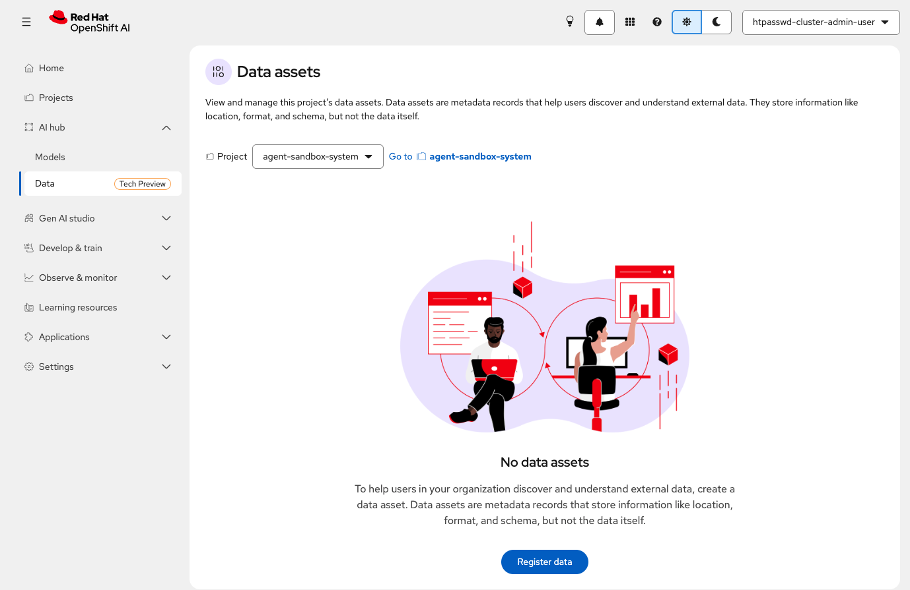

# Step 1: Configure the Data Registry

[Step 2: Register a data asset →](../02-register-data-asset/README.md) ·
[Guide index](../README.md)

This step uses an **RHOAI admin** account with permission to configure RHOAI
components. If you followed the optional sample-user guide, use
`rhoai-admin`; otherwise, use your own RHOAI admin account. After enabling the
component, wait for its service namespace and complete the one-time connection
Secret handoff below. Then use `rhoai-user-data-curator`, or your own RHOAI user
with project `admin` permissions, for
[Step 2](../02-register-data-asset/README.md). For a separate-account
walkthrough, see the optional
[sample users and roles guide](../supplementary/users-and-roles.md).

## How the registry is organized

The Data Registry stores metadata that helps people discover and understand data. It does not copy the data itself or store connection credentials.

```text
RHOAI project (authorization boundary)
└── Collection (optional organizational grouping)
    └── Asset (metadata about structured or unstructured data)
        ├── Location or path
        └── Optional reference to a RHOAI connection
```

An asset belongs to one RHOAI project and one collection. An RHOAI user who can
view registry resources in the project can view every asset and collection in
that project. Collections organize metadata; they are not separate
authorization boundaries.

## Prerequisites

You need:

- Red Hat OpenShift AI 3.6 installed on OpenShift;
- an `oc` client matching your OpenShift version, logged in to the cluster;
- an RHOAI admin account with permission to manage the DataScienceCluster,
  dashboard configuration, and supporting resources for this Technology Preview;
- a reachable PostgreSQL database for registry metadata, using an existing
  service or following the optional [demo PostgreSQL
  setup](../supplementary/postgresql-demo.md) linked from the landing page.

After this setup, an RHOAI user with project `admin` permissions can follow
Steps 2 and 3 and, if needed, optional Step 4 without cluster-wide admin access.

## Enable and deploy the Data Registry

Run commands from `examples/data-registry/01-configure-data-registry/` in your
repository checkout unless a linked supplementary guide says otherwise.

### Enable the component

Find the `DataScienceCluster` resource used by your RHOAI installation:

```bash
oc get datasciencecluster
```

In the RHOAI admin terminal, patch that resource (`default-dsc` below) to
enable only the Data Registry component:

```bash
oc patch datasciencecluster default-dsc --type=merge \
  -p '{"spec":{"components":{"data":{"dataRegistry":{"managementState":"Managed"}}}}}'
```

The Feature Store and Data Registry management states are independent. Do not change the Feature Store state unless you also intend to enable or disable that component.

`managementState` is an enum such as `Managed` or `Removed`; it is not a `true` or `false` field. Check the custom resource definition installed on your cluster if the field is not accepted:

```bash
oc explain datasciencecluster.spec.components --recursive
```

### Enable the dashboard UI

The Data Registry backend and its dashboard UI are enabled separately. After
enabling the component, set `spec.dashboardConfig.dataRegistry` to `true` in
the Dashboard configuration custom resource. In the standard RHOAI 3.6
installation, the resource is named `odh-dashboard-config` in the
`redhat-ods-applications` namespace:

```bash
oc get odhdashboardconfig -n redhat-ods-applications

oc patch odhdashboardconfig odh-dashboard-config \
  -n redhat-ods-applications \
  --type=merge \
  -p '{"spec":{"dashboardConfig":{"dataRegistry":true}}}'
```

Verify that the setting is enabled before testing the dashboard:

```bash
oc get odhdashboardconfig odh-dashboard-config \
  -n redhat-ods-applications \
  -o jsonpath='{.spec.dashboardConfig.dataRegistry}{"\n"}'
```

The command should print `true`. If your installation uses a different
`OdhDashboardConfig` resource name, use the name returned by the `oc get`
command above. Changing the `DataScienceCluster` management state alone does
not make the Data Registry appear in the dashboard.

Wait for the DataScienceCluster to report `Ready`:

```bash
oc wait --for=jsonpath='{.status.phase}'=Ready datasciencecluster/default-dsc --timeout=10m
```

The Data Registry component creates `rhoai-data-registry` as a managed service
namespace. Wait until it appears before continuing; do not create it manually.
If your account can view namespaces, confirm with:

```bash
oc get namespace rhoai-data-registry
```

If namespace visibility is restricted, ask the person creating the connection
Secret to confirm it exists.

### Create the registry instance

> **Required namespace:** The `FeatureStore` must use
> `metadata.namespace: rhoai-data-registry`. This is the service namespace,
> separate from the RHOAI project where you catalog assets.

Before creating the instance, make sure a reachable PostgreSQL metadata
database exists. Use an existing service or follow the
[supplementary demo PostgreSQL setup](../supplementary/postgresql-demo.md).
The demo deployment is for evaluation only, not production. If you share a
PostgreSQL server with a Feast Feature Store, use a separate database and user
for the Data Registry when possible.

The `FeatureStore` reads `Secret/data-registry-database` in
`rhoai-data-registry`; a Secret in the PostgreSQL namespace cannot be used
directly. Create the connection Secret before applying the `FeatureStore`.

Ask a cluster admin or a user with delegated OpenShift permissions to create
the Secret. The account must be able to read the database credentials and
create Secrets in `rhoai-data-registry`; RHOAI admin membership alone is not
enough. Use one of these paths:

- For the demo database, follow the [connection Secret instructions in the
  supplementary guide](../supplementary/postgresql-demo.md#configure-the-data-registry-connection).
- For an existing database, copy
  [database-secret.example.yaml](database-secret.example.yaml), replace every
  `CHANGE_ME` value, and have that authorized user apply it:

  ```bash
  oc apply -f database-secret.example.yaml
  ```

Never commit a Secret containing real credentials. If the password contains
reserved URI characters, URL-encode it before using it in the DSN.

Back in the **RHOAI admin terminal**, review
[feature-store.yaml](feature-store.yaml), then create the instance:

```bash
oc apply -f feature-store.yaml
```

The fields that are specific to this setup are:

| Field | Purpose |
| --- | --- |
| `metadata.annotations[dataregistry.opendatahub.io/enabled]` | Marks this `FeatureStore` as the Data Registry instance. |
| `metadata.namespace` | Deploys the service in the RHOAI-managed Data Registry namespace. It is not the project in which assets are cataloged. |
| `services.registry.local.persistence` | Selects SQL persistence and the Secret key containing the registry DSN. |
| `services.registry.local.server.envFrom` | Makes the PostgreSQL values referenced by the DSN available to the server. |
| `services.onlineStore.disabled` | Avoids deploying a Feast online store, which the Data Registry does not use. |
| `authz.kubernetes` | Uses OpenShift authorization for project-scoped registry access. |

The remaining fields are standard `FeatureStore` configuration used by the Feast Operator.

### Verify the deployment

Wait for the `FeatureStore` to report `Ready`:

```bash
oc wait --for=jsonpath='{.status.phase}'=Ready \
  featurestore/data-registry -n rhoai-data-registry --timeout=10m

oc get featurestore/data-registry -n rhoai-data-registry
```

In the RHOAI dashboard, open **AI hub → Data**. The **Data** item carries a
**Tech Preview** badge.
Confirm that the **Data assets** page loads. Select a project you can access;
an empty project shows **No data assets**. If no project is available, create
your first project in [Step 2](../02-register-data-asset/README.md).



If the page does not load, inspect the `FeatureStore` and events from the
**cluster-admin terminal**; the RHOAI admin may not have pod/event access:

```bash
oc describe featurestore/data-registry -n rhoai-data-registry
oc get events -n rhoai-data-registry --sort-by='.lastTimestamp'
```
