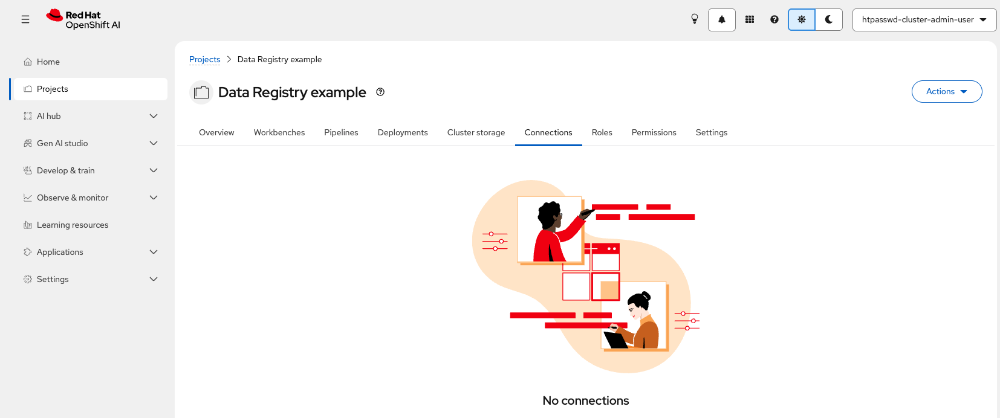
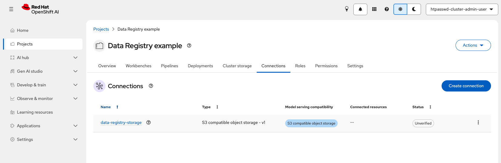
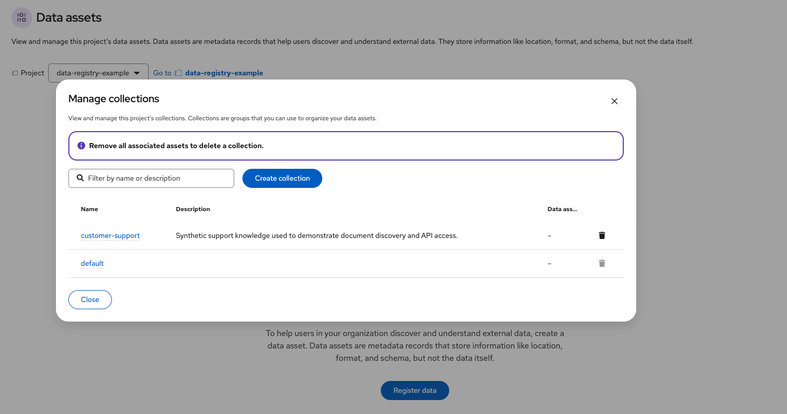
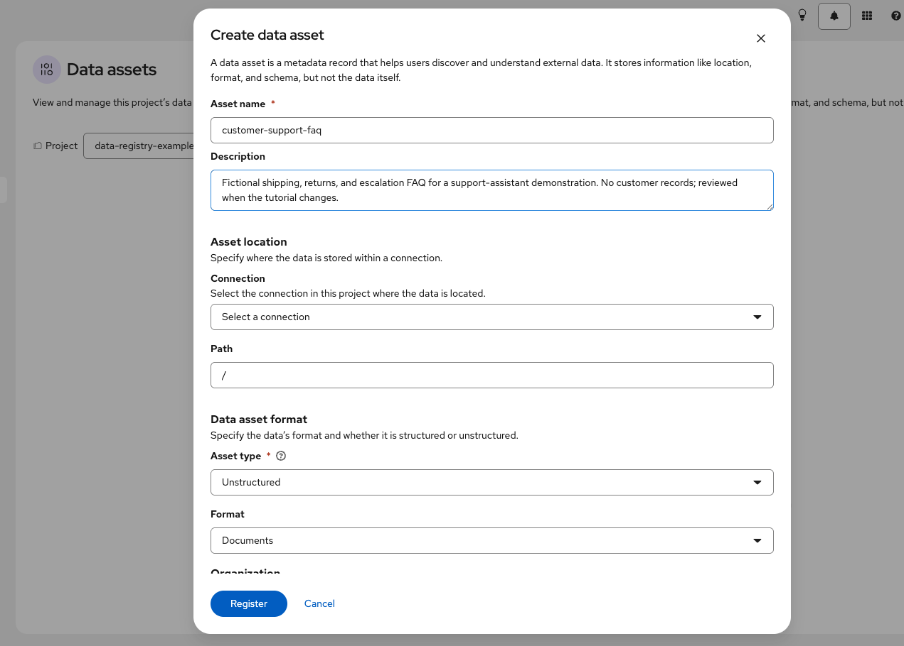
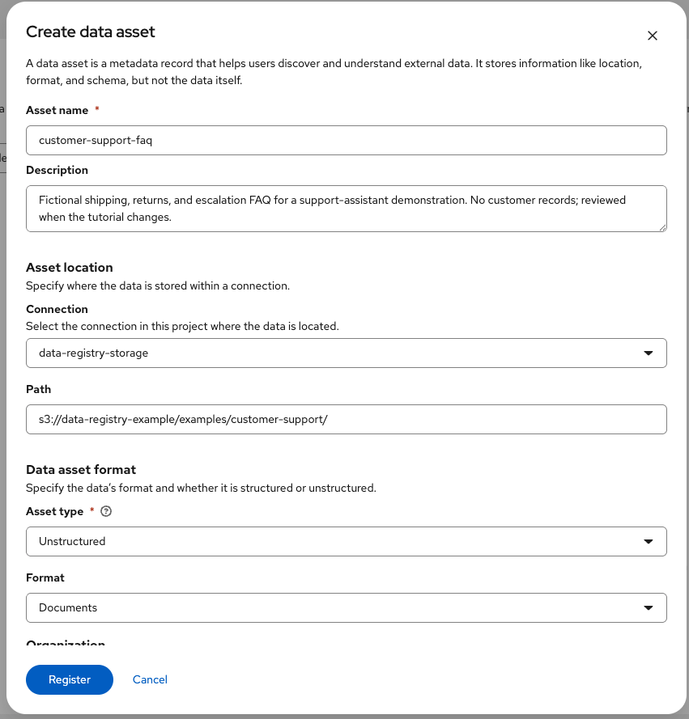
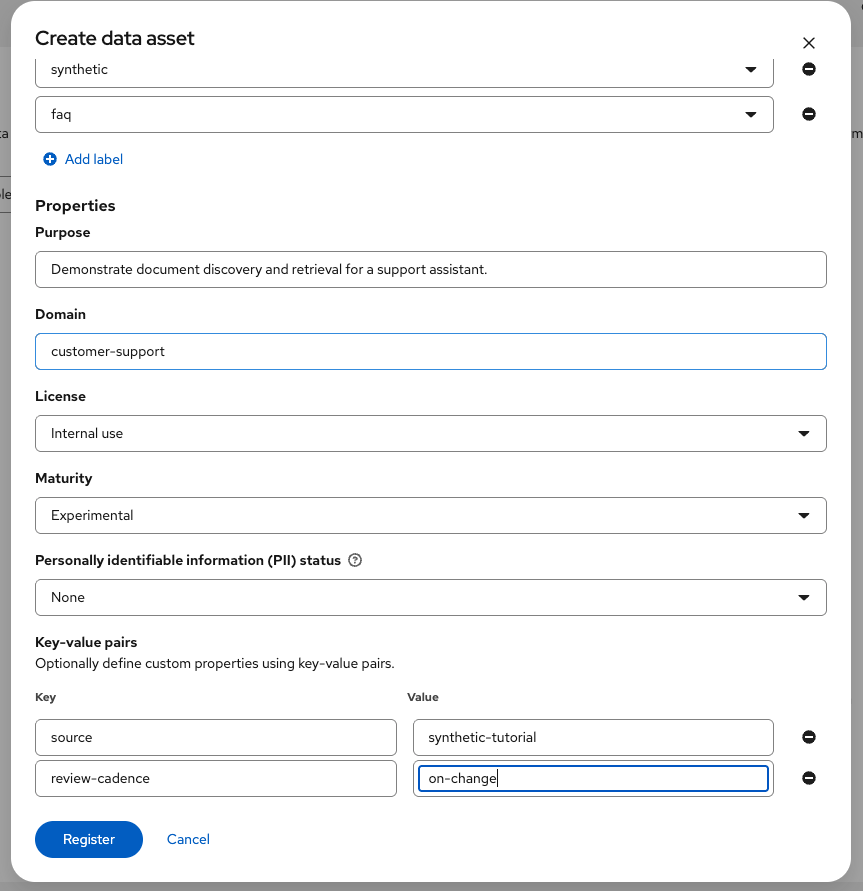
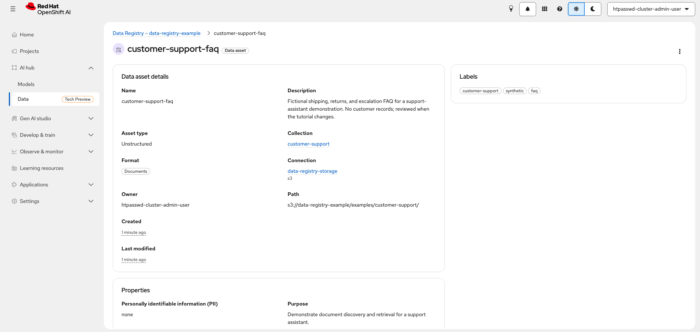

# Step 2: Register a Data Asset

[← Step 1: Configure the registry](../01-configure-data-registry/README.md) ·
[Step 3: Use the Data Registry API →](../03-use-registry-api/README.md) ·
[Guide index](../README.md)

In this walkthrough, you create an RHOAI project, connect it to an S3-compatible
object store, upload one fictional support document, and register that document
in the Data Registry. The registry stores a description and a location. The
object stays in S3-compatible storage, and the connection holds the credentials.
Step 3 uses the same asset and connection from a workbench.

This walkthrough uses the **SeaweedFS evaluation store** from the supplementary
guide as its default so you can follow along without an AWS account. SeaweedFS
is not a Data Registry dependency. If your organization already provides an
S3-compatible store, keep the project, collection, asset, and API steps below;
use your organization's endpoint, bucket, and scoped credentials wherever the
SeaweedFS values are shown.

## Before you start

- Complete [Step 1](../01-configure-data-registry/README.md), or ask an
  administrator to confirm that **AI hub → Data** loads.
- Follow the [S3-compatible storage guide](../supplementary/s3-compatible-storage.md)
  to deploy and verify SeaweedFS, or obtain an existing S3 service and its
  approved credentials. The guide covers the SeaweedFS endpoint, bucket,
  credentials, and test upload.
- Have permission to create an RHOAI project, connection, collection, and asset.
- Keep credentials out of Git, screenshots, asset descriptions, and notebook
  outputs. This example's document contains only synthetic information.

Already have the RHOAI project and S3 connection? Skip sections 1 and 3, and
use their names and endpoint in the remaining steps. Confirm that the
connection belongs to the selected project and can access the bucket and path
you use below.

The example names below are used throughout Steps 2 and 3:

| Item | Example value | Why it exists |
| --- | --- | --- |
| RHOAI project | `data-registry-example` | Project boundary for the connection and registry metadata. |
| S3 bucket | `data-registry-example` | SeaweedFS example bucket; use your actual bucket with another service. |
| Connection | `data-registry-storage` | Supplies the selected S3 endpoint and credentials to the workbench. The name is reusable for either storage path. |
| Collection | `customer-support` | Groups related support knowledge assets. |
| Asset | `customer-support-faq` | Catalog entry for the document prefix. |
| Asset path | `s3://data-registry-example/examples/customer-support/` | SeaweedFS example path; replace the bucket with yours when using another service. |

## 1. Create the RHOAI project

In the RHOAI dashboard, open **Projects**, select **Create project**, enter
`data-registry-example` as the project name, and create it. Select the new
project in the project selector. A project is the access boundary: people who
can view registry resources in it can see its collections and assets. The
SeaweedFS deployment is in a separate namespace, so its service and PVC are
not owned by this RHOAI project.

An OpenShift administrator can create the same project from the CLI:

```bash
oc new-project data-registry-example \
  --display-name='Data Registry example'
oc label namespace data-registry-example opendatahub.io/dashboard=true
```

If the project already exists, do not recreate it. Check that it appears under
**Projects** in the dashboard. The label makes a CLI-created namespace
available as an RHOAI project; it does not grant storage access.



*Data Registry example project open on its Connections tab before adding an S3 connection.*

## 2. Put an example document in S3-compatible storage

Upload the [synthetic FAQ](sample-data/customer-support-faq.md) for this
tutorial. It gives the asset a real object that Step 3 can list and download.
The content is safe to inspect, but it is still only fictional demonstration
material.

### SeaweedFS (default)

Follow the [SeaweedFS S3 verification](../supplementary/s3-compatible-storage.md#verify-the-s3-api)
to start the port-forward and load the credentials from
`Secret/seaweedfs-credentials`. Keep the port-forward running. From this
directory, upload the FAQ and confirm the object key:

```bash
aws --endpoint-url http://127.0.0.1:18333 s3api put-object \
  --bucket data-registry-example \
  --key examples/customer-support/customer-support-faq.md \
  --body sample-data/customer-support-faq.md

aws --endpoint-url http://127.0.0.1:18333 s3api list-objects-v2 \
  --bucket data-registry-example \
  --prefix examples/customer-support/

unset AWS_ACCESS_KEY_ID AWS_SECRET_ACCESS_KEY
```

The list should show `examples/customer-support/customer-support-faq.md`.
The registry does not upload this file for you.

### Use an existing S3 service instead

Skip the SeaweedFS port-forward. Use your organization's approved AWS CLI
profile or credential process, and upload the same fixture to your bucket at
`examples/customer-support/customer-support-faq.md`. For an S3-compatible
service other than AWS, include the endpoint supplied by your organization;
for AWS S3, the AWS CLI uses its regional endpoint by default. Use the region
configured in your CLI profile or set `AWS_DEFAULT_REGION` to the region your
service requires. For example, replace the placeholders below with your
service values:

```bash
S3_ENDPOINT=https://s3.example.org
S3_BUCKET=your-approved-bucket

aws --endpoint-url "$S3_ENDPOINT" s3api put-object \
  --bucket "$S3_BUCKET" \
  --key examples/customer-support/customer-support-faq.md \
  --body sample-data/customer-support-faq.md

aws --endpoint-url "$S3_ENDPOINT" s3api list-objects-v2 \
  --bucket "$S3_BUCKET" \
  --prefix examples/customer-support/
```

For AWS S3, omit `--endpoint-url "$S3_ENDPOINT"` from both commands. If your
organization does not allow workstation access to the endpoint, use its
approved upload tool. In either case, confirm the object appears under the
same bucket and prefix you will record in the connection and asset.

## 3. Create an S3 connection in the project

Open **Projects → data-registry-example → Connections → Create connection**.
Choose **S3 compatible object storage - v1**. This connection will be attached
to the workbench in Step 3 and selected on the asset form below. The values
shown are for the default SeaweedFS path; use your organization's values if you
chose an existing service.

| Connection field | Example value | What it means |
| --- | --- | --- |
| Name | `data-registry-storage` | The connection resource used by the asset and workbench. |
| Access key | From `Secret/seaweedfs-credentials` | SeaweedFS only. For another service, use its approved scoped access key. |
| Secret key | From the same Secret | SeaweedFS only. For another service, use its approved secret key. Never include it in screenshots. |
| Endpoint | `http://seaweedfs.data-registry-storage.svc:8333` | SeaweedFS S3 API endpoint. For another service, use its endpoint. Do not use SeaweedFS Admin port 12646. |
| Region | `us-east-1` | SeaweedFS example signing region. For another service, use the region it requires. |
| Bucket | `data-registry-example` | SeaweedFS example bucket. For another service, use the bucket you uploaded to. |

For SeaweedFS, copy each key from the Secret without printing it. On macOS, for
example:

```bash
oc -n data-registry-storage get secret seaweedfs-credentials \
  -o jsonpath='{.data.AWS_ACCESS_KEY_ID}' | openssl base64 -d -A | pbcopy
oc -n data-registry-storage get secret seaweedfs-credentials \
  -o jsonpath='{.data.AWS_SECRET_ACCESS_KEY}' | openssl base64 -d -A | pbcopy
```

Use your workstation's clipboard utility on other systems. If you chose an
existing S3 service, obtain its credentials through your organization's
approved process instead; do not reuse the SeaweedFS keys. Keep the connection
name `data-registry-storage` to use Step 3's default workspace mount and
notebook settings. The name is only a project connection name; it does not
identify the storage provider. The `.svc` endpoint is for workloads inside
the cluster. The workstation uses a port-forward only for the SeaweedFS upload.

After saving, check that `data-registry-storage` appears on the project's
**Connections** tab. The connection contains configuration and credentials; it
does not itself create a Data Registry asset or grant every project member S3
access.



*The `data-registry-storage` connection is listed in the project. This example view shows its status as Unverified.*

## 4. Create a collection

Open **AI hub → Data** and select `data-registry-example` in the project
selector. Select **Manage collections**, then **Create collection**. Enter:

| Collection field | Example value | Why |
| --- | --- | --- |
| Name | `customer-support` | Stable group for support knowledge assets. |
| Description | `Synthetic support knowledge used to demonstrate document discovery and API access.` | Tells future readers what belongs here. |

Save and confirm the collection appears in the list. The server records the
creator as owner; the current form does not ask you to type an owner. That owner
is descriptive metadata and does not grant permissions. Every asset belongs to
one collection. The `default` collection is fine for a quick test, but a named
collection makes this example easier to find. Collections do not create an
additional access boundary inside the project.



*The `customer-support` collection is available in the selected project.*

## 5. Register the document as an asset

Select **Register data** in **AI hub → Data**. Fill in the form using the values
below. The form has sections for identity, format, organization, location, and
additional properties. Select the connection you just created; this records a
reference to it on the asset so another user can identify the intended source.
The registry stores the connection name, not a copy of the S3 keys.

| Field | Enter | Why this value is useful |
| --- | --- | --- |
| Asset name | `customer-support-faq` | Stable lowercase identifier for API and search. |
| Description | `Fictional shipping, returns, and escalation FAQ for a support-assistant demonstration. No customer records; reviewed when the tutorial changes.` | Scope, exclusions, and update cadence in one place. |
| Asset type | **Unstructured** | The source is a document, not a table with columns. |
| Format | **Documents** | Matches the Markdown document in S3. |
| Collection | `customer-support` | Groups it with related support knowledge. |
| Labels | `customer-support`, `synthetic`, `faq` | Short, reusable discovery terms. |
| Connection | `data-registry-storage` | Points to the S3 configuration in this project. |
| Path | `s3://data-registry-example/examples/customer-support/` | SeaweedFS example prefix; replace the bucket with your actual bucket if using another service. |
| Purpose | `Demonstrate document discovery and retrieval for a support assistant.` | States the intended use without claiming production suitability. |
| License | **Internal use** | The synthetic document is for this tutorial; confirm reuse terms for real data. |
| Maturity | **Experimental** | Signals that this is an evaluation asset. |
| Domain | `customer-support` | Business area that owns the content. |
| PII status | **None** | Matches the fictional fixture; this is metadata, not an access control. |
| Custom properties | `source=synthetic-tutorial`, `review-cadence=on-change` | Extra context useful to downstream readers. |

The owner shown after registration comes from the authenticated creator; it is
not a field to fill in. Names must use lowercase letters, digits, and hyphens
and be at most 63 characters. Description is limited to 500 characters and
purpose to 200. Labels should follow one agreed vocabulary. Never add a
password, token, or real personal information to labels, descriptions, paths,
or custom properties.

If your organization uses a different S3 provider, choose the connection you
created for it and replace the bucket in the path with the actual bucket, for
example `s3://your-approved-bucket/examples/customer-support/`. The path
describes the location; it is not a credential or an upload command.



*The asset identity and format are filled in before choosing the S3 connection and path.*



*The asset points to the SeaweedFS bucket prefix through `data-registry-storage`.*



*The asset's discovery, governance, and custom properties are set before registration.*

Select **Register**. Find `customer-support-faq` in `customer-support` and open
its details. Confirm the format, description, connection, path, labels, and
governance metadata. A successful save proves the metadata was registered. The
upload in section 2 proves the object exists. Step 3 proves an authorized
workbench can read both the registry metadata and the object.



*The asset details show its collection, connection, S3 prefix, labels, and properties.*

## What the fields mean for your own data

For another data product, replace the fictional values deliberately:

- **Name, description, owner:** use a stable identifier, describe scope and
  exclusions, and identify who can answer quality and access questions. The
  creator-derived owner does not grant permissions.
- **Type, format, schema:** choose structured for tabular data, and describe
  fields and nullability in its schema. Choose unstructured for documents,
  images, audio, video, binary files, and other file collections. The registry
  does not inspect a source to verify a declared schema.
- **Collection and labels:** organize discovery within the project. Neither
  changes who can view the asset.
- **Connection and path:** associate an existing project connection and locate
  the physical data. Registration does not test credentials or grant storage
  access. A path should not contain secrets.
- **Purpose, license, maturity, domain, PII, custom properties:** record
  intended use, reuse terms, lifecycle, business area, data classification,
  and local conventions. Confirm these with the data owner. PII status is an
  informative classification; it does not enforce storage or registry access.

Next, [use the Data Registry API](../03-use-registry-api/README.md) to
inspect this asset and download the document using the attached connection.
