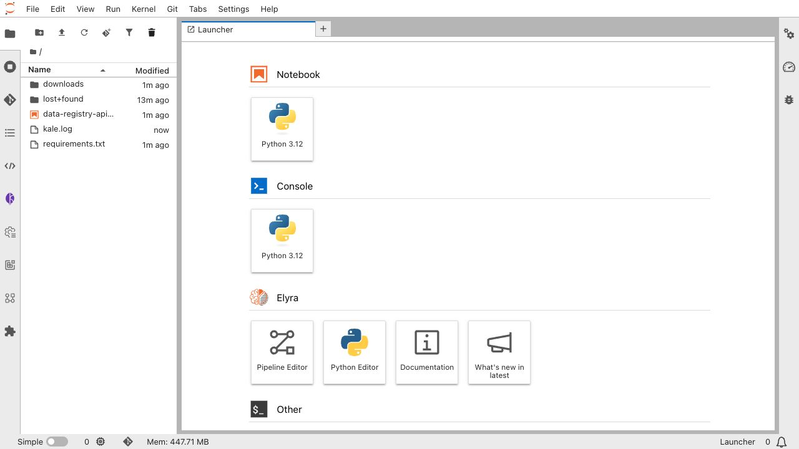
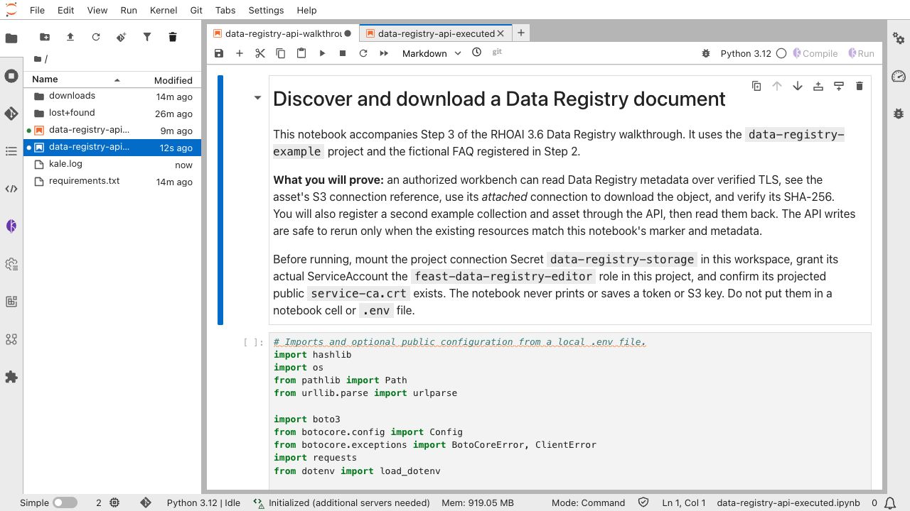
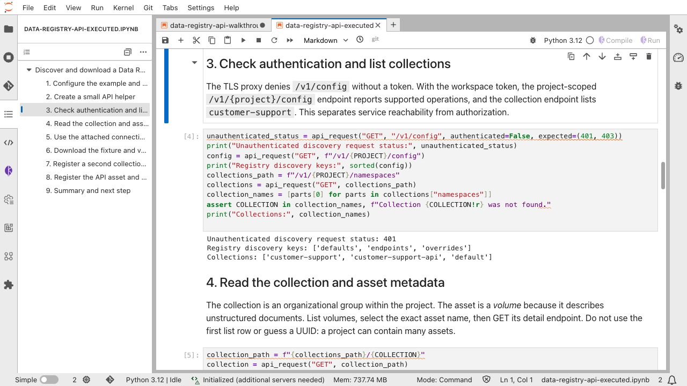
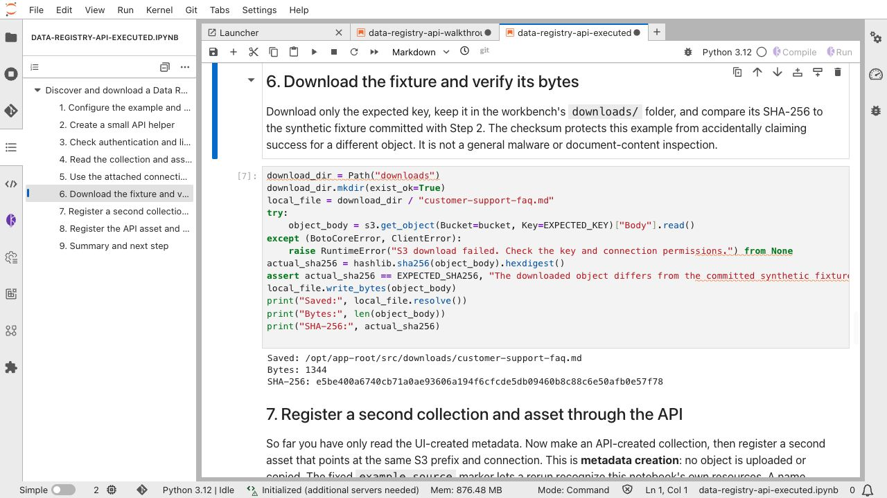
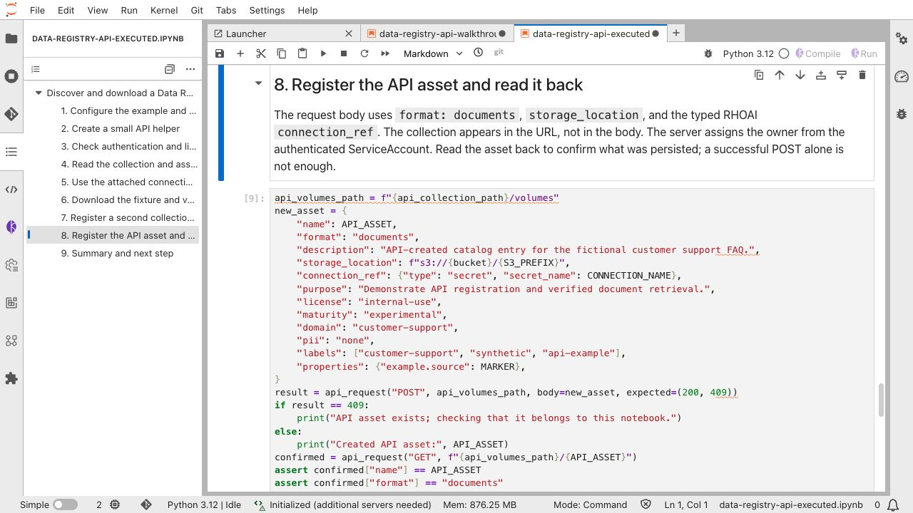
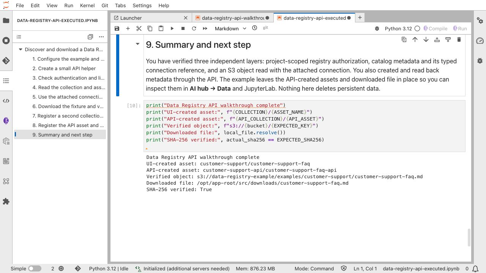

# Step 3: Use the Data Registry API from a workbench

[← Step 2: Register an asset](../02-register-data-asset/README.md) ·
[Step 4: Share access →](../04-share-registry-access/README.md) ·
[Guide index](../README.md)

This step turns the metadata created in Step 2 into a reproducible API exercise.
You create a JupyterLab workspace in the project, mount the same S3 connection,
and run the [guided notebook](data-registry-api-walkthrough.ipynb). The notebook reads the
collection and asset through the authenticated Data Registry API, checks the
connection reference and S3 path, then lists and downloads the synthetic FAQ
from SeaweedFS. This demonstrates the difference between *discovering data*
through the registry and *reading data* through a storage connection.

The notebook follows the discovery, reference-checking, download, and
verification sequence in the
[PDF volume example](https://gitlab.cee.redhat.com/data-strategy/data-registry-production/-/tree/main/notebook-examples/rhai-s3-pdf-volume-download).
This example uses one small Markdown document so you can see every step without
a separate producer script. No credentials or bearer tokens are printed.

## 1. Check prerequisites

Complete [Step 2](../02-register-data-asset/README.md). In
`data-registry-example`, confirm that the `customer-support` collection and
`customer-support-faq` asset appear, and that the `data-registry-storage`
connection exists. The S3 object must already be uploaded under
`examples/customer-support/`.

Ask an RHOAI administrator to confirm that WorkbenchesV2 is enabled. On the
RHOAI 3.6 installation used for this example, both the parent Workbenches
component and its V2 subcomponent must be `Managed`. The dashboard's
`workbenchesV2` setting must also be `true` to show the **Workspaces** UI.
These are cluster-wide settings; project owners should not change them as
part of registering an asset.

```bash
oc get datasciencecluster default-dsc \
  -o jsonpath='{.spec.components.workbenches.managementState}{" "}{.spec.components.workbenches.workbenchesV2.managementState}{"\n"}'

oc get odhdashboardconfig odh-dashboard-config -n redhat-ods-applications \
  -o jsonpath='{.spec.dashboardConfig.workbenchesV2}{"\n"}'
```

The example uses the supported **Jupyter | Data Science | CPU | Python 3.12
(3.6)** image. If it lacks `requests`, `boto3`, or `python-dotenv`, install
the versions in [requirements.txt](requirements.txt) into the workbench kernel
using its approved package mirror before running the notebook. The optional
[`.env.example`](../.env.example) contains public names and paths only; the
attached connection supplies S3 credentials.

The workbench you will use has a JupyterLab launcher like this after it starts:



> **Screenshot to add:** **AI hub → Workspaces** before creating the example.

## 2. Create and connect the workbench

In the RHOAI dashboard, open **AI hub → Workspaces** and select
**Create workspace**. Select `data-registry-example` as the project/namespace.
Choose **JupyterLab** as the workspace kind and use these settings:

| Setting | Example selection | Why |
| --- | --- | --- |
| Name | `data-registry-api` | Makes this exercise easy to identify. |
| Image | **Jupyter | Data Science | CPU | Python 3.12 (3.6)** | Opens the supplied `.ipynb` in JupyterLab. |
| Pod configuration | **Small CPU** (1 CPU, 2 GiB) | Enough for API calls and the small document; no GPU is needed. |
| Home storage | Create or attach a 5 GiB persistent volume, such as `data-registry-api-home` | Keeps the notebook and downloaded file after a pod restart. |
| Secret | Attach the existing project connection Secret `data-registry-storage` at `/var/run/secrets/data-registry-storage` | Mounts the S3 settings as files without putting credentials in the notebook. |

Choose the image, pod configuration, and storage class offered by your
installation. In the form's **Secrets** step, attach the **existing**
connection Secret; it must be marked mountable for WorkspacesV2. If your UI
offers attachment only after creation, edit the workspace to add the Secret,
save, and wait for its restart. Do not copy S3 keys into the notebook.
Start the workspace and wait until it shows **Running**, then open JupyterLab.
The Secret mount is read-only; it contains files named `AWS_ACCESS_KEY_ID`,
`AWS_SECRET_ACCESS_KEY`, `AWS_S3_ENDPOINT`, `AWS_DEFAULT_REGION`, and
`AWS_S3_BUCKET`. The notebook reads those files without displaying their
contents. Older notebook-style workbenches may inject the same settings as
environment variables, which the notebook also supports.

> **Screenshot to add:** Create workspace form with project, JupyterLab kind,
> image, Small CPU, and storage; then the Secrets step with
> `data-registry-storage` selected (never show Secret values).
>
> **Screenshot to add:** Running workspace row in **AI hub → Workspaces**.

If the workspace form on your installation does not expose a Secret mount,
an administrator can create the same tested configuration from
[workspace.example.yaml](workspace.example.yaml) instead. It creates the 5 GiB
home volume and JupyterLab workspace, mounts the **existing** connection
Secret, and includes the registry ingress label discussed below. It does not
contain a credential or create a RoleBinding:

```bash
oc apply -f workspace.example.yaml
oc get workspace data-registry-api -n data-registry-example \
  -o jsonpath='{.status.state}{"\n"}'
```

Wait for `Running`. If your cluster uses a nondefault storage class, set
`spec.storageClassName` on the PVC in the manifest before applying it.

When the workspace opens, the notebook and requirements file should be visible
in JupyterLab. The notebook begins with a plain-language explanation of the
API, storage, and checksum checks:



## 3. Connect and authorize the workbench in this project

### Allow traffic to the registry Service

The operator-managed registry ingress policy accepts traffic from workbench
pods labeled `opendatahub.io/feast-integration=true`. On the RHOAI 3.6
WorkspacesV2 installation used for this example, a newly created JupyterLab
workspace did not receive that label automatically. If a request to the
registry Service times out, add the label to this workspace's pod template:

```bash
oc patch workspace data-registry-api -n data-registry-example \
  --type=merge \
  -p '{"spec":{"podTemplate":{"podMetadata":{"labels":{"opendatahub.io/feast-integration":"true"}}}}}'
```

Wait for the workspace to return to **Running**. This changes only the example
workspace pod, and uses the existing ingress policy; it does not edit an
operator-managed NetworkPolicy. Ask the cluster administrator to check the
policy on another RHOAI version before applying the label there.

### Grant the workspace ServiceAccount registry permissions

The workspace's Kubernetes ServiceAccount is the API caller. The registry
checks that identity for each request. Mounting the S3 connection lets the
notebook read the object, but it does not authorize registry API calls. On
this RHOAI 3.6 cluster the operator supplies these registry roles:

| Role | Registry permissions | Can complete this notebook? |
| --- | --- | --- |
| `feast-data-registry-viewer` | Read catalog resources | No; the notebook creates a collection and asset. |
| `feast-data-registry-editor` | Read and write catalog resources | Yes, on the installation tested for this guide. |
| `feast-data-registry-admin` | Editor permissions plus `connections use` | Yes, but broader than this notebook needs here. |

The workbench initially received HTTP 403 because its ServiceAccount had no
Data Registry grant in `data-registry-example`. On this installation the
registry proxy maps these endpoints to project-scoped registry permissions.
The installed volume route stores `connection_ref` as metadata; it does not
check `connections use`. The notebook needs catalog reads and two creates,
which the operator-provided **editor** role supplies. The S3 read is authorized
separately by the mounted connection's credentials. A later RHOAI version may
enforce connection use differently, so check its current authorization
contract if this request returns 403 after the editor grant.

The namespaced RoleBinding below does not grant Kubernetes project
administration, access to other namespaces, or permission to read the Secret
through the Kubernetes API. The Secret is mounted separately in the workspace.
The editor role also includes update, patch, and delete on registry catalog
resources, so grant it only to this example workspace ServiceAccount. A
custom Role can be narrower where your platform supports it.

A project administrator should identify the ServiceAccount of the **new**
workspace pod and bind the operator-provided role in `data-registry-example`:

```bash
WORKSPACE_SA="$(oc get pod -n data-registry-example \
  -l notebooks.kubeflow.org/workspace-name=data-registry-api \
  -o jsonpath='{.items[0].spec.serviceAccountName}')"
test -n "$WORKSPACE_SA"
echo "Workspace ServiceAccount: $WORKSPACE_SA"

oc create rolebinding data-registry-api-editor \
  --namespace=data-registry-example \
  --clusterrole=feast-data-registry-editor \
  --serviceaccount="data-registry-example:$WORKSPACE_SA" \
  --dry-run=client -o yaml | oc apply -f -

oc auth can-i --list -n data-registry-example \
  --as="system:serviceaccount:data-registry-example:$WORKSPACE_SA"
```

In the permission list, confirm that `registries`, `namespaces`, and
`volumes` in the `dataregistry.opendatahub.io` API group include `get`,
`list`, and `create`. For this workspace, the ServiceAccount is
`ws-data-registry-api`. This
is a **namespaced RoleBinding** to an operator-provided ClusterRole; it does
not modify that ClusterRole. Use the ServiceAccount reported by your pod.
See [Step 4](../04-share-registry-access/README.md) for the existing user and
group sharing examples.

## 4. Supply the public TLS certificate authority

The notebook calls the in-cluster TLS Service
`https://feast-data-registry-data-registry.rhoai-data-registry.svc:443`.
OpenShift signs that Service certificate with its service CA. The JupyterLab
workspace pod projects the **public** service CA at
`/var/run/secrets/kubernetes.io/serviceaccount/service-ca.crt`, beside its
short-lived ServiceAccount token. Confirm the CA file is mounted:

```bash
oc exec -n data-registry-example <workspace-pod> -c main -- \
  test -s /var/run/secrets/kubernetes.io/serviceaccount/service-ca.crt
```

The notebook verifies TLS against that file. If your workspace image does not
project it, export the public CA from `ConfigMap/openshift-service-ca.crt` in
this project and upload it beside the notebook; set `REGISTRY_CA_BUNDLE` to
`service-ca.crt`. If your administrator supplies a different trusted CA bundle
or service hostname, set `REGISTRY_CA_BUNDLE` and `REGISTRY_URL` in the
notebook configuration cell. Keep certificate validation enabled. The service
hostname must match a SAN in its serving certificate.

## 5. Upload and run the notebook

Download or clone this repository, then upload
[data-registry-api-walkthrough.ipynb](data-registry-api-walkthrough.ipynb) and
[requirements.txt](requirements.txt) to the workspace's persistent folder.
Alternatively, an administrator can copy them to the Running workspace pod
with `oc cp`. From this guide's directory in a repository checkout:

```bash
WORKSPACE_POD="$(oc get pods -n data-registry-example \
  -l notebooks.kubeflow.org/workspace-name=data-registry-api \
  -o jsonpath='{.items[0].metadata.name}')"

oc cp data-registry-api-walkthrough.ipynb \
  "data-registry-example/$WORKSPACE_POD:/opt/app-root/src/data-registry-api-walkthrough.ipynb" \
  -c main

oc cp requirements.txt \
  "data-registry-example/$WORKSPACE_POD:/opt/app-root/src/requirements.txt" \
  -c main
```

In JupyterLab:

1. Open the notebook and read its first cell. Check the project, collection,
   asset, expected S3 prefix, and connection name in the configuration cell.
2. Select the workbench's Python 3 kernel. If imports fail, install
   [requirements.txt](requirements.txt) using the approved workbench package
   mirror, restart the kernel, and run from the top.
3. Run the cells **in order**. The notebook stops on a failed prerequisite,
   unexpected HTTP response, wrong connection, wrong object, or hash mismatch.
4. Confirm the final cell prints a success summary and that
   `downloads/customer-support-faq.md` exists in the workbench folder.

The notebook performs these checks:

| Notebook section | API or storage action | Expected result |
| --- | --- | --- |
| Runtime preflight | Check projected service CA and ServiceAccount token, plus mounted connection setting *presence* | No secret values displayed. |
| Authentication | GET `/v1/config` without a token, then `/v1/data-registry-example/config` with the workbench token | The proxy denies the anonymous request; project discovery succeeds for an authorized ServiceAccount. |
| Collections | GET `/v1/data-registry-example/namespaces` | `customer-support` is listed. |
| Asset list and detail | GET `/v1/data-registry-example/namespaces/customer-support/volumes` and `/volumes/customer-support-faq` | Exact asset, format, path, and connection reference match Step 2. |
| S3 list and download | `ListObjectsV2`, `GetObject` through the attached connection | The fixture is present and downloaded. |
| Verification | SHA-256 of the downloaded file | Matches the committed synthetic fixture. |
| API registration | POST a `customer-support-api` collection and `customer-support-faq-api` volume; GET both | A second catalog entry points at the same S3 prefix and connection. |

The registry API returns **metadata**. The S3 client uses the workbench's
attached connection to fetch the **document bytes**. Neither a registry read
nor a saved connection reference alone proves that a user may read physical
data. The final S3 call provides that separate check.

The following screenshots show the results from the running example workspace.
They show names, paths, and a checksum; no credential or bearer token is
displayed.









## If a check fails

| Symptom | What to check |
| --- | --- |
| No Workspaces page or create action | Ask the administrator to check both Workbenches management states, component readiness, and the dashboard's `workbenchesV2` setting. |
| Missing `AWS_*` setting | Mount `data-registry-storage` at `/var/run/secrets/data-registry-storage` and restart the workspace; do not add credentials to the notebook. |
| Registry request returns 401 | The projected ServiceAccount token is missing, expired, or not sent to the API. Restart the workbench and rerun the preflight. |
| Registry request returns 403 | Check the workspace pod's actual ServiceAccount and its namespaced editor RoleBinding; check your installed version's authorization mapping. |
| TLS certificate error | Check the projected `service-ca.crt`, the service hostname, and the cluster's CA rotation. Do not disable verification. |
| Connection or path differs | Open the asset detail page and correct the metadata in Step 2. The notebook deliberately rejects a different resource. |
| S3 request returns 403 | Check connection attachment, the bucket policy, and that the connection uses the S3 API endpoint rather than the SeaweedFS Admin port. |
| Registry request times out | Check that the workspace pod has `opendatahub.io/feast-integration=true` and can reach the registry Service on port 443. |
| S3 times out | Check workbench egress and storage ingress NetworkPolicies for the project and port 8333. |
| SHA-256 mismatch | Upload the committed fixture to the documented key again only after inspecting the current object and confirming this test key is yours. |

This exercise does not delete assets, connections, bucket objects, workbench
storage, or project resources. Continue to [Step 4](../04-share-registry-access/README.md)
for the current sharing guidance.
