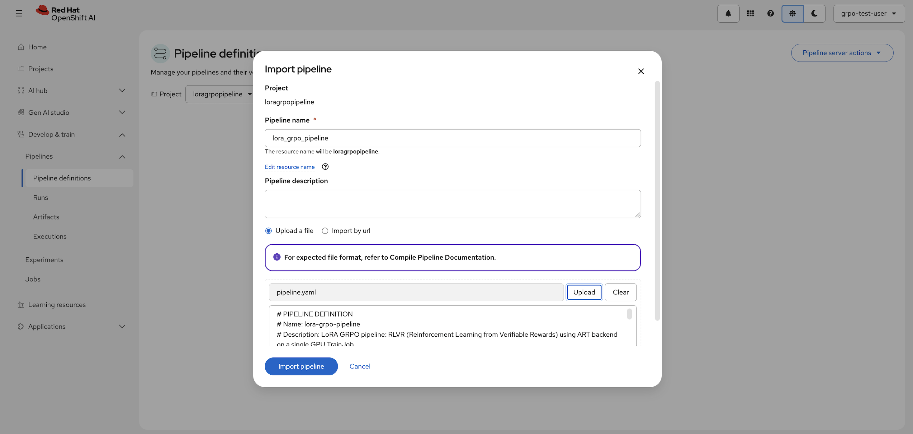
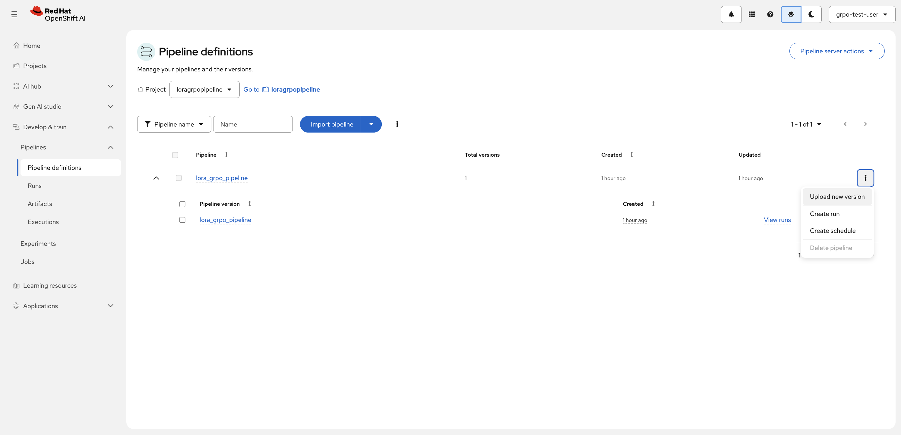
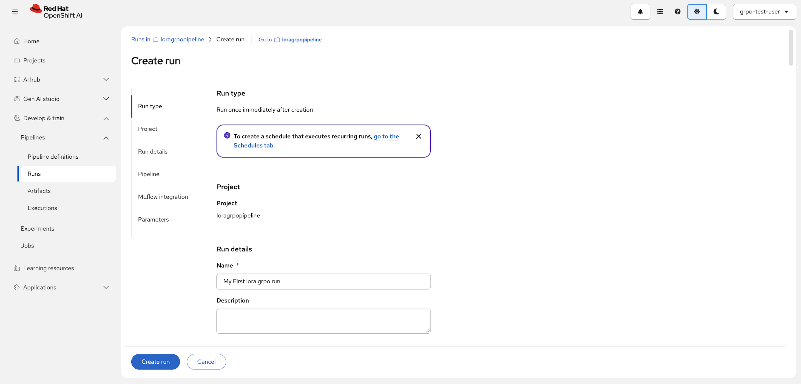
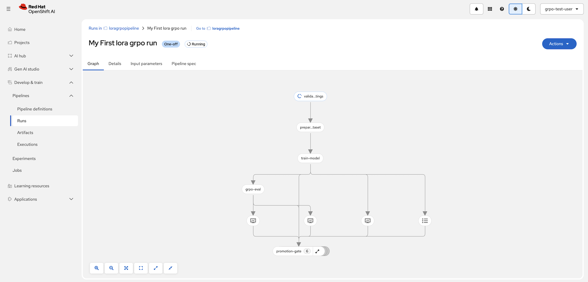
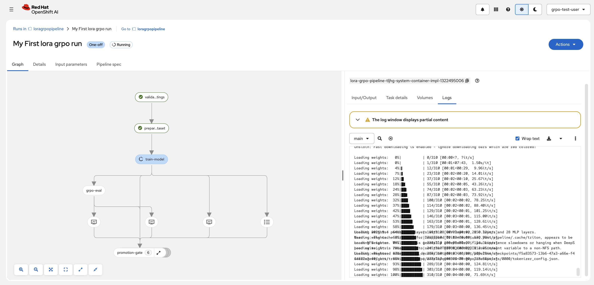
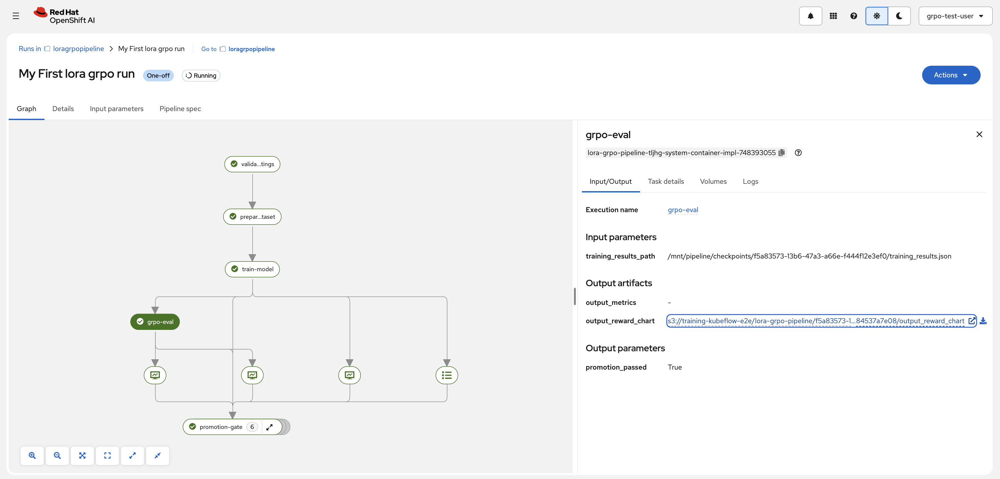
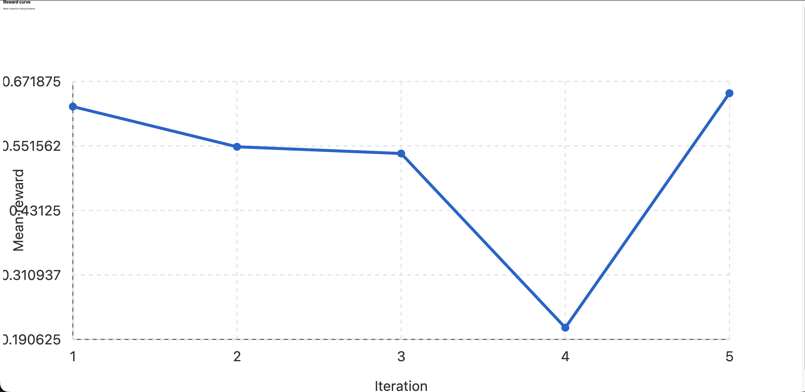
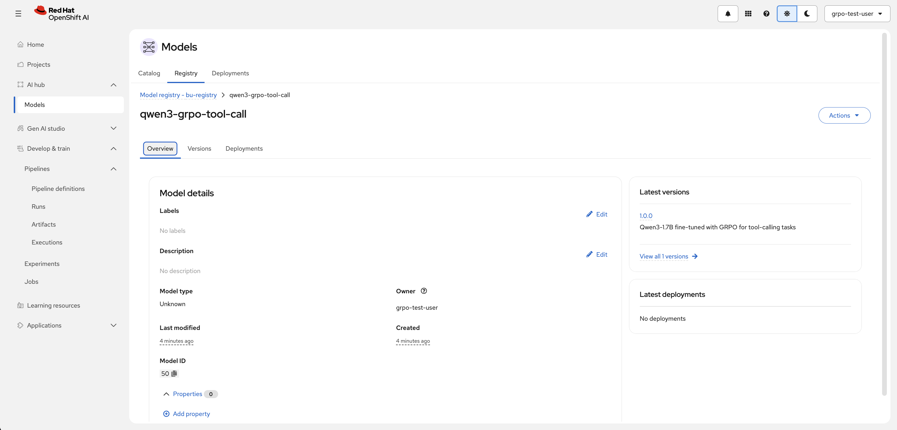
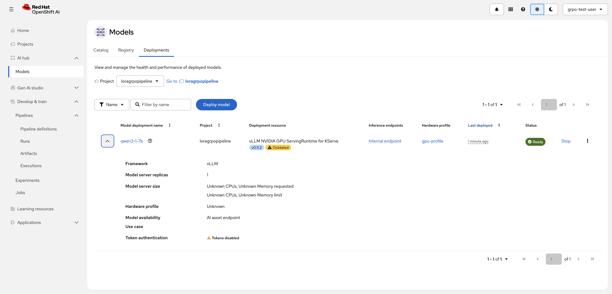

# LoRA GRPO pipeline on Red Hat OpenShift AI

This example is tested on Red Hat OpenShift AI 3.6 Early Access 2 (EA2).

## Overview

This guide walks through importing, configuring, running, and validating the
LoRA GRPO pipeline through the Red Hat OpenShift AI (RHOAI) Dashboard. It uses
Kubeflow Pipelines, Kubeflow Trainer, and Training Hub's ART backend to fine-tune
a model for tool calling on a single GPU.

The pipeline prepares the dataset, trains LoRA adapters and merges them into
the base model, evaluates recorded rewards, and conditionally registers and
deploys the resulting model through Model Registry and KServe.

The underlying pipeline is marked **alpha** and its interface may change. Use
the same pipeline revision for compilation, parameter reference, and validation.

## Prerequisites

- A RHOAI 3.6.EA2 cluster with the Dashboard, AI Pipelines, Trainer, Model Registry,
  and KServe model serving configured.
- A project with a running pipeline server and its artifact storage configured.
- A `ClusterTrainingRuntime` compatible with Training Hub's LoRA GRPO algorithm.
  The pipeline's default runtime name is `training-hub`.
- An existing ReadWriteMany (RWX) PVC in the pipeline project. The serving
  namespace must be the same namespace as this PVC.
- A non-admin user with access to the project and pipeline server, and authorized
  workload identities for training, registration, and deployment.
- Network access and image pull credentials needed by the pipeline components,
  training runtime, model downloads, and serving image.
- For compilation: Git, Python 3.11 or newer, and the pipeline repository's
  Python dependencies. For CLI verification: an authenticated `oc` client.

## Hardware requirements

These settings were verified against a successful `Qwen/Qwen3-1.7B` run on
RHOAI 3.6 EA2. The table shows the CPU, memory, and GPU requests and limits for
the training worker and serving container. Allow additional capacity for
platform sidecars when sizing the serving pod.

| Purpose | GPU | CPU | Memory | Storage |
| --- | --- | --- | --- | --- |
| TrainJob worker | 1 NVIDIA A100 (80 GB) | 4 cores | 64Gi | Shared RWX PVC |
| Serving replica | 1 NVIDIA A100 (80 GB) | 2 cores | 8Gi | Same RWX PVC |
| Persistent model and cache storage | — | — | — | 50Gi ReadWriteMany (RWX) PVC |

Training and serving are separate stages. The ART backend shares its training
GPU between rollout generation and policy updates. Evaluation reads the
training results; it does not launch a separate GPU benchmark job.

Use the table as a tested configuration. Recheck GPU memory for other models
or training settings, and size the shared PVC for model files, training outputs,
prepared datasets, runtime caches, and retained runs.

## Setup

### Administrator responsibilities

Start with a new project and record the setup before handing it to the test user.
Cluster-scoped configuration and grants outside the user's project must be
performed by an administrator.

This example uses the project name `loragrpopipeline`.

The administrator owns project and pipeline-server setup, artifact storage, shared
PVC creation, secrets, runtime availability, and other access grants. The
end user imports, configures, runs, monitors, and validates the pipeline, with
read access to runtimes and project PVCs for inspecting prerequisites.

| Setup area | Required result |
| --- | --- |
| Project access | The non-admin user can open the project and import, configure, and run pipelines through the pipeline server. |
| Pipeline server | The project has a ready pipeline server and working artifact storage. |
| Cluster Storage | An RWX PVC is bound, readable as a resource by the user, writable by the training workload, and usable by model serving. |
| Runtime and GPU | A compatible ClusterTrainingRuntime is available; the user can read available runtimes, the training identity can discover its runtime, and the worker can schedule. |
| Training credentials | `kubernetes-credentials` identifies an authorized identity that can submit and monitor TrainJobs in this project. |
| Registry | The selected registry is reachable; the pipeline ServiceAccount can register models, and the user can view registered models. |
| Serving | The pipeline ServiceAccount can get, create, and patch ServingRuntime and InferenceService resources in the project. |
| User monitoring and validation | In the project, the user can get/list pods, get pod logs, and list/read the generated ServingRuntime and InferenceService. Deployment write access and cluster-wide pod access are not required. |
| Pull access and network | Required images can be pulled and components can reach the API, registry, artifact storage, and dataset/model sources. |

Verify access separately for the three identities used in this example.

1. **Test user.** The end user signs in to the Dashboard with this account.
   Verify that they can import the pipeline, start runs, and inspect task logs,
   inputs/outputs, and results.
2. **Training API identity.** The training task authenticates with the token
   in the `kubernetes-credentials` Secret. Verify that this identity can discover
   the training runtime and submit and monitor TrainJobs in the project.
3. **Pipeline ServiceAccount.** The registration and deployment tasks
   authenticate with their pods' mounted ServiceAccount credentials. Verify
   that the account can register models in the selected Model Registry and
   manage KServe resources in the serving project.

Grant only the permissions required by each identity. The test user does not
need cluster-admin access to run this example.

### Create shared storage for GRPO

**Administrator:** provision a separate shared PVC for the GRPO pipeline.
Configuring a pipeline server may create an internal database PVC such as
`mariadb-dspa`. This database volume serves the pipeline infrastructure; it is
not the model/checkpoint PVC selected by `p01_persistent_pvc`.

`oc get pvc -n loragrpopipeline` lists the PVCs your account can see in the
namespace, including storage created for services such as the pipeline server's
database. The RHOAI **Cluster storage** tab is a view of storage managed through
the Dashboard and may omit these internal service PVCs.

For example, the CLI might list only `mariadb-dspa` while the Cluster storage
tab is empty. That PVC stores the pipeline server's database data; its existence
does not provide shared storage for GRPO models, checkpoints, and caches. Leave
it dedicated to the database and create `loragrpopipeline-pvc` separately using
the steps below. Verify that the new claim has **ReadWriteMany (RWX)** access
and at least **50Gi**, then use its actual resource name for `p01_persistent_pvc`.

1. Identify an installed RWX-capable storage class. In the OpenShift console,
   open **Storage → StorageClasses**, or run `oc get storageclass` as admin.
   Confirm the selected provisioner supports ReadWriteMany. If no suitable class is available, have the storage administrator configure a shared-filesystem provisioner before proceeding.
2. In the RHOAI Dashboard, open **Projects → loragrpopipeline → Cluster storage**
   and click **Add cluster storage**.
3. Set the storage name to `loragrpopipeline-pvc`, request at least **50Gi**, and
   select the RWX-capable class verified in step 1. Ensure the resulting access
   mode is **ReadWriteMany**.
4. Create the storage and verify the actual PVC name, requested capacity,
   access mode, and provisioning status. Check the selected StorageClass's
   `volumeBindingMode` and share it with the test user.

   ```bash
   oc get pvc loragrpopipeline-pvc -n loragrpopipeline
   oc describe pvc loragrpopipeline-pvc -n loragrpopipeline
   ```

**Test user:** check the claim with
`oc get pvc loragrpopipeline-pvc -n loragrpopipeline`.

- **`Immediate`**. Wait for `Bound` before starting the run.
- **`WaitForFirstConsumer`**. `Pending` is expected before the run. Set
  `p01_persistent_pvc` to the claim name, start the pipeline, and check for
  `Bound` when the first task pod uses the claim.

If the claim stays `Pending` at the expected binding step, ask the
administrator to check provisioning and pod scheduling events.

### Credentials and data connections

Create secrets in the pipeline project before starting a run.

| Secret | Keys | When required |
| --- | --- | --- |
| `kubernetes-credentials` | `KUBERNETES_SERVER_URL`, `KUBERNETES_AUTH_TOKEN` | Every run; use credentials for the same cluster as the pipeline. |
| `hf-token` | `HF_TOKEN` | Gated or private Hugging Face models/datasets; the token must have access to the selected resources. |
| Connection Secret selected by `p08_dataset_data_connection_name` | `AWS_ACCESS_KEY_ID`, `AWS_SECRET_ACCESS_KEY`; optionally `AWS_DEFAULT_REGION`, `AWS_S3_ENDPOINT` | Private S3 dataset input. The parameter defaults to `s3-secret`. |

The pipeline server's artifact-storage configuration is separate from the
optional S3 connection used to read a training dataset. A Hugging Face or
PVC-based dataset does not require an S3 dataset connection.

### Model Registry prerequisites

An existing model registry can be reused. It can reside in a different namespace
from the pipeline project; the registry records the model's storage URI.

Ask the administrator or registry owner to provide:

- An available registry and its connection address and port for
  `p04_model_registry_address` and `p22_model_registry_port`.
- Registry access for the pipeline ServiceAccount used by the registration task.
- Dashboard registry access for the end user to validate the registered model.
- Network connectivity from the pipeline project to the selected endpoint.

Use a unique model name/version pair for each registration. Match the address
scheme and port to the selected endpoint.

If a registry needs to be created, the administrator can follow the
[RHOAI registry creation instructions](https://docs.redhat.com/en/documentation/red_hat_openshift_ai_self-managed/3.5/html/managing_model_registries/creating-a-model-registry_managing-model-registries).

### Generate the pipeline YAML

Compile the full [LoRA GRPO pipeline from the `rhoai-3.6` branch](https://github.com/red-hat-data-services/pipelines-components/tree/rhoai-3.6/pipelines/training/finetuning/lora_grpo).

```bash
git clone --branch rhoai-3.6 --single-branch https://github.com/red-hat-data-services/pipelines-components.git
cd pipelines-components
PYTHONPATH=. python pipelines/training/finetuning/lora_grpo/pipeline.py
```

The output is
`pipelines/training/finetuning/lora_grpo/pipeline.yaml`.
The dependencies belong to the pipeline repository; this guide does not contain
a separate Python application.

## Usage

Before importing, sign in as the test user and confirm the project and its
Pipelines page are accessible.

### 1. Import the pipeline

1. Sign in to the RHOAI Dashboard as the non-admin user.
2. Open **Develop & train → Pipelines → Pipeline definitions** and select the
   project prepared by the administrator.
3. Choose **Import pipeline**, upload the generated `pipeline.yaml`, and give
   the definition a descriptive name, such as `lora-grpo-pipeline`.



If a pipeline definition already exists, open its actions menu and choose
**Upload new version**. Upload the compiled `pipeline.yaml` and select that
version when creating the run.



### 2. Configure the run

Open **Pipelines → Runs → Create run**. Select the project, pipeline definition,
and pipeline version, then enter a run name and configure its parameters.



Check the parameter descriptions in the imported definition against the revision you compiled. All six parameters below are required.

| Parameter | Example value | Meaning |
| --- | --- | --- |
| `p01_persistent_pvc` | `loragrpopipeline-pvc` | Existing RWX PVC name, without a path. |
| `p02_dataset_uri` | `hf://Agent-Ark/Toucan-1.5M:Qwen3` | Hugging Face dataset reference, including the `Qwen3` configuration. |
| `p03_training_model` | `Qwen/Qwen3-1.7B` | Base model to fine-tune. |
| `p04_model_registry_address` | `<registry-service-host>` | Registry endpoint provided by the administrator. Include `https://` for an HTTPS endpoint and set its matching port in `p22_model_registry_port`. |
| `p05_serving_namespace` | `loragrpopipeline` | Same namespace as the pipeline and PVC. |
| `p06_tokenizer_mode` | `slow` | Proposed Qwen3 setting; supported modes are `auto`, `slow`, and `mistral`. Confirm with the selected model and serving image. |

For this example, change these below optional parameters. Keep the remaining optional parameters at their defaults

| Parameter | Example value | Purpose |
| --- | --- | --- |
| `p11_training_prompt_batch_size` | `10` | Prompts per update. |
| `p12_training_lora_r` | `8` | LoRA rank. |
| `p13_training_lora_alpha` | `8` | LoRA scaling. |
| `p20_model_registry_name` | `qwen3-grpo-tool-call` | Choose a unique model name for  registration. |
| `p21_model_registry_version` | `1.0.0` | Choose a version pair for each registration. |
| `p22_model_registry_port` | `443` | Must match the selected registry's port. |
| `p35_model_registry_author` | `grpo-test-user` | Author stored in the registry entry. |
| `p36_model_registry_description` | `Qwen3-1.7B fine-tuned with GRPO for tool-calling tasks` | Description stored in the registry entry. |

The rollout batch is `prompt_batch_size × group_size`, or 200 with the defaults.
The LoRA weight scale is `lora_alpha / lora_r`. Increasing batch/group size,
model size, or iteration count affects resource usage or run duration; adjust
resources and the completion timeout accordingly. The timeout is a maximum
wait in seconds and returns as soon as the TrainJob completes or fails.

### 3. Run and inspect results

Click **Run** and open the run graph. Inspect the task details, logs and inputs or outputs as each stage finishes:

1. Replica validation checks the serving replica bounds.
2. Dataset preparation resolves the source and normalizes non-Hugging Face data.
3. Training submits a TrainJob, waits for completion, and persists the merged
   model and training results on the shared PVC.
4. GRPO evaluation reads the recorded training metrics and determines promotion.
5. If promotion gate passes, model registration runs and then model deployment creates the serving resources.



Select **train-model** and open **Logs** to follow training progress.



Select the evaluation task's metrics and `output_reward_chart` artifact to
inspect the recorded reward history.





| Metric | Interpretation |
| --- | --- |
| `initial_reward` | First recorded reward observation. |
| `final_reward` | Last recorded reward observation. |
| `reward_improvement` | Final reward minus initial reward. |
| `mean_reward` | Mean reward across recorded observations. |
| `full_match_rate` | Last recorded full-match rate for tool calls. |
| `training_iterations` | Number of recorded reward observations. |
| `promotion_passed` | `1` when promotion passes, otherwise `0`. |

Promotion gate requires at least two recorded reward observations and
`final_reward > initial_reward`. A run can finish successfully with model registration
and model deployment skipped when the model does not pass this gate. These metrics
describe the training run; they are not an independent held-out benchmark.

## Expected outcomes

### Verify the registered model

For a promoted run, open **AI hub → Models →  Registry**, select the configured registry,
and locate the model name and version entered for this run. Check its metrics,
pipeline provenance, and model storage URI.



### Verify the deployed model

The ServingRuntime and InferenceService names are generated from the base model
specified in `p03_training_model`. For example, `Qwen/Qwen3-1.7B` produces the
name `qwen3-1-7b` for both resources. There is no separate pipeline parameter to
override these names.

Open **AI hub → Models → Deployments**, select your project, and verify that
the deployment shows **Ready**.



Run these checks as the non-admin user, replacing the project placeholder:

```bash
oc -n <pipeline-project> get servingruntime qwen3-1-7b
oc -n <pipeline-project> get inferenceservice qwen3-1-7b
oc -n <pipeline-project> get inferenceservice qwen3-1-7b -o jsonpath='{.spec.predictor.model.storageUri}{"\n"}'
oc -n <pipeline-project> get inferenceservice qwen3-1-7b -o jsonpath='{.status.conditions}{"\n"}{.status.url}{"\n"}'
```

Confirm `Ready=True` and that the storage URI points to this run's model
directory. The deployment task also outputs the inference API URL.

Repeated promoted runs for the same base model in the same namespace update
the existing endpoint. Run-specific model directories do not create distinct
serving endpoints. Use separate projects to isolate concurrent demonstrations.

The current deployment component disables endpoint authentication. Confirm the
resulting endpoint's access and network exposure with the administrator before
using sensitive data in this example.

### Send a test inference request

Once the deployment is **Ready**, get its base URL. Set `PROJECT` and
`DEPLOYMENT` to the values for your run.

```bash
PROJECT=loragrpopipeline
DEPLOYMENT=qwen3-1-7b
INFERENCE_URL=$(oc -n "$PROJECT" get inferenceservice "$DEPLOYMENT" -o jsonpath='{.status.url}')
printf '%s\n' "$INFERENCE_URL"
```

Run the following requests from an environment that can reach the endpoint.
If the URL ends in `.svc.cluster.local`, run `curl` from an existing workbench
or terminal inside the cluster. Set `INFERENCE_URL` there to the URL printed
above if you switch terminals.

To test from your workstation when the endpoint is internal, an administrator
can port-forward the predictor pod. In **Workloads → Pods**, select the pipeline
project and find the running `qwen3-1-7b-predictor-…` pod. Replace the example
pod name below and leave the command running.

```bash
PREDICTOR_POD='<predictor-pod-name>'
oc -n loragrpopipeline port-forward "pod/$PREDICTOR_POD" 18080:8080
```

In a second terminal, set `INFERENCE_URL=http://127.0.0.1:18080` and run the
requests below. Port forwarding requires `create` on `pods/portforward` in the
project. This example uses the administrator session for the port-forward.

```bash
curl --fail --silent --show-error "${INFERENCE_URL%/}/v1/models"
```

Copy the model `id` from `data` in the response. The example deployment serves
`qwen3-1-7b`. Replace the `model` value below if your response lists a different
ID. Send a short prompt using the vLLM chat completions API.

```bash
curl --fail --silent --show-error "${INFERENCE_URL%/}/v1/chat/completions" \
  -H 'Content-Type: application/json' \
  --data '{"model":"qwen3-1-7b","messages":[{"role":"user","content":"What is 2 plus 2? Answer in one sentence."}],"max_tokens":128}'
```

Expect HTTP `200` and generated text in `choices[0].message.content`. In the
verified port-forward test, `/v1/models` returned `qwen3-1-7b` and the chat
request returned generated text. If `choices[0].finish_reason` is `length`, the
response reached `max_tokens`. Increase it and retry to allow the answer to
finish. See the [vLLM OpenAI-compatible API](https://docs.vllm.ai/en/latest/serving/openai_compatible_server/).

## Troubleshooting

| Symptom | Check |
| --- | --- |
| User cannot import or run | Verify project membership and pipeline-server permissions using the non-admin identity. |
| Runtime missing or API returns 403 during training | Check the identity in `kubernetes-credentials`, token expiry, runtime discovery access, and TrainJob permissions. |
| Registry or deployment returns 403 | Check the pipeline ServiceAccount's grants in the registry namespace and serving project. |
| PVC pending, mount failure, or permission denied | Check RWX support, storage quota, namespace, and workload write access. |
| Training pod pending | Check GPU availability, resource quota, node placement, and runtime settings. |
| Out-of-memory failure | Review batch/group size, rollout GPU memory utilization, and model size. |
| Dataset validation fails | Check the Hugging Face repository ID, dataset configuration, required access token, and Training Hub loader error. |
| Registration and deployment skipped | Inspect `promotion_passed` and reward history before treating this as an error. |
| Serving fails | Inspect InferenceService conditions and predictor logs; check the model URI, image pull access, GPU capacity, and tokenizer mode. |
