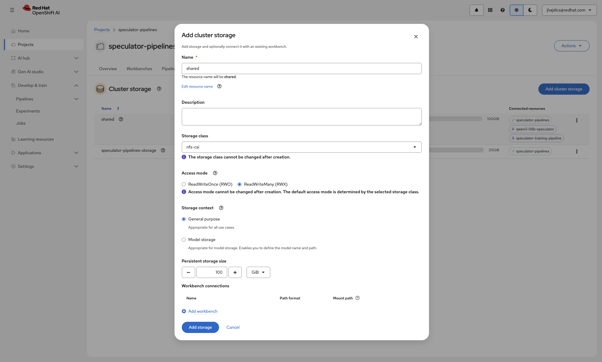
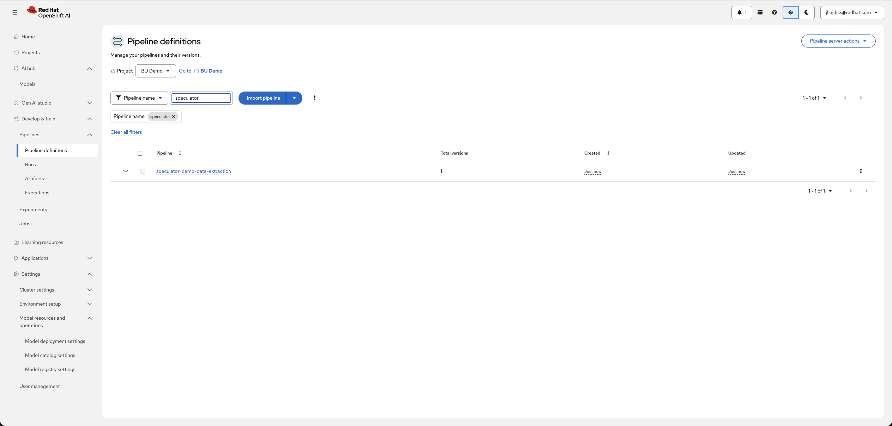
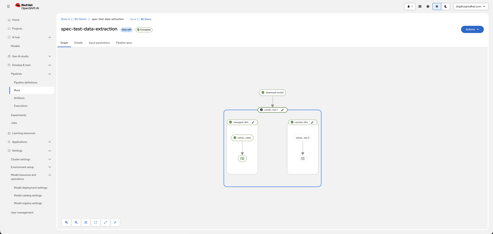

# Pipelines for Speculative Decoding Draft Model Training on Red Hat OpenShift AI

This guided example walks through training a custom Eagle3 draft model for speculative decoding using **Kubeflow Pipelines** on Red Hat OpenShift AI. It covers generating each pipeline definition from source, importing it into Red Hat OpenShift AI, running it, interpreting the evaluation results, and testing the served endpoint.

> [!WARNING]
>
> The upstream speculator pipelines may change. Re-generate the pipeline YAML after pulling upstream changes.

This page covers what is shared across all four modes — background, prerequisites, and the Quick Start. Each mode has its own guide in a subfolder.

> [!TIP]
>
> Prefer driving TrainJobs directly from a notebook instead of pipelines? See the SDK-based examples at [`../../../rhoai-3.6/speculator/`](../../../rhoai-3.6/speculator/) — same four training modes, executed via the Kubeflow SDK `SpeculativeDecodingTrainer`.

## What is Speculative Decoding?

Large language models generate tokens one at a time during inference. Each token requires reading the entire model from GPU memory (e.g., 140 GB for a 70B model in FP16), but the actual computation for one token is tiny. The GPU spends most of its time waiting for data to arrive from memory — running at under 1% compute utilization during normal token generation. This is called being **memory-bound**.

Speculative decoding exploits a key insight: verifying multiple tokens at once costs almost the same as generating one, because the expensive part (reading the model from memory) is identical and the GPU's compute units are idle anyway. A small, fast **draft model** (~1.2 GB with Qwen3-0.6B) quickly guesses the next several tokens, then the large **verifier model** checks all guesses at once in a single forward pass. Correct guesses become output; at the first rejected guess, the verifier's own token is used and the draft model starts guessing again. The output is mathematically identical to normal decoding — no quality loss.

For more background — why custom draft models matter after fine-tuning, and how the Eagle3 architecture reads hidden states from four intermediate verifier layers — see the [SDK example README](../../../rhoai-3.6/speculator/README.md#what-is-speculative-decoding).

## Pipelines Overview

There are four pipelines, one per training mode. Each is a separate pipeline definition in the [`pipelines-components`](https://github.com/red-hat-data-services/pipelines-components/tree/main/pipelines/training/speculator) repository, with a subfolder here holding its guide:

| Pipeline | SDK-mode analog | Use Case | Guide |
| --- | --- | --- | --- |
| Hidden State Extraction | `DATA_ONLY` | First step of a two-step workflow. Extract hidden states once, then iterate on training many times. | [data-extraction/](data-extraction/) |
| Training | `TRAIN_ONLY` | Second step of the two-step workflow. Trains, evaluates, registers, and serves a draft from artifacts left by the extraction pipeline. | [train-only/](train-only/) |
| Online | `ONLINE` | Single Trainer job: a managed vLLM sidecar extracts hidden states on the fly while the draft trains. Simplest one-run path. | [online/](online/) |
| Offline | `OFFLINE` | Extraction via an external (user-managed) vLLM endpoint, then training — all in one run. For when you already run your own vLLM. | [offline/](offline/) |

Every pipeline that trains also **evaluates** the draft with GuideLLM (acceptance metrics), optionally **registers** it to the Kubeflow Model Registry (mandatory in train-only), and **serves** it with a KServe speculative-decoding endpoint.

New to the two-step vs one-run distinction? Start with [data-extraction](data-extraction/), verify its output on the PVC as its guide describes, then move on to [train-only](train-only/).

## Choosing a mode

Work through this page top to bottom before touching a cluster — by the end you should know your mode, know your cluster can support it, and know what (if anything) to request from your administrator.

**1. Match your goal to a mode:**

| What do you need? | Choose | What must already be available? |
| --- | --- | --- |
| One run that manages extraction and training together | **ONLINE** | Capacity for the training worker and managed vLLM sidecar together; no external extraction server to prepare. |
| Extraction and training using a verifier endpoint you already operate | **OFFLINE** | A reachable, extraction-capable vLLM endpoint, compatible versions/layers, and shared PVC paths. An ordinary chat-serving endpoint is insufficient. The pipeline still needs training compute. |
| Reusable extraction outputs for separate training runs | **DATA_ONLY**, followed by **TRAIN_ONLY** | Extraction compute or an extraction-capable remote endpoint, plus persistent storage for the verifier, hidden states and preprocessed dataset. Extraction alone does not produce a trained draft. |
| Train another draft from compatible extraction outputs you already have | **TRAIN_ONLY** | The matching verifier weights, hidden states and preprocessed dataset on the PVC, training compute, and access to the required model registry. |

**2. Check the resource implications.** For the default Qwen3-0.6B configuration: ONLINE needs **two GPUs together** in the Trainer pod (worker + sidecar); managed DATA_ONLY needs **one** extraction GPU; TRAIN_ONLY and OFFLINE need **one** pipeline GPU during their sequential GPU stages. Count the external OFFLINE server and any endpoints retained from previous runs separately — see [Hardware requirements](#hardware-requirements) and each mode guide's component table. A cluster-wide GPU count alone does not prove the pod can schedule: CPU, memory, GPU memory, and placement all matter.

**3. Check access.** Run the `oc auth can-i` checks in [Access you need](#access-you-need-and-what-your-administrator-must-provide). If any check fails, stop and send your administrator the grant manifests — the rest of this guide assumes they pass.

**4. Your path through this guide:**

1. This section — choose the mode.
2. [Access you need](#access-you-need-and-what-your-administrator-must-provide) — self-check, administrator handoff if needed.
3. [Prerequisites](#prerequisites) — shared setup you do **once** per project.
4. [Quick Start](#quick-start) — compile the pipeline YAML, import it, create a run.
5. Your mode's guide — the parameter table, the stage-by-stage walkthrough, and how to verify that mode's actual outputs (extraction files before TRAIN_ONLY; evaluation metrics and a real endpoint request for the training modes).
6. [Testing the served endpoint](#testing-the-served-endpoint) — training modes only.
7. [Cleaning up](#cleaning-up) — release serving GPUs when you are done.

> [!NOTE]
>
> The example runs use deliberately small settings (16 extraction samples, 10 evaluation samples) — they prove the workflow end to end, not speedup. Establishing a speedup number requires a separate baseline run under matching conditions.

## Red Hat OpenShift AI compatibility

This example is compatible with Red Hat OpenShift AI 3.6. The pipelines additionally require:

- Kubeflow Pipelines **>= 2.15.2** (the Red Hat OpenShift AI Data Science Pipelines component)
- Kubeflow Trainer **>= 0.1.0** (the Red Hat OpenShift AI `trainer` component)
- For the training pipelines: Model Registry **>= 0.3.4**, KServe **>= 2.10.0**, vLLM ServingRuntime **>= 0.24.0**
- Kubernetes (OpenShift) **>= 1.28**

## Access you need (and what your administrator must provide)

Setting up and running these pipelines involves two personas:

- **You (the user)** — work in a single OpenShift project (namespace), create runs, watch them, and verify the results.
- **Your administrator** — grants the roles that make the above possible, and prepares cluster-level resources that cannot be created from within your project: the [ClusterTrainingRuntimes](#clustertrainingruntimes-ctrs), the serving [hardware profile](#cluster-wide-access-only-your-administrator-can-grant), and optionally the [Model Registry](#model-registry-and-kserve-train-only--online--offline).

Work through this section **before** anything else in the Prerequisites. The recipe was verified with `oc auth can-i` impersonation on a live Red Hat OpenShift AI 3.6 cluster. If a check fails, stop and send your administrator the [grant manifests](#what-to-send-your-administrator) instead of discovering the gap after a training run.

### Log in and select your project

All `oc` commands in this guide target **one project**. Selecting a project in the Red Hat OpenShift AI dashboard does **not** change your terminal's namespace — establish it in your shell before running the first command:

```bash
oc login https://api.<cluster-domain>:6443
oc project <project-namespace>
```

`oc project -q` prints the project your terminal is currently scoped to — run it if you are unsure, and re-run `oc project <project-namespace>` after opening a new terminal.

**No project yet?** Create one first: in the dashboard under **Develop & train > Data Science Projects > Create data science project**, or with `oc new-project <project-namespace>` if your cluster allows self-provisioning. If both fail, creating the project is an administrator task — add it to the [grant request](#what-to-send-your-administrator) along with the access manifests.

> [!NOTE]
>
> In OpenShift, **project** and **namespace** mean the same thing. The dashboard says "project"; `oc`, YAML manifests, and this guide's parameters say "namespace". Whatever you created in the dashboard, use that exact name in `oc project` and in every `<project-namespace>` placeholder below.

### What you need in your project namespace

Your administrator binds a namespace-scoped Role (this guide calls it `engineer`) to your user. It grants everything the pipelines and their verification steps need inside the project:

| API group | Resources | Verbs | Why the pipelines need it |
| --- | --- | --- | --- |
| Core | `configmaps` | get, list, watch, create, update, patch, delete | Trainer job configuration |
| Core | `serviceaccounts` | get, list | Discover the pipeline runner ServiceAccount |
| Core | `pods`, `persistentvolumeclaims`, `resourcequotas`, `events`, `services` | get, list, watch | Watch run progress, check the PVC and services |
| Core | `pods/log` | get | Stream logs from extraction/training workers |
| Core | `pods/portforward`, `pods/exec` | create | Test the served endpoint (`oc port-forward`, `oc exec`) |
| Core | `persistentvolumeclaims` | create, delete | Create the shared PVC (and clean it up) |
| `batch` | `jobs`, `jobs/status` | full CRUD / read | Legacy batch jobs some runtimes create |
| `trainer.kubeflow.org` | `trainjobs`, `optimizationjobs` (+ `/status`) | full CRUD / read | Submit and monitor the Trainer jobs every mode runs |
| `trainer.kubeflow.org` | `trainingruntimes` | get, list, watch | Resolve namespaced TrainingRuntimes |
| `jobset.x-k8s.io` | `jobsets` | get, list, watch | Inspect the JobSets under a TrainJob |
| `serving.kserve.io` | `servingruntimes`, `inferenceservices` | get, list, watch, create, update, patch, delete | The serving stage creates and manages these (train-only / online / offline) |
| `apps` | `deployments` | get, list, watch | Resolve the predictor deployment for `oc exec`/`oc port-forward` and check its state |
| `apps` | `deployments/scale` | patch | Pause and resume the predictor (`oc scale` in [Cleaning up](#cleaning-up)) — the deployments themselves are created and deleted by the KServe controller, not by you |
| `kubeflow.org` | `notebooks` | full CRUD | Create a workbench to inspect PVC contents |
| `image.openshift.io` | `imagestreams` | get, list, watch | Resolve image references |

The `engineer` Role is bound to **you** only. It deliberately grants **no secret access and no token minting** — the `kubernetes-credentials` and `hf-token` secrets are created by your administrator (see [Kubernetes authentication secret](#kubernetes-authentication-secret)). The `pipeline-runner` ServiceAccount gets its own smaller Role — limited to what the pipeline's own API calls need (TrainJob submission, the KFP workspace PVC, serving resources) and equally without secret access or token minting. Keeping credential creation — and with it the ability to mint ServiceAccount tokens — out of both identities closes the privilege-escalation path of creating a `kubernetes.io/service-account-token` Secret that references a more privileged ServiceAccount.

### Cluster-wide access only your administrator can grant

Two things cannot be granted from inside your project:

1. **ClusterTrainingRuntimes discovery** — the pipelines reference CTRs (`vllm-extract-cuda`, `speculator-model-opt-cuda`) by name, and the Trainer needs to read them cluster-wide. This is a ClusterRole (this guide calls it `speculator-ctr-reader-<project-namespace>`) granting `get`, `list`, `watch` on `clustertrainingruntimes`.
2. **Project discovery** — Red Hat OpenShift AI can only show your project in the dashboard if your user can `get` it. The same ClusterRole includes a *named-resource* read on your project and namespace — scoped to `<project-namespace>` only, nothing else.

The serving stage additionally depends on a cluster-level resource your administrator controls: a GPU **HardwareProfile** (for example `gpu-profile`) in `redhat-ods-applications`. If it is missing or the pipeline's ServiceAccount cannot read it, InferenceService creation fails **after** training has already completed. Ask your administrator to verify both:

```bash
oc get hardwareprofiles -n redhat-ods-applications
```

and to grant the pipeline runner read access to it (see [What to send your administrator](#what-to-send-your-administrator)).

### Which access does your mode need?

| Access | data-extraction | train-only | online | offline |
| --- | --- | --- | --- | --- |
| Project `engineer` Role + CTR discovery | Required | Required | Required | Required |
| Pipeline server (with S3 object storage) | Required | Required | Required | Required |
| Serving: KServe writes, predictor scale + HardwareProfile | Not needed | Required | Required | Required |
| Model Registry access | Not needed | Required (always registers) | Optional (skip by leaving the registry address empty) | Optional |
| External extraction-capable vLLM endpoint | Optional (remote mode) | Not needed | Not needed | Required |

### Check your own access before you start

Run these as yourself. Every answer must be `yes` for the modes you plan to use:

```bash
# Namespace access (all modes)
oc auth can-i create trainjobs -n <project-namespace>
oc auth can-i create persistentvolumeclaims -n <project-namespace>
oc auth can-i create configmaps -n <project-namespace>
oc auth can-i create notebooks.kubeflow.org -n <project-namespace>

# Serving (train-only / online / offline)
oc auth can-i create inferenceservices.serving.kserve.io -n <project-namespace>
oc auth can-i delete inferenceservices.serving.kserve.io -n <project-namespace>
oc auth can-i get deployments.apps -n <project-namespace>
oc auth can-i patch deployments.apps --subresource=scale -n <project-namespace>

# Cluster-wide discovery (all modes)
oc auth can-i list clustertrainingruntimes
oc auth can-i get namespaces/<project-namespace>
```

If any answer is `no`, collect the failing checks and send them with the manifests below to your administrator — do not start the setup.

### What to send your administrator

Everything below is ready to paste. Replace `<project-namespace>` with your project name and `<your-username>` with your OpenShift login. Note the split: the `engineer` Role binds to **your user** (CLI and dashboard work), while the `pipeline-runner` ServiceAccount gets its own smaller Role for the pipeline's API calls — the two identities get different grants on purpose, and neither includes secret access or token minting. If your organization already has equivalent roles, binding those instead is fine as long as the [checks above](#check-your-own-access-before-you-start) pass.

One boundary to be aware of: these grants stop at your project. They do **not** authorize listing Roles across namespaces or creating a RoleBinding in the Model Registry's namespace — the registry setup commands in [Model Registry and KServe](#model-registry-and-kserve-train-only--online--offline) are marked as administrator tasks for exactly that reason. The same applies to the credential secrets: you cannot create Secrets or mint ServiceAccount tokens, so the [Kubernetes authentication secret](#kubernetes-authentication-secret) setup is an administrator task too.

**1. Namespace Role + binding** (applied by the administrator):

```yaml
apiVersion: rbac.authorization.k8s.io/v1
kind: Role
metadata:
  name: engineer
  namespace: <project-namespace>
rules:
  - apiGroups: [""]
    resources: ["configmaps"]
    verbs: ["get", "list", "watch", "create", "update", "patch", "delete"]
  - apiGroups: [""]
    resources: ["serviceaccounts"]
    verbs: ["get", "list"]
  - apiGroups: [""]
    resources: ["pods", "persistentvolumeclaims", "resourcequotas", "events", "services"]
    verbs: ["get", "list", "watch"]
  - apiGroups: [""]
    resources: ["pods/log"]
    verbs: ["get"]
  - apiGroups: [""]
    resources: ["pods/portforward", "pods/exec"]
    verbs: ["create"]
  - apiGroups: [""]
    resources: ["persistentvolumeclaims"]
    verbs: ["create", "delete"]
  - apiGroups: ["batch"]
    resources: ["jobs"]
    verbs: ["get", "list", "watch", "create", "update", "patch", "delete"]
  - apiGroups: ["batch"]
    resources: ["jobs/status"]
    verbs: ["get", "list", "watch"]
  - apiGroups: ["trainer.kubeflow.org"]
    resources: ["trainjobs"]
    verbs: ["get", "list", "watch", "create", "update", "patch", "delete"]
  - apiGroups: ["trainer.kubeflow.org"]
    resources: ["optimizationjobs"]
    verbs: ["get", "list", "watch", "create", "update", "patch", "delete"]
  - apiGroups: ["trainer.kubeflow.org"]
    resources: ["trainjobs/status", "optimizationjobs/status"]
    verbs: ["get", "list", "watch"]
  - apiGroups: ["trainer.kubeflow.org"]
    resources: ["trainingruntimes"]
    verbs: ["get", "list", "watch"]
  - apiGroups: ["jobset.x-k8s.io"]
    resources: ["jobsets"]
    verbs: ["get", "list", "watch"]
  - apiGroups: ["serving.kserve.io"]
    resources: ["servingruntimes", "inferenceservices"]
    verbs: ["get", "list", "watch", "create", "update", "patch", "delete"]
  - apiGroups: ["apps"]
    resources: ["deployments"]
    verbs: ["get", "list", "watch"]
  - apiGroups: ["apps"]
    resources: ["deployments/scale"]
    verbs: ["patch"]
  - apiGroups: ["kubeflow.org"]
    resources: ["notebooks"]
    verbs: ["get", "list", "watch", "create", "update", "patch", "delete"]
  - apiGroups: ["image.openshift.io"]
    resources: ["imagestreams"]
    verbs: ["get", "list", "watch"]
---
apiVersion: rbac.authorization.k8s.io/v1
kind: RoleBinding
metadata:
  name: engineer
  namespace: <project-namespace>
roleRef:
  apiGroup: rbac.authorization.k8s.io
  kind: Role
  name: engineer
subjects:
  - kind: User
    apiGroup: rbac.authorization.k8s.io
    name: <your-username>
```

The `engineer` Role is bound to your user only and grants **no secret access and no token minting** — credential creation is an administrator task by design. This is not just minimalism: on clusters that populate manually created `kubernetes.io/service-account-token` Secrets, a role combining secret creation with secret read can mint a token for a more privileged ServiceAccount (create a Secret of that type pointing at the ServiceAccount, wait for the token controller to populate it, read it back). Keeping both capabilities away from your user and the runner closes that path. If your runner has a different name, update the `resourceNames` entries and the bindings below to match.

**2. Pipeline runner Role + binding** — the smaller Role for the ServiceAccount the pipeline runs as (applied by the administrator). It contains only what the pipeline's own API calls need:

```yaml
apiVersion: rbac.authorization.k8s.io/v1
kind: Role
metadata:
  name: pipeline-runner
  namespace: <project-namespace>
rules:
  # Trainer job submission and monitoring (the Trainer token identity)
  - apiGroups: [""]
    resources: ["configmaps"]
    verbs: ["get", "list", "watch", "create", "update", "patch"]
  - apiGroups: [""]
    resources: ["pods"]
    verbs: ["get", "list", "watch"]
  # The KFP workspace PVC the pipeline creates at run time
  - apiGroups: [""]
    resources: ["persistentvolumeclaims"]
    verbs: ["get", "list", "watch", "create", "delete"]
  - apiGroups: ["trainer.kubeflow.org"]
    resources: ["trainjobs"]
    verbs: ["get", "list", "watch", "create", "update", "patch"]
  - apiGroups: ["trainer.kubeflow.org"]
    resources: ["trainjobs/status"]
    verbs: ["get", "list", "watch"]
  - apiGroups: ["trainer.kubeflow.org"]
    resources: ["trainingruntimes"]
    verbs: ["get", "list", "watch"]
  - apiGroups: ["jobset.x-k8s.io"]
    resources: ["jobsets"]
    verbs: ["get", "list", "watch"]
  # The serve stage
  - apiGroups: ["serving.kserve.io"]
    resources: ["servingruntimes", "inferenceservices"]
    verbs: ["get", "list", "watch", "create", "update", "patch"]
  - apiGroups: ["apps"]
    resources: ["deployments"]
    verbs: ["get", "list", "watch"]
---
apiVersion: rbac.authorization.k8s.io/v1
kind: RoleBinding
metadata:
  name: pipeline-runner
  namespace: <project-namespace>
roleRef:
  apiGroup: rbac.authorization.k8s.io
  kind: Role
  name: pipeline-runner
subjects:
  - kind: ServiceAccount
    namespace: <project-namespace>
    name: pipeline-runner
```

The runner deliberately does **not** get: secret access (its pipelines mount the credentials it needs), token minting, workbench (`notebooks`) management, pod exec/port-forward, or deployment scaling — none of those are pipeline operations, and granting them would let pipeline code borrow credentials or escalate through another ServiceAccount.

**3. ClusterRole + binding** for CTR discovery and project visibility (applied by the administrator):

```yaml
apiVersion: rbac.authorization.k8s.io/v1
kind: ClusterRole
metadata:
  name: speculator-ctr-reader-<project-namespace>
rules:
  - apiGroups: ["trainer.kubeflow.org"]
    resources: ["clustertrainingruntimes"]
    verbs: ["get", "list", "watch"]
  - apiGroups: ["project.openshift.io"]
    resources: ["projects"]
    resourceNames: ["<project-namespace>"]
    verbs: ["get"]
  - apiGroups: [""]
    resources: ["namespaces"]
    resourceNames: ["<project-namespace>"]
    verbs: ["get"]
---
apiVersion: rbac.authorization.k8s.io/v1
kind: ClusterRoleBinding
metadata:
  name: engineer-cluster-<project-namespace>
roleRef:
  apiGroup: rbac.authorization.k8s.io
  kind: ClusterRole
  name: speculator-ctr-reader-<project-namespace>
subjects:
  - kind: User
    apiGroup: rbac.authorization.k8s.io
    name: <your-username>
  - kind: ServiceAccount
    namespace: <project-namespace>
    name: pipeline-runner
```

As with the RoleBinding above, `pipeline-runner` needs the CTR read too: the TrainJobs it submits reference ClusterTrainingRuntimes by name.

> [!NOTE]
>
> The `-<project-namespace>` suffix is deliberate: the ClusterRole embeds your project in `resourceNames`, and the binding embeds your user and runner — so these objects are **per project and user**. Distinct names keep grants for different projects side by side; applying a second copy with the same fixed name would silently *replace* the first project's access. If your organization prefers one shared binding, add new subjects to the existing ClusterRoleBinding (`oc edit clusterrolebinding`) and append the project to the ClusterRole's `resourceNames` lists instead of re-applying this manifest.

**4. HardwareProfile read for the pipeline runner** (train-only / online / offline; applied by the administrator in `redhat-ods-applications`):

```yaml
apiVersion: rbac.authorization.k8s.io/v1
kind: Role
metadata:
  name: speculator-hardwareprofile-reader-<project-namespace>
  namespace: redhat-ods-applications
rules:
  - apiGroups: ["infrastructure.opendatahub.io"]
    resources: ["hardwareprofiles"]
    verbs: ["get", "list", "watch"]
---
apiVersion: rbac.authorization.k8s.io/v1
kind: RoleBinding
metadata:
  name: speculator-hardwareprofile-reader-<project-namespace>
  namespace: redhat-ods-applications
roleRef:
  apiGroup: rbac.authorization.k8s.io
  kind: Role
  name: speculator-hardwareprofile-reader-<project-namespace>
subjects:
  - kind: ServiceAccount
    namespace: <project-namespace>
    name: pipeline-runner
```

The `pipeline-runner` ServiceAccount is created in your project when the pipeline server is configured — confirm the name on your cluster with `oc get serviceaccounts -n <project-namespace>` and adjust the binding if yours differs.

### What this access deliberately does not grant

The recipe above is intentionally minimal. As a user you **cannot**:

- Create or delete pods directly (pods are created by the Trainer and pipeline controllers, not by you).
- Create, update, or delete image streams.
- Create, read, or modify any Secret, or mint tokens for any ServiceAccount — credential setup ([Kubernetes authentication secret](#kubernetes-authentication-secret)) is an administrator task, which also closes the path of creating a `kubernetes.io/service-account-token` Secret that references a more privileged ServiceAccount.
- Access or administer other projects — the cluster-scoped grant is a named read of your project only.
- Modify cluster-wide configuration or act as `cluster-admin`.

The **pipeline runner** is held to an even tighter line: its Role omits secret access, token minting, workbench management, pod exec/port-forward, and deployment scaling entirely — the pipeline's code never needs them, and granting them would turn the runner into a privilege-escalation path.

> [!IMPORTANT]
>
> **The project namespace is the trust boundary — one capability cannot be scoped away.** TrainJob submission, the entire point of this example, lets the submitter choose container images, commands, environment variables, and volume mounts (the Trainer API's `trainer.env`, `image`, and `podSpecOverrides` fields). Any identity that can create TrainJobs in a namespace can therefore read every Secret in it — for example by injecting one through `env.valueFrom.secretKeyRef` into a job — and run arbitrary code there. This is inherent to training-job submission, not a flaw in the Role above: removing other grants such as workbench (`notebooks`) creation or `pods/exec` does not reduce this access, because the same operations are available through a TrainJob. Administrators should treat the project as a single trust domain: keep cluster-privileged ServiceAccounts and unrelated high-value Secrets out of it, and enforce finer-grained limits — blocking secret mounts, restricting images — with an admission policy engine such as Kyverno or Gatekeeper where required.

If a step in this guide seems to need something from that list, it is a step for your administrator — PVC creation and deletion are the only infrastructure-level writes granted, and only inside your project.

## Requirements

- An OpenShift cluster with Red Hat OpenShift AI 3.6 installed:
  - The **dashboard**, **trainer**, and **datasciencepipelines** components enabled
  - The **pipeline server** running — see [Prerequisites](#configure-the-pipeline-server)
  - The **modelregistry** component enabled (required for the train-only pipeline; optional elsewhere)
- Speculator **ClusterTrainingRuntimes (CTRs)** deployed — see [ClusterTrainingRuntimes](#clustertrainingruntimes-ctrs)
- Worker nodes with **NVIDIA GPUs** (Ampere or newer recommended) — the CTRs are CUDA-based
- An **existing ReadWriteMany PVC** — see [Existing RWX PVC](#existing-rwx-pvc)
- Python 3.11+ on your workstation or workbench, to generate the pipeline YAML
- A HuggingFace account and token (recommended, to avoid rate limits; Qwen3-0.6B is not gated)

## Hardware requirements

Values below are for the default **Qwen3-0.6B** verifier. Requirements scale with verifier model size.

| Pipeline | Training GPU | vLLM sidecar GPU | Evaluation / Serving GPU | Peak concurrent pipeline GPUs |
| --- | --- | --- | --- | --- |
| data-extraction (managed vLLM) | — | 1 | — | 1 |
| data-extraction (remote vLLM) | — | — (external) | — | 0 |
| train-only | 1 | — | ~1 | 1 |
| online | 1 | 1 | ~1 | 2 |
| offline | 1 | — (external) | ~1 | 1 |

> [!NOTE]
>
> - The vLLM sidecar currently supports exactly 1 GPU (`p12_vllm_resource_gpu`).
> - Evaluation (GuideLLM) and the KServe endpoint each consume roughly one GPU while active.
> - Stages run sequentially — evaluation and serving start after the training job completes and reuse its freed GPUs, so the totals reflect **peak concurrent** usage: one pipeline GPU for train-only and offline, two for online (its training worker + vLLM sidecar run together in one Trainer pod).
> - Offline mode uses your external vLLM server's own resources — size it separately, on top of the pipeline totals.
> - Every training run leaves a GPU-backed endpoint behind. If you do not [clean it up](#cleaning-up), its GPU counts toward the cluster total during your *next* run.

## Prerequisites

Work through the [access checks](#access-you-need-and-what-your-administrator-must-provide) first — they tell you which of the sections below apply to the modes you plan to run:

- **Every mode** needs the [RWX PVC](#existing-rwx-pvc), the [pipeline server](#configure-the-pipeline-server), the [Kubernetes authentication secret](#kubernetes-authentication-secret), and the [CTRs](#clustertrainingruntimes-ctrs).
- **train-only, online, and offline** additionally need the [Model Registry and KServe setup](#model-registry-and-kserve-train-only--online--offline) (registry access is mandatory for train-only, optional for online/offline).
- **data-extraction** needs only the four sections in the first bullet — RWX PVC, pipeline server, Kubernetes authentication secret, and CTRs — because it does not train, serve, or register, it skips the Model Registry and KServe setup.

All `oc` commands below assume you ran `oc project <project-namespace>` — see [Log in and select your project](#log-in-and-select-your-project). The [Quick Start](#quick-start) assumes all of the applicable sections are in place.

### Existing RWX PVC

These pipelines store all models, datasets, hidden states, checkpoints, and outputs on a shared PersistentVolumeClaim that you must provide before running anything: `p01_persistent_pvc` names an **existing** ReadWriteMany PVC in the pipeline namespace, which the pipeline mounts at `/mnt/persistent`. The pipelines never create or resize it.

> [!IMPORTANT]
>
> There are **two** PVCs involved in every run:
>
> 1. **Your persistent PVC** (`p01_persistent_pvc`) — pre-existing, holds the verifier, datasets, hidden states, checkpoints, and the final draft. Must be RWX and exist in the same namespace as the pipeline and the serving endpoint — PVCs are namespace-scoped and cannot be mounted across namespaces.
> 2. **The KFP workspace PVC** — created by the pipeline itself at run time (200Gi, storage class `nfs-csi`, ReadWriteMany) for the Kubeflow Pipelines launcher tasks. Its size and storage class are set at compile time; see [Customizing before you compile](#customizing-before-you-compile).

Create the PVC once in the Red Hat OpenShift AI dashboard: in the left navigation, open **Cluster storage** and click **Add cluster storage**. Name it (this guide uses `shared`), set size 100Gi, and explicitly select a storage class with **ReadWriteMany** access — the dialog's default class is often RWO-only. Alternatively with `oc`:

```bash
oc apply -f - <<EOF
apiVersion: v1
kind: PersistentVolumeClaim
metadata:
  name: shared
spec:
  accessModes: ["ReadWriteMany"]
  storageClassName: <your-rwx-storage-class>
  resources:
    requests:
      storage: 100Gi
EOF
```

Replace `<your-rwx-storage-class>` with the name of a storage class on your cluster that provisions **ReadWriteMany** volumes — list what is available with `oc get storageclass`. Omitting `storageClassName` binds the PVC to the cluster's default class, which is often RWO-only and leaves the PVC stuck `Pending` or mounted read-only.



> [!WARNING]
> **SCREENSHOT TODO — REPLACE BEFORE MERGE.** This image shows storage inside *Create workbench*, but the step above documents the standalone **Cluster storage → Add cluster storage** route. Retake it from that route with the name (`shared`), size (100Gi), and an explicit **ReadWriteMany** storage-class selection visible.

Verify it's bound:

```bash
oc get pvc shared
```

Expected: `STATUS Bound`.

> [!TIP]
>
> Attaching the PVC to a workbench is **optional** and separate from creating it — the pipelines mount it themselves at run time. Attach it in **Create workbench** (or a workbench's **Add storage** action) only if you want a terminal that mounts the PVC for [inspecting outputs](data-extraction/README.md#verifying-the-output-on-the-pvc); the attachment does not affect the pipelines.

### Configure the pipeline server

The pipeline server must be running for your project before you can import or run pipelines. In the Red Hat OpenShift AI dashboard, open your project, choose the **Pipelines** tab, and click **Configure pipeline server** if it is not already configured. Provide the object storage connection details it asks for (an S3-compatible bucket — the same kind used for any pipeline work; artifacts land there).


For the official documentation, see [configuring a pipeline server](https://docs.redhat.com/en/documentation/red_hat_openshift_ai_self-managed/3.5/html/working_with_ai_pipelines/managing-ai-pipelines_ai-pipelines#configuring-a-pipeline-server_ai-pipelines).

### Kubernetes authentication secret

The pipeline submits Trainer jobs through the Kubernetes API and requires a secret named `kubernetes-credentials` **in the project namespace**:

| Key | Description |
| --- | --- |
| `KUBERNETES_SERVER_URL` | Kubernetes API server URL (e.g., `https://api.cluster.example.com:6443`) |
| `KUBERNETES_AUTH_TOKEN` | Service account token with permissions to create Trainer jobs |

The token's identity is the **Trainer token identity** — the pipeline uses it to submit TrainJobs through the Kubernetes API, so it needs at minimum:

| API group | Resources | Verbs |
| --- | --- | --- |
| `trainer.kubeflow.org` | `trainjobs` | get, list, watch, create, update, patch |
| `trainer.kubeflow.org` | `trainingruntimes`, `clustertrainingruntimes` | get, list, watch |
| Core | `configmaps` | get, list, watch, create, update, patch |

The `pipeline-runner` ServiceAccount is already bound to the `pipeline-runner` Role and the `speculator-ctr-reader-<project-namespace>` ClusterRole by the manifests in [What to send your administrator](#what-to-send-your-administrator), so it satisfies this baseline as-is.

> [!IMPORTANT]
>
> The documented `engineer` access deliberately grants no secret creation and no token minting — on clusters that populate manually created `kubernetes.io/service-account-token` Secrets, those capabilities combined would allow minting a token for a more privileged ServiceAccount. **This setup is therefore an administrator task.** Ask your administrator to run the commands below in your project namespace.

**Administrator procedure — create the secret.** Mint a long-lived token for the runner (with a restrictive `umask` so the file is owner-only), create the secret from it, then remove the plaintext file. The `&&` chain stops at the first failure — if the mint fails or writes an empty file, the secret is never touched:

```bash
umask 077   # token file: owner-only, before it is written
oc create token pipeline-runner -n <project-namespace> --duration=8760h > /path/to/token-file \
  && [ -s /path/to/token-file ] \
  && oc create secret generic kubernetes-credentials -n <project-namespace> \
       --from-literal=KUBERNETES_SERVER_URL="https://api.your-cluster.com:6443" \
       --from-file=KUBERNETES_AUTH_TOKEN=/path/to/token-file \
  && rm /path/to/token-file \
  && oc get secret kubernetes-credentials -n <project-namespace>
```

A failed run may leave the token file behind — it is owner-only (`umask 077`) and safe to delete.

> [!NOTE]
>
> `--from-file` keeps the token out of shell history and process listings — prefer it over `--from-literal` for secret values. This is the only **required** secret and is non-optional for all four pipelines. It is mounted only in the KFP launcher tasks, never forwarded to Trainer workers.

**Administrator procedure — renew an expired token.** Tokens expire (the mint above uses a one-year duration). An expired token fails every run at job submission with a `401 Unauthorized`; if runs suddenly stop starting, that is the symptom. Mint a fresh token file as above, then update the existing secret — do **not** re-run `oc create secret`, which fails with `AlreadyExists` — re-supplying both keys so the configured server URL is preserved. As above, the chain stops before the apply if the mint fails or the file is empty, so the existing valid secret is preserved:

```bash
umask 077
oc create token pipeline-runner -n <project-namespace> --duration=8760h > /path/to/token-file \
  && [ -s /path/to/token-file ] \
  && oc create secret generic kubernetes-credentials -n <project-namespace> \
       --from-literal=KUBERNETES_SERVER_URL="https://api.your-cluster.com:6443" \
       --from-file=KUBERNETES_AUTH_TOKEN=/path/to/token-file \
       --dry-run=client -o yaml \
  | oc apply -n <project-namespace> -f - \
  && rm /path/to/token-file
```

The `--dry-run=client -o yaml | oc apply -f -` form creates the secret when it does not exist and updates it in place when it does — use the same `KUBERNETES_SERVER_URL` value as the initial setup; it does not change on renewal.

### Optional hf-token secret

Only needed for gated models or rate-limit-free downloads. The same boundary applies — ask your administrator to create it:

```bash
oc create secret generic hf-token -n <project-namespace> \
  --from-file=HF_TOKEN=/path/to/hf-token-file
```

Qwen3-0.6B is not gated, so this example runs without it.

### ClusterTrainingRuntimes (CTRs)

The Trainer jobs reference CTRs by name via the `pNN_job_runtime` parameter. Check what is installed:

```bash
oc get clustertrainingruntimes
```

| CTR name | Used by |
| --- | --- |
| `vllm-extract-cuda` | data-extraction (managed mode), online |
| `speculator-model-opt-cuda` | train-only, offline, data-extraction (remote mode) |

If missing, follow the [SDK example's CTR instructions](../../../rhoai-3.6/speculator/README.md) or deploy them from the Kubeflow Trainer runtime definitions.

### Model Registry and KServe (train-only / online / offline)

The train-only pipeline **always** registers the draft — registry setup is mandatory there. Online and offline skip registration when the registry address is left empty.

**1. Create or select a registry.** In the Red Hat OpenShift AI dashboard, open **AI Hub > Models > Model registries** and create or select a registry.


> [!WARNING]
> **SCREENSHOT TODO — REPLACE BEFORE MERGE.** This image shows an existing registry list, not the creation flow step 1 describes. Retake it from the **Create registry** dialog, or the moment the new registry appears with its REST URL visible.

**2. Find the registry's REST route.** Red Hat OpenShift AI gives each model registry its own dedicated REST route, named after the registry. The **dashboard** shows the route on the registry's page — that is the user path. Listing routes across all namespaces with `oc` needs cluster-wide read, which the [documented access](#access-you-need-and-what-your-administrator-must-provide) does not include — if you prefer the CLI, an administrator runs:

```bash
oc get routes -A | grep rest
```

For a registry named `bu-registry`, the route host looks like `bu-registry-rest.apps.<cluster-domain>`. The pipeline parameters are then the route URL **including the `https://` scheme** and the HTTPS port:

| Parameter (train-only names) | Value |
| --- | --- |
| `p02_model_registry_address` | `https://bu-registry-rest.apps.<cluster-domain>` |
| `p45_model_registry_port` | `443` |

> [!IMPORTANT]
>
> - Include the scheme in the address, matching how the endpoint is served — `https://` for Red Hat OpenShift AI routes, which is the normal case. Without a scheme the pipeline falls back to plain HTTP, which the route does not serve. If your endpoint is plain HTTP (a custom ingress without TLS, or a route with an insecure-edge policy), use `http://` and that endpoint's port; the same rules apply.
> - Do **not** paste the dashboard's REST URL (`https://<dashboard-host>/model-registry/<name>/api/model_registry/v1alpha3`). The pipeline appends the `/api/...` path itself, and the extra `/model-registry/<name>` prefix breaks the request. Always use the dedicated `-rest` route.
> - Alternative, in-cluster: the registry's Service works too — address `model-registry-<name>.<namespace>.svc` (no scheme), port `8080`. Finding it with `oc get svc -A` again needs cluster-wide read — ask an administrator to run it and give you the Service name.

**3. Grant the pipeline runner access.** Pipeline runs execute under a ServiceAccount in your project — Red Hat OpenShift AI creates `pipeline-runner` when the pipeline server is configured. Confirm the name before binding:

```bash
oc get serviceaccounts -n <project-namespace>
```

The grant a Red Hat OpenShift AI Model Registry installs is a **namespaced Role** in the registry's namespace (`registry-user-<registry-name>`), not a ClusterRole. That namespace is outside the [documented access](#access-you-need-and-what-your-administrator-must-provide): the grants do not authorize listing Roles across namespaces or creating a RoleBinding there. **Your administrator (or whoever manages the registry) runs the discovery and binding:**

```bash
# Discover the grant and its kind (Role vs ClusterRole):
oc get role,clusterrole -A | grep registry-user

# Typical case — a namespaced Role (note --role, not --clusterrole):
oc create rolebinding registry-access-<project> \
  --namespace=<registry-namespace> \
  --role=registry-user-<registry-name> \
  --serviceaccount=<project-namespace>:pipeline-runner
```

If the administrator instead created a ClusterRole for the registry, they substitute `--clusterrole=` in the binding — the discovery command above tells them which case applies. Binding with the wrong kind fails the register stage with a permission error after training has already completed.

**4. Serving namespace.** The serving namespace must be able to access the persistent PVC, and the pipeline ServiceAccount needs permission to manage ServingRuntimes and InferenceServices there. Using the same namespace as the PVC (typically your project namespace) is the simplest working setup. Serving also reads the GPU **HardwareProfile** from `redhat-ods-applications` — see [Cluster-wide access only your administrator can grant](#cluster-wide-access-only-your-administrator-can-grant) for the profile and its read grant, or the serve stage fails at InferenceService creation.

## Quick Start

The steps below use the data-extraction pipeline as the worked example, but the flow is identical for all four modes — only the parameters differ (each mode's guide has its parameter table).

### 1. Generate the pipeline YAML

The compiled pipeline YAML is not included in this repository — you generate it from the pipeline source in `pipelines-components`. Each pipeline's `pipeline.py` compiles itself when executed, writing `pipeline.yaml` beside it.

**Requirements:** Python 3.11+ and the KFP SDK.

```bash
# Clone the pipelines repository
git clone https://github.com/red-hat-data-services/pipelines-components.git
cd pipelines-components

# Set up an isolated environment
python3 -m venv .venv
source .venv/bin/activate

# Install the repository. This is required — the pipelines import shared
# `kfp_components` modules, and compilation fails with ModuleNotFoundError
# without it. The KFP SDK (kfp, kfp-kubernetes) comes with it: both are
# declared as dependencies in the repository's pyproject.toml.
pip install -e .

# Compile the pipeline you want (one of: data_extraction, train_only, online, offline)
PYTHONPATH=$(pwd) python pipelines/training/speculator/data_extraction/pipeline.py

# The compiled pipeline is written next to its source:
# pipelines/training/speculator/data_extraction/pipeline.yaml
```

Repeat the last command for each mode you plan to run. To compile all four at once:

```bash
for mode in data_extraction train_only online offline; do
  PYTHONPATH=$(pwd) python "pipelines/training/speculator/$mode/pipeline.py"
done
```

> [!NOTE]
>
> - `pip install -e .` installs whichever KFP release satisfies the repository's declared range (`>=2.16.1`) — usually the latest. For the exact versions the repository itself is tested with, install from its hash-pinned requirements instead: `pip install -r requirements.txt`.
> - Compilation is **not** byte-reproducible — each pipeline embeds an archive of its component sources, so two compiles of the same commit produce slightly different files. This is expected and does not affect the pipeline.

**Expected result:** four `pipeline.yaml` files (or the one you need), one under each `pipelines/training/speculator/<mode>/` directory. Each is roughly 100–200 KB.

### 2. Create the prerequisites

Work through [Prerequisites](#prerequisites): PVC, pipeline server, `kubernetes-credentials` secret, CTRs, and (for train-only / serving) Model Registry. Each subsection above includes a verification command — run them.

### 3. Import the pipeline into Red Hat OpenShift AI

1. In the Red Hat OpenShift AI dashboard, click **Develop & train** in the left navigation.
2. Choose **Pipelines**.
3. If the pipeline server was just configured, wait until the **Pipeline definitions** page loads without a configuration prompt.
4. Click **Import pipeline** (the button at the top of the **Pipeline definitions** page).
5. In the dialog:
   - **Name**: a display name, e.g. `speculator-hidden-state-extraction`
   - **Pipeline file**: select **Upload a file** and choose the `pipeline.yaml` you compiled in step 1.
6. Click **Import**.


**Expected result:** the pipeline appears in the **Pipeline definitions** list under the **display name you entered in the dialog** — imported definitions are listed by that name, not by the name embedded in the YAML.



### 4. Create a run and set parameters

1. On the **Pipeline definitions** page, click the imported pipeline.
2. Open the **Actions** menu on the definition page and choose **Create run**.

   > [!WARNING]
   > **SCREENSHOT TODO — NEW (optional).** Consider adding a screenshot of the definition page's **Actions → Create run** menu here — customers now enter the run dialog through it, and no current image shows that path.

3. In the run dialog:
   - **Run name**: something meaningful, e.g. `speculator-extraction-1`
   - **Run group**: leave the default run group or create one — this only groups runs in the UI
   - **MLflow tracking**: **disable it** (the toggle is on by default). These pipelines have not been tested with an MLflow experiment association, and leaving it on may cause the run to fail or behave unexpectedly.
   - **Parameters**: fill in the values from the mode's example table (linked below). Parameters appear in `p01…` order — booleans render as **True/False** dropdowns, and everything with a default can be left alone unless the table says otherwise.
4. Click **Create run**.


> [!WARNING]
> **SCREENSHOT TODO — REPLACE BEFORE MERGE.** This image shows only run metadata. Retake it scrolled so the fields a customer actually enters are visible: **Run name**, **Run group**, the **MLflow tracking** toggle shown being disabled, and the first parameter fields with example values filled in.

The ready-to-copy parameter tables:

- [data-extraction](data-extraction/README.md#example-qwen3-06b)
- [train-only](train-only/README.md#example-qwen3-06b)
- [online](online/README.md#example-qwen3-06b)
- [offline](offline/README.md#example-qwen3-06b)

### 5. Watch the run

1. From the run confirmation (or **Pipelines > Runs**), open the run. The pipeline graph shows each task as a node.
2. Node colors track state: pending, running, succeeded, failed.
3. Click any node to open its detail pane — **Logs** for stdout/stderr, **Artifacts** for its outputs.
4. Tasks run sequentially in these pipelines (extraction before training, training before evaluation, etc.), so a failure early in the graph stops everything downstream. The failing node's logs are the first place to look.



When the run succeeds, continue with the mode's guide — for the two-step workflow that means [verifying the output on the PVC](data-extraction/README.md#verifying-the-output-on-the-pvc) and then the [train-only pipeline](train-only/README.md), whose guide covers [interpreting the evaluation results](train-only/README.md#interpreting-the-evaluation-results).

## Testing the served endpoint

Every training pipeline leaves a **cluster-local** KServe InferenceService behind. This section is the procedure that works — each step below was verified against a live Red Hat OpenShift AI 3.6 cluster. (Also see the train-only guide's [Testing the served endpoint](train-only/README.md#testing-the-served-endpoint) for the mode-specific details.)

> [!IMPORTANT]
>
> The endpoint is **cluster-local**: its URL is `<name>-predictor.<namespace>.svc.cluster.local` and resolves **only inside the cluster**. Running `curl` against it from your laptop fails with `Could not resolve host` — that is expected, not a broken deployment.

**1. Find the InferenceService and its URL:**

```bash
oc get inferenceservice -n <project-namespace>
```

The `URL` column shows the cluster-local address. Note the deployment name is `<name>-predictor`.

**2. Discover the model id** — this is the step people get wrong. The vLLM server registers the model under the **InferenceService name**, not the verifier model ID. Ask it:

```bash
oc exec -n <project-namespace> deploy/<name>-predictor -c kserve-container -- \
  curl -s localhost:8080/v1/models
```

The response's `data[0].id` is the model id to use in requests.

> [!NOTE]
>
> The container listens on port **8080**. The Service in front of it may expose a different port (often 80) — see the port-forward caveat below.

**3. Send a chat request** (from anywhere `oc` is logged in — the command executes inside the predictor container):

```bash
oc exec -n <project-namespace> deploy/<name>-predictor -c kserve-container -- \
  curl -s localhost:8080/v1/chat/completions \
  -H "Content-Type: application/json" \
  -d '{"model": "<name>", "messages": [{"role": "user", "content": "What is the capital of France?"}], "max_tokens": 200}'
```

The answer is in `choices[0].message.content`.

**4. (Optional) Access from your laptop** with port-forwarding:

```bash
oc port-forward -n <project-namespace> deploy/<name>-predictor 5000:8080
```

Then `curl http://localhost:5000/v1/models` (and the chat request with `http://localhost:5000/...`) from any local terminal.

> [!WARNING]
>
> Forward to the **container** port `8080`, not the Service's port. `oc port-forward` performs no Service port translation — it dials a port **inside the pod's network namespace**, where the vLLM server listens on 8080. Forwarding to the Service's port 80 yields `connection refused` even though everything is healthy. Keep the port-forward terminal open; re-run the command if it drops.

**5. (Optional) Pretty-print just the answer** with `jq`:

```bash
oc exec -n <project-namespace> deploy/<name>-predictor -c kserve-container -- \
  curl -s localhost:8080/v1/chat/completions \
  -H "Content-Type: application/json" \
  -d '{"model": "<name>", "messages": [{"role": "user", "content": "What is the capital of France?"}], "max_tokens": 200}' \
  | jq -r '.choices[0].message.content'
```

For an interactive session (repeated questions, or a conversation that keeps history), port-forward once as in step 4 and drive `http://localhost:5000` with curl or a small script — every request is independent unless you pass the full message history yourself.

## Cleaning up

Every training run leaves a **GPU-backed KServe endpoint** behind, and offline mode additionally depends on your **external extraction server**. Neither needs to keep running after verification — release the GPUs while keeping the data that matters.

**1. Pause or remove the serving endpoint (train-only / online / offline).** To pause it and keep the deployment for later (resumable):

```bash
oc scale deploy/<name>-predictor -n <project-namespace> --replicas=0
# ...and later, to serve again:
oc scale deploy/<name>-predictor -n <project-namespace> --replicas=1
```

To remove it entirely:

```bash
oc get inferenceservices,servingruntimes -n <project-namespace>
oc delete inferenceservice <name> -n <project-namespace>
```

Deleting the InferenceService removes its predictor Deployment and Pods and releases the GPU. If the pipeline created a dedicated ServingRuntime for the run, delete that too — the listing above shows what exists.

**2. Stop the external extraction server (offline only).** Its GPUs are outside the pipeline's control — scale it to zero or tear it down however you deployed it.

**3. Verify the GPUs were released:**

```bash
oc get pods -n <project-namespace>          # no *-predictor pods should remain
oc get nodes -o custom-columns=NAME:.metadata.name,GPUs:.status.allocatable.'nvidia\.com/gpu'
```

**4. Keep what matters.** Shutting down compute does not delete data:

- The PVC — verifier, hidden states, processed datasets, `final_model` — is untouched by endpoint deletion.
- Model Registry entries survive. But remember the weights-swap warning in each mode guide: registry versions reference the shared `final_model` path on the PVC, so a later rerun changes what a previously registered version points at. Copying `final_model` to a unique path preserves the **files** but does **not** repoint the registry — the version keeps referencing `final_model`. To keep a registered revision tied to its original weights, either run the next revision against a **separate PVC** (the existing version's reference stays intact on the original one), or re-register the preserved copy as a **new version** pointing at its unique path — by running with that path as the output, or through the Model Registry UI/API.

**5. (Optional) Tidy the pipeline UI.** Delete finished runs from the **Pipelines > Runs** page if the list gets noisy — this does not affect endpoints, PVCs, or registry entries.

## Default verifier model

These examples standardize on **`Qwen/Qwen3-0.6B`** with `target_layer_ids = "2,14,25,28"` (the four intermediate verifier layers Eagle3 reads). **`meta-llama/Llama-3.2-1B-Instruct`** has also been run end-to-end successfully on Red Hat OpenShift AI 3.6 with these pipelines.

The layer IDs are **verifier-specific**: they name four layers *of the verifier model*, and a wrong set fails at training time with a tensor shape mismatch. For Qwen3-0.6B use `2,14,25,28`; for any other verifier, look up that model's four Eagle3 target layers (see the [SDK example's guidance](../../../rhoai-3.6/speculator/README.md#speculator-specific-considerations)) — do not reuse Qwen's IDs for a different architecture.

## Customizing before you compile

Most settings — models, datasets, paths, hyperparameters, resources — are run-time parameters you fill in when creating the run. A few are baked in at compile time and can only be changed by editing the pipeline source before running step 1:

| Setting | Where | Default |
| --- | --- | --- |
| KFP workspace PVC size | `PVC_SIZE` in the mode's `pipeline.py` | `200Gi` |
| KFP workspace PVC storage class | `PVC_STORAGE_CLASS` in the mode's `pipeline.py` | `nfs-csi` |
| KFP workspace PVC access modes | `PVC_ACCESS_MODES` in the mode's `pipeline.py` | `["ReadWriteMany"]` |

Edit the constants near the top of the file, then re-run the compile command. `nfs-csi` will not exist on many clusters — check with `oc get storageclass` and substitute your RWX class.

## Troubleshooting

Compile and run-time problems, ordered roughly by when you'd hit them:

| Symptom | Diagnosis | Fix |
| --- | --- | --- |
| Compile fails: `ModuleNotFoundError: No module named 'kfp_components'` | The `pipelines-components` repo was not installed as a package | Run `pip install -e .` from the repository root |
| Compile fails: `ModuleNotFoundError: No module named 'components'` | `PYTHONPATH` not set to the repository root | Prefix the command with `PYTHONPATH=$(pwd)` and run it from the repo root |
| `pip install -e .` fails to resolve dependencies | Your package index (e.g. an internal mirror) doesn't carry a required package or version | Install from the repo's hash-pinned requirements instead: `pip install -r requirements.txt` |
| Import into Red Hat OpenShift AI rejected | YAML built with an incompatible KFP SDK version | Re-compile with the pinned versions in step 1 |
| "Configure pipeline server" prompt never goes away | Pipeline server not running/configured for the project | See [Configure the pipeline server](#configure-the-pipeline-server) |
| Run fails immediately with `storageclass.storage.k8s.io "nfs-csi" not found` | Cluster has no `nfs-csi` storage class; the KFP workspace PVC cannot be created | Find your RWX class with `oc get storageclass`, then [recompile](#customizing-before-you-compile) with your class name |
| PVC stuck `Pending` | No RWX dynamic provisioner, or capacity exhausted | Talk to your cluster admin; RWX storage is required |
| Trainer submit task fails with 401/403 | `kubernetes-credentials` secret missing or token lacks Trainer permissions | Recreate the secret; scope the token to Trainer job creation |
| Run fails with ClusterTrainingRuntime not found | CTR from `pNN_job_runtime` not deployed | `oc get clustertrainingruntimes`; deploy the missing runtime |
| Training pod OOM-killed | Verifier too large for defaults, or `gpu_memory_utilization` too high | Raise `pNN_training_resource_memory`; lower `gpu_memory_utilization` |
| Registry task fails with connection refused or 404 | Wrong registry address/port, or missing RoleBinding | Use the registry's `-rest` route with the `https://` scheme and port `443` (or the in-cluster service with port `8080`); add the RoleBinding per [Prerequisites](#model-registry-and-kserve-train-only--online--offline) |
| Training fails: `HFValidationError: Repo id must be in the form 'repo_name' or 'namespace/repo_name'` | `verifier_model_pvc` uses the HuggingFace model ID format (e.g. `models/Qwen3-0.6B`) instead of the on-disk directory name | The download task replaces `/` with `--` in the model ID. Use the actual directory name: `models/Qwen--Qwen3-0.6B`. Check with `ls $PVC_MOUNT/models/` |
| Model download fails with 401 | Gated model without `hf-token` secret | Ask your administrator to create the `hf-token` secret |
| `curl: Could not resolve host: <name>-predictor.<ns>.svc.cluster.local` | The URL is cluster-local; you are off-cluster (e.g. your laptop) | Run the request from inside the cluster via `oc exec`, or use `oc port-forward` — see [Testing the served endpoint](#testing-the-served-endpoint) |
| `connection refused` when port-forwarding to port 80 | The predictor container listens on **8080**; port-forward does no Service port translation | Forward to the container port: `oc port-forward ... 5000:8080` |
| Chat request returns "model not found" | Wrong model id — the server registers the model under the **InferenceService name**, not the verifier model ID | Discover the id with `oc exec ... -- curl -s localhost:8080/v1/models` |
| First request to the endpoint hangs or is refused | vLLM still loading the model into GPU, or KServe scaled the predictor to zero and it is waking | Check `oc get inferenceservice` shows `True`, check the predictor pod is `Running`, wait, retry |
| Older registry versions break after a re-run | `final_model` on the PVC is overwritten each run | Use a separate PVC per revision if old versions must keep referencing their weights |

More mode-specific symptoms are in each subfolder's guide.

## Source

The pipelines documented here live in [`red-hat-data-services/pipelines-components`](https://github.com/red-hat-data-services/pipelines-components/tree/main/pipelines/training/speculator) under `pipelines/training/speculator/`. The parameter tables in the mode guides are derived from that repository's own pipeline READMEs. Since the pipelines may change, re-generate your YAML after pulling upstream changes and re-check the parameter list against the imported definition.
