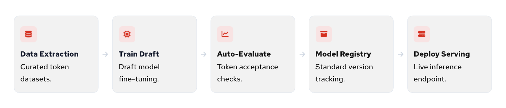
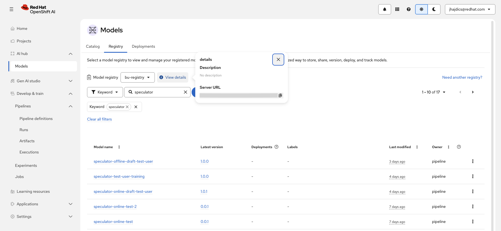
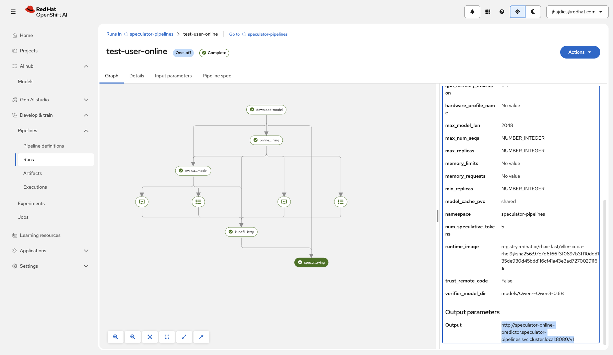
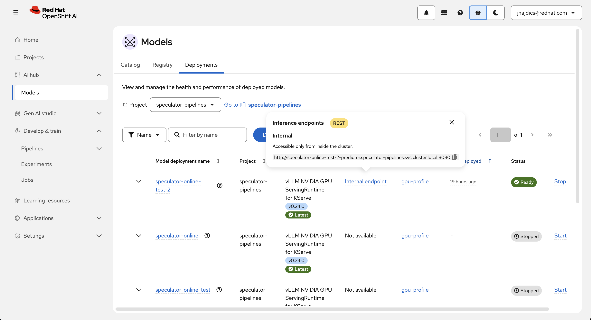

# Pipelines for Speculative Decoding Drafter Model Training on Red Hat OpenShift AI

This guided example walks through training a custom Eagle3 draft model for speculative decoding using **Kubeflow Pipelines** on Red Hat OpenShift AI. It covers generating each pipeline definition from source, importing it into Red Hat OpenShift AI, running it, interpreting the evaluation results, and testing the served endpoint.

This example is tested on Red Hat OpenShift AI 3.6.

This page covers what is shared across all four modes — background, prerequisites, and the run instructions. Each mode has its own guide in a subfolder.

> [!TIP]
>
> Prefer driving TrainJobs directly from a notebook instead of pipelines? See the [Speculative Decoding Draft Model Training via Kubeflow Trainer](../../../rhoai-3.6/speculator/) example — same four training modes, executed via the Kubeflow SDK `SpeculativeDecodingTrainer`.

## Contents

| Step |
| --- |
| **[1. Understand the pipelines](#1-understand-the-pipelines)** |
| **[2. Match your goal to a mode based on available GPU and storage](#2-match-your-goal-to-a-mode-based-on-available-gpu-and-storage)** |
| **[3. Check your cluster](#3-check-your-cluster)** |
| **[4. Set up your project](#4-set-up-your-project)** |
| **[5. Run a pipeline](#5-run-a-pipeline)** |
| **[6. Test the served endpoint](#6-test-the-served-endpoint)** |
| **[7. Clean up](#7-clean-up)** |
| **[Reference](#reference)** |

Each mode has its own guide with a stage-by-stage walkthrough and its example parameter tables: [data-extraction](data-extraction/README.md) · [train-only](train-only/) · [online](online/) · [offline](offline/).

## 1. Understand the pipelines

### What is Speculative Decoding?

Large language models generate tokens one at a time during inference. Each token requires reading the entire model from GPU memory (e.g., 140 GB for a 70B model in FP16), but the actual computation for one token is tiny. The GPU spends most of its time waiting for data to arrive from memory — running at under 1% compute utilization during normal token generation. This is called being **memory-bound**.

Speculative decoding exploits a key insight: verifying multiple tokens at once costs almost the same as generating one, because the expensive part (reading the model from memory) is identical and the GPU's compute units are idle anyway. A small, fast **draft model** quickly guesses the next several tokens, then the larger **verifier model** — `Qwen/Qwen3-0.6B` in these examples, kept deliberately small so an example run finishes quickly — checks all guesses at once in a single forward pass. Correct guesses become output; at the first rejected guess, the verifier's own token is used and the draft model starts guessing again. The output is mathematically identical to normal decoding — no quality loss.

For more background — why custom draft models matter after fine-tuning, and how the Eagle3 architecture reads hidden states from four intermediate verifier layers — see the [SDK example README](../../../rhoai-3.6/speculator/README.md#what-is-speculative-decoding).

### Pipelines Overview

There are four pipelines, one per training mode. Each is a separate pipeline definition in the [`pipelines-components`](https://github.com/red-hat-data-services/pipelines-components/tree/rhoai-3.6/pipelines/training/speculator) repository, with a subfolder here holding its guide:

| Pipeline | SDK-mode analog | Use Case |
| --- | --- | --- |
| [Hidden State Extraction](data-extraction/README.md) | `DATA_ONLY` | First step of a two-step workflow. Extract hidden states once, then iterate on training many times. |
| [Training](train-only/) | `TRAIN_ONLY` | Second step of the two-step workflow. Trains, evaluates, registers, and serves a draft from artifacts left by the extraction pipeline. |
| [Online](online/) | `ONLINE` | Single Trainer job: a managed vLLM sidecar extracts hidden states on the fly while the draft trains. Simplest one-run path. |
| [Offline](offline/) | `OFFLINE` | Extraction via an external (user-managed) vLLM endpoint, then training — all in one run. For when you already run your own vLLM. |

Every pipeline that trains also **evaluates** the draft with GuideLLM (acceptance metrics), optionally **registers** it to the Kubeflow Model Registry (mandatory in train-only), and **serves** it with a KServe speculative-decoding endpoint.



## 2. Match your goal to a mode based on available GPU and storage

<a id="hardware-requirements"></a>

GPU counts are pipeline GPUs for the default Qwen3-0.6B configuration, *with the managed vLLM sidecar / without it* — offline mode always uses your external endpoint, whose GPUs count separately:

| What do you need? | Choose | GPUs (sidecar / without) | Storage used | Notes |
| --- | --- | --- | --- | --- |
| One run that manages extraction and training together | **ONLINE** (Recommended) | 2 / — | ~13 GB | Fewest moving parts, but the training worker and vLLM sidecar run together in one pod — both GPUs must be available at the same time. |
| Extraction and training using a verifier endpoint you already operate | **OFFLINE** | — / 1 | ~13 GB | You run the extraction yourself: the vLLM endpoint must support hidden-state extraction — an ordinary chat-serving endpoint is not enough. |
| Reusable extraction outputs for separate training runs | **DATA_ONLY**, then **TRAIN_ONLY** | 1 then 1 / 0 then 1 | ~1.7 GB, then ~12 GB | Extraction is paid once; every TRAIN_ONLY run reuses its outputs. Extraction alone produces no trained draft. |
| Train another draft from compatible extraction outputs you already have | **TRAIN_ONLY** | 1 / 1 | ~12 GB | Needs the extraction artifacts on the PVC and a model registry to register into. |

Storage figures are what an example run (Qwen3-0.6B, 16 samples) writes to the one shared RWX PVC — the ~1.5 GB verifier cache and 167 MB of extraction outputs are small; training dominates, adding ~8.4 GB of checkpoints under the extraction output directory plus a ~2.9 GB `final_model`; full-dataset runs scale the hidden-state and checkpoint usage accordingly. Create the PVC once in [Set up your project](#create-an-rwx-pvc). Stages run sequentially — evaluation and serving start after training completes and reuse its freed GPUs — and every training run leaves a GPU-backed endpoint behind that counts toward the cluster total until you [clean it up](#cleaning-up).

## 3. Check your cluster

### Requirements

- An OpenShift cluster with Red Hat OpenShift AI **3.6** installed, with the **dashboard**, **trainer**, and **datasciencepipelines** components enabled; the **modelregistry** component is additionally required for the train-only pipeline (optional elsewhere)
- Component versions — the minimums declared by the pipeline source: Kubeflow Pipelines **>= 2.15.2**, Kubeflow Trainer **>= 0.1.0**, Kubernetes (OpenShift) **>= 1.28**; the training pipelines additionally need Model Registry **>= 0.3.4**, KServe **>= 2.10.0**, vLLM ServingRuntime **>= 0.24.0**
- Worker nodes with **NVIDIA GPUs** (Ampere or newer recommended) — the speculator runtimes are CUDA-based
- Python 3.11+ on your workstation or workbench, to generate the pipeline YAML
- A HuggingFace account and token (recommended, to avoid rate limits; Qwen3-0.6B is not gated)

Everything project-level — the pipeline server, the Trainer runtimes, and the shared RWX PVC — is prepared in [Set up your project](#prerequisites).

### Check access

Before you start, confirm with your administrator that you have access to what your selected mode needs: the project and its [pipeline server](#configure-the-pipeline-server), the Trainer [runtimes](#clustertrainingruntimes-ctrs), GPU resources, shared [RWX storage](#create-an-rwx-pvc), and the [`kubernetes-credentials`](#credentials) secret — and, for the training modes, the [Model Registry and KServe serving](#model-registry-and-kserve-train-only--online--offline). On a restricted cluster, also confirm the pipeline, runtime, and serving images can be pulled. data-extraction needs none of that last group. If something is missing, ask your administrator to prepare it — the rest of this guide assumes it is in place.

### Hardware requirements

Values below are for the default **Qwen3-0.6B** verifier; requirements scale with verifier model size. The vLLM sidecar supports exactly 1 GPU.

| Pipeline | GPUs — managed vLLM | GPUs — external vLLM | Shared PVC |
| --- | --- | --- | --- |
| data-extraction | 1 | 0 (your server's own) | Required |
| train-only | 1 | 1 | Required |
| online | 2 | — | Required |
| offline | — | 1 + your server's own | Required |

<a id="prerequisites" name="prerequisites"></a>

## 4. Set up your project

No project yet? Create one in the dashboard under **Develop & train > Data Science Projects > Create data science project** — see [Create a project](https://docs.redhat.com/en/documentation/red_hat_openshift_ai_self-managed/latest/html/getting_started_with_red_hat_openshift_ai_self-managed/creating-a-project_get-started).

Work through the setup your mode needs:

| Setup | Who does it | data-extraction | train-only / online / offline |
| --- | --- | --- | --- |
| [RWX PVC](#create-an-rwx-pvc) | you | Required | Required |
| [Pipeline server](#configure-the-pipeline-server) | administrator | Required | Required |
| [Credentials](#credentials) | administrator | Required | Required |
| [CTRs](#clustertrainingruntimes-ctrs) | administrator | Required | Required |
| [Model Registry](#model-registry-and-kserve-train-only--online--offline) | administrator, then you | Not needed | Mandatory for train-only, optional for online/offline |
| [KServe serving](#model-registry-and-kserve-train-only--online--offline) | administrator | Not needed | Required |

data-extraction skips the last two rows because it does not train, serve, or register. [Run a pipeline](#quick-start) assumes every applicable row is done.

### Create an RWX PVC

All models, datasets, hidden states, checkpoints and outputs live on one shared PersistentVolumeClaim that must exist before you run anything. `p01_persistent_pvc` names it, the pipelines mount it at `/mnt/persistent`, and they never create or resize it. It must be RWX and in the same project as the pipeline and the serving endpoint — PVCs cannot be mounted across projects — and you should run one pipeline at a time against a given PVC: concurrent runs share the PVC-root `final_model` path.

Create it once in the dashboard: **Cluster storage > Add cluster storage**, name `shared`, size 100Gi, and pick a **ReadWriteMany** storage class explicitly — the default class is often RWO-only, which leaves the claim `Pending` or mounted read-only. See [Configure cluster storage](https://docs.redhat.com/en/documentation/red_hat_openshift_ai_self-managed/latest/html/working_on_projects/configuring-cluster-storage_projects) in the Red Hat OpenShift AI documentation for the procedure.


### Configure the pipeline server

The pipeline server must be configured for your project before you can import or run pipelines — an **administrator task**. See [Configure a pipeline server](https://docs.redhat.com/en/documentation/red_hat_openshift_ai_self-managed/latest/html/working_with_ai_pipelines/managing-ai-pipelines_ai-pipelines#configuring-a-pipeline-server_ai-pipelines) in the Red Hat OpenShift AI documentation.

### Credentials

Before the first run, the administrator creates these Secrets in the project — see [Using connections](https://docs.redhat.com/en/documentation/red_hat_openshift_ai_self-managed/latest/html/working_on_projects/using-connections_projects) in the Red Hat OpenShift AI documentation for creating secrets and connections. The pipelines submit Trainer jobs through the Kubernetes API, so `kubernetes-credentials` is required by all four pipelines — its token belongs to the pipeline runner ServiceAccount the pipeline server creates, is mounted only in the KFP launcher tasks (never forwarded to Trainer workers), and can expire.

| Secret | Keys | When required |
| --- | --- | --- |
| `kubernetes-credentials` | `KUBERNETES_SERVER_URL`, `KUBERNETES_AUTH_TOKEN` | Every run; use credentials for the same cluster as the pipeline. |
| `hf-token` | `HF_TOKEN` | Gated models or rate-limit-free downloads only — Qwen3-0.6B is not gated, so this example runs without it. |

### ClusterTrainingRuntimes (CTRs)

The Trainer jobs reference CTRs by name via the `pNN_job_runtime` parameter:

| CTR name | Used by |
| --- | --- |
| `vllm-extract-cuda` | data-extraction (managed mode), online |
| `speculator-model-opt-cuda` | train-only, offline, data-extraction (remote mode) |

### Model Registry and KServe (train-only / online / offline)

The train-only pipeline **always** registers the draft — a reachable registry is mandatory there; online and offline skip registration when the registry address is left empty. If no registry exists yet, your administrator can follow the [model registry creation instructions](https://docs.redhat.com/en/documentation/red_hat_openshift_ai_self-managed/latest/html/managing_model_registries/index) in the Red Hat OpenShift AI documentation. View existing registries in the dashboard under **AI Hub > Models** — each registry's page shows its dedicated REST route:



What must already be available:

- **A Model Registry** your user can view in the dashboard and the pipeline runner can register into — creating it and binding its `registry-user-<registry-name>` Role to both identities (the runner for registration, your user for the dashboard view) are administrator tasks.
- **Serving in your project** — the endpoint is served in the project you run the pipeline in, which must reach the persistent PVC and let the pipeline runner manage ServingRuntimes and InferenceServices. Serving also reads the GPU HardwareProfile in `redhat-ods-applications`; without it the serve stage fails at InferenceService creation.

What you provide to the pipeline:

| Parameter (train-only names) | Value |
| --- | --- |
| `p02_model_registry_address` | `https://<registry-name>-rest.apps.<cluster-domain>` — the registry's `-rest` route, scheme included |
| `p45_model_registry_port` | `443` |
| `p03_model_registry_name` | The name the draft is registered under |
| `p04_serving_namespace` | Your project — where the endpoint is served |

Use the `-rest` route, not the dashboard URL, and keep the `https://` scheme — the failure modes are in [Troubleshooting](#troubleshooting). In-cluster alternative: the registry Service, `model-registry-<name>.<project>.svc` (no scheme), port `8080` — ask an administrator for the name.

<a id="quick-start" name="quick-start"></a>

## 5. Run a pipeline

The steps below use the data-extraction pipeline as the worked example, but the flow is identical for all four modes — only the parameters differ (each mode's guide has its parameter table). Work through [Set up your project](#prerequisites) first and complete each section's checks before importing anything — only the PVC is yours to create, so request the administrator tasks early.

### 1. Generate the pipeline YAML

The compiled pipeline YAML is not included in this repository — you generate it from the pipeline source in `pipelines-components`. Each pipeline's `pipeline.py` compiles itself when executed, writing `pipeline.yaml` beside it.

**Requirements:** Python 3.11+ and the KFP SDK. Do this on your own computer: compiling is a purely local step — it needs no cluster access and no workbench, and the first time the cluster is involved is [importing the result](#2-import-the-pipeline-into-red-hat-openshift-ai).

```bash
# Clone the rhoai-3.6 branch, matching the supported Red Hat OpenShift AI release
git clone --branch rhoai-3.6 https://github.com/red-hat-data-services/pipelines-components.git
cd pipelines-components

# Set up an isolated environment
python3 -m venv .venv
source .venv/bin/activate

# Pin the KFP SDK to the version your cluster's task images can install,
# then install the repository without letting pip float those pins. The
# install is required: the pipelines import shared `kfp_components`
# modules and compilation fails with ModuleNotFoundError without it.
pip install 'kfp==2.16.1' 'kfp-kubernetes==2.16.1'
pip install -e . --no-deps

# Compile the pipeline you want (one of: data_extraction, train_only, online, offline)
PYTHONPATH=$(pwd) python pipelines/training/speculator/data_extraction/pipeline.py

# The compiled pipeline is written next to its source:
# pipelines/training/speculator/data_extraction/pipeline.yaml
```

Repeat the last command for each mode you plan to run. To compile all four at once:

```bash
for mode in data_extraction train_only online offline; do
  PYTHONPATH=$(pwd) python "pipelines/training/speculator/$mode/pipeline.py"
done
```

**Expected result:** four `pipeline.yaml` files (or the one you need), one under each `pipelines/training/speculator/<mode>/` directory. Each is roughly 100–200 KB.

### 2. Import the pipeline into Red Hat OpenShift AI

1. In the Red Hat OpenShift AI dashboard, click **Develop & train** in the left navigation.
2. Choose **Pipelines**.
3. If the pipeline server was just configured, wait until the **Pipeline definitions** page loads without a configuration prompt.
4. Click **Import pipeline** (the button at the top of the **Pipeline definitions** page).
5. In the dialog:
   - **Name**: a display name, e.g. `speculator-hidden-state-extraction`
   - **Pipeline file**: select **Upload a file** and choose the `pipeline.yaml` you compiled in step 1.
6. Click **Import**.


**Expected result:** the pipeline appears in the **Pipeline definitions** list under the **display name you entered in the dialog** — imported definitions are listed by that name, not by the name embedded in the YAML.


### 3. Create a run and set parameters

1. On the **Pipeline definitions** page, click the imported pipeline.
2. Open the **Actions** menu on the definition page and choose **Create run**.

   

3. In the run form:
   - **Run name**: something meaningful, e.g. `speculator-extraction-1`
   - **Run group**: leave the default run group or create one — this only groups runs in the UI
   - **MLflow integration**: clear the **Enable MLflow experiment tracking** checkbox — it is **checked by default**, so you have to untick it. These pipelines have not been tested with an MLflow experiment association, and leaving it on may cause the run to fail or behave unexpectedly.
   - **Parameters**: fill in the values from the mode's example table (linked below). Parameters appear in `p01…` order, each with its own description underneath — booleans render as **True/False** radio buttons, numbers as steppers, and everything with a default can be left alone unless the table says otherwise.
4. Click **Create run**.


The ready-to-copy parameter tables:

- [data-extraction](data-extraction/README.md#3-configure-the-run)
- [train-only](train-only/README.md#3-configure-the-run)
- [online](online/README.md#3-configure-the-run)
- [offline](offline/README.md#3-configure-the-run)

> [!NOTE]
>
> The example runs use deliberately small settings (16 extraction samples, 10 evaluation samples) — they prove the workflow end to end, not speedup. Establishing a speedup number requires a separate baseline run under matching conditions.

### 4. Watch the run

1. From the run confirmation (or **Pipelines > Runs**), open the run. The pipeline graph shows each task as a node.
2. Node colors track state: pending, running, succeeded, failed.
3. Click any node to open its detail pane — **Logs** for stdout/stderr, **Artifacts** for its outputs.
4. Tasks run sequentially in these pipelines (extraction before training, training before evaluation, etc.), so a failure early in the graph stops everything downstream. The failing node's logs are the first place to look.


When the run succeeds, continue with the mode's guide — for the two-step workflow that means the [train-only pipeline](train-only/README.md), whose guide covers [reviewing the results](train-only/README.md#5-review-the-results).

<a id="testing-the-served-endpoint" name="testing-the-served-endpoint"></a>

## 6. Test the served endpoint

Every training pipeline leaves a **cluster-local** KServe InferenceService behind — the procedure below was verified against a live Red Hat OpenShift AI 3.6 cluster. For mode-specific details, see the train-only guide's [Test the served endpoint](train-only/README.md#test-the-served-endpoint); for background on model serving in general, see [Deploying models](https://docs.redhat.com/en/documentation/red_hat_openshift_ai_self-managed/latest/html/deploying_models/index) in the Red Hat OpenShift AI documentation.

> [!IMPORTANT]
>
> The endpoint is **cluster-local**: its URL is `<name>-predictor.<namespace>.svc.cluster.local` and resolves **only inside the cluster**. Running `curl` against it from your laptop fails with `Could not resolve host` — that is expected, not a broken deployment.

### 1. Find the serving URL in the dashboard

The serving task's logs print the endpoint's URL. In the run's graph, click the serving node and open its **Logs**:



### 2. Send a chat request

The vLLM server registers the model under the **InferenceService name** — use that name, not the verifier model ID, as the `model` in the request. Run this from anywhere `oc` is logged in — the command executes inside the predictor container:

```bash
oc exec -n <project-namespace> deploy/<name>-predictor -c kserve-container -- \
  curl -s localhost:8080/v1/chat/completions \
  -H "Content-Type: application/json" \
  -d '{"model": "<name>", "messages": [{"role": "user", "content": "What is the capital of France?"}], "max_tokens": 200}'
```

The answer is in `choices[0].message.content`. To print just that, append `| jq -r '.choices[0].message.content'`.

<a id="cleaning-up" name="cleaning-up"></a>

## 7. Clean up

Every training run leaves a **GPU-backed KServe endpoint** behind, and offline mode — or data-extraction in remote mode — additionally depends on your **external extraction server**. Neither needs to keep running after verification — release the GPUs while keeping the data that matters.

### 1. Stop, restart or remove the serving endpoint

Train-only, online and offline each leave one behind. The endpoint the run created is listed in the dashboard under **AI Hub > Models > Deployments**:



Its action menu offers the three things you need:

| Action | What happens | When to use it |
| --- | --- | --- |
| **Stop** | KServe deletes the predictor pods and releases the GPU, keeping the InferenceService | You are done for now but expect to query the endpoint again |
| **Start** | Recreates the predictor from the same InferenceService — no pipeline re-run | Resuming a stopped endpoint; the first request is slow again while vLLM loads the model |
| **Delete** | Removes the InferenceService, its predictor and the GPU it held, permanently | You are finished with this draft, or you want the name free for the next run |

## Reference

### Default verifier model

These examples standardize on **`Qwen/Qwen3-0.6B`** with `target_layer_ids = "2,14,25,28"` (the four intermediate verifier layers Eagle3 reads). **`meta-llama/Llama-3.2-1B-Instruct`** has also been run end-to-end successfully on Red Hat OpenShift AI 3.6 with these pipelines.

The layer IDs are **verifier-specific**: they name four layers *of the verifier model*, and a wrong set fails at training time with a tensor shape mismatch. For Qwen3-0.6B use `2,14,25,28`; for any other verifier, look up that model's four Eagle3 target layers (see the [SDK example's guidance](../../../rhoai-3.6/speculator/README.md#speculator-specific-considerations)) — do not reuse Qwen's IDs for a different architecture.

### Troubleshooting

Compile-time problems, ordered roughly by when you'd hit them. Run-time symptoms are in each mode guide's troubleshooting table.

| Symptom | Diagnosis | Fix |
| --- | --- | --- |
| Compile fails: `ModuleNotFoundError: No module named 'kfp_components'` | The `pipelines-components` repo was not installed as a package | Run `pip install -e .` from the repository root |
| Compile fails: `ModuleNotFoundError: No module named 'components'` | `PYTHONPATH` not set to the repository root | Prefix the command with `PYTHONPATH=$(pwd)` and run it from the repo root |
| `pip install -e .` fails to resolve dependencies | Your package index (e.g. an internal mirror) doesn't carry a required package or version | On a Linux (el9) host, install the repo's hash-pinned set instead: `pip install -r requirements.txt`, then `pip install -e . --no-deps` |
| Import into Red Hat OpenShift AI rejected | YAML built with an incompatible KFP SDK version | Re-compile with the pinned versions in [step 1](#1-generate-the-pipeline-yaml) |
| A task fails with `No matching distribution found for kfp==<version>` | Every task installs the KFP version baked in at compile time, and the task pods do not all use the same package index — the registration task's image is pinned to an older one than the rest | Re-compile with the pin in [step 1](#1-generate-the-pipeline-yaml). The error lists what that pod can reach (`from versions: …`); the pin has to be a version every task's index offers, which is why this guide uses `2.16.1` |
| Run fails immediately with `storageclass.storage.k8s.io "nfs-csi" not found` | Cluster has no `nfs-csi` storage class; the KFP workspace PVC cannot be created | Find your RWX class with `oc get storageclass`, then recompile with your class name |
| PVC stuck `Pending` | No RWX dynamic provisioner, or capacity exhausted | Talk to your cluster admin; RWX storage is required |

### Source

The pipelines documented here live in [`red-hat-data-services/pipelines-components`](https://github.com/red-hat-data-services/pipelines-components/tree/rhoai-3.6/pipelines/training/speculator) under `pipelines/training/speculator/`, on the **`rhoai-3.6`** branch — the one this guide compiles from, and the one whose runtime images match Red Hat OpenShift AI 3.6. The example parameter tables in the mode guides are derived from that branch's pipeline sources and READMEs; the full parameter lists are documented in the pipeline directories' own READMEs. The pipelines still change within a release branch, so re-generate your YAML after pulling `rhoai-3.6` and re-check the parameter list against the imported definition.
