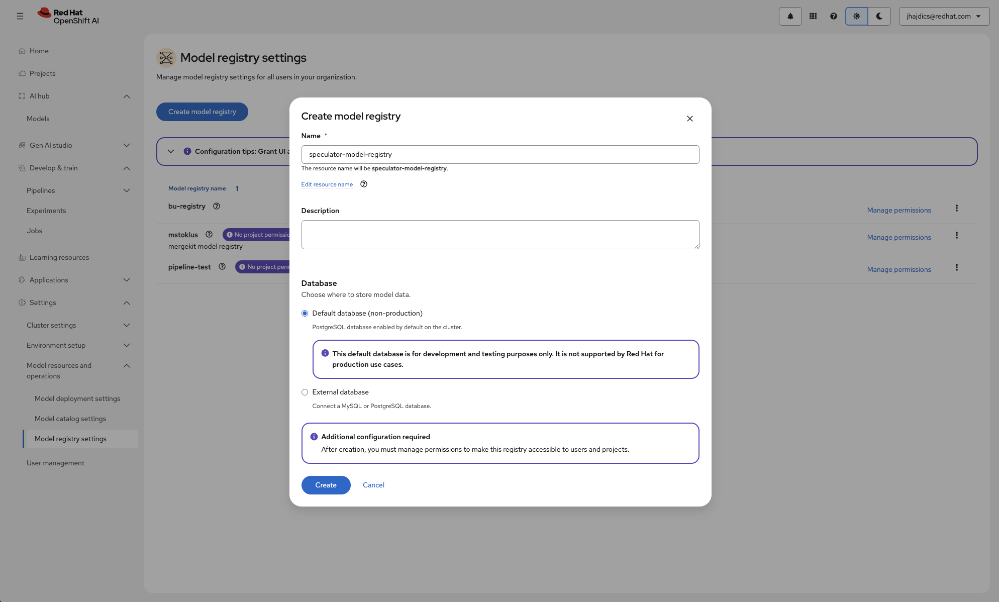
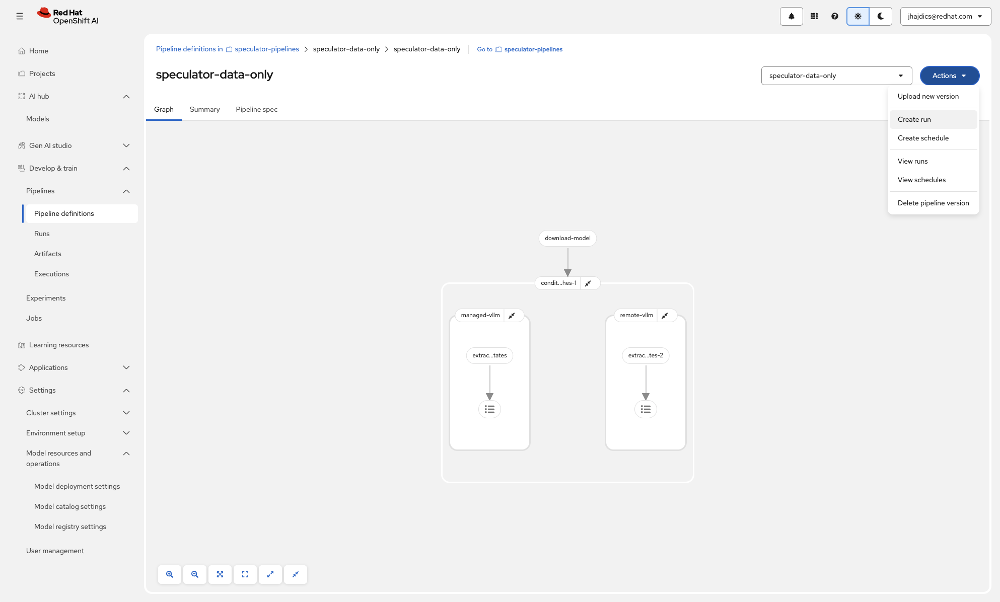

# Pipelines for Speculative Decoding Draft Model Training on Red Hat OpenShift AI

This guided example walks through training a custom Eagle3 draft model for speculative decoding using **Kubeflow Pipelines** on Red Hat OpenShift AI. It covers generating each pipeline definition from source, importing it into Red Hat OpenShift AI, running it, interpreting the evaluation results, and testing the served endpoint.

> [!WARNING]
>
> The upstream speculator pipelines may change. Re-generate the pipeline YAML after pulling upstream changes.

This page covers what is shared across all four modes — background, prerequisites, and the Quick Start. Each mode has its own guide in a subfolder.

> [!TIP]
>
> Prefer driving TrainJobs directly from a notebook instead of pipelines? See the SDK-based examples at [`../../../rhoai-3.6/speculator/`](../../../rhoai-3.6/speculator/) — same four training modes, executed via the Kubeflow SDK `SpeculativeDecodingTrainer`.

## Contents

| Step | What it covers |
| --- | --- |
| **[1. Understand the pipelines](#1-understand-the-pipelines)** | [What speculative decoding is](#what-is-speculative-decoding) · [the four pipelines](#pipelines-overview) |
| **[2. Choose your mode](#2-choose-your-mode)** | [Match your goal](#1-match-your-goal-to-a-mode) · [resources](#2-check-the-resource-implications) · [access](#3-check-access) · [your path](#4-your-path-through-this-guide) |
| **[3. Check your cluster](#3-check-your-cluster)** | [Compatibility](#red-hat-openshift-ai-compatibility) · [requirements](#requirements) · [hardware](#hardware-requirements) |
| **[4. Get access](#4-get-access)** | [Log in](#log-in-and-select-your-project) · [minimum permissions](#minimum-permissions) · [per mode](#which-access-does-your-mode-need) · [check yourself](#check-your-own-access-before-you-start) · [trust boundary](#the-trust-boundary) |
| **[5. Set up your project](#5-set-up-your-project)** | [RWX PVC](#existing-rwx-pvc) · [pipeline server](#configure-the-pipeline-server) · [credentials](#kubernetes-authentication-secret) · [hf-token](#optional-hf-token-secret) · [CTRs](#clustertrainingruntimes-ctrs) · [registry and KServe](#model-registry-and-kserve-train-only--online--offline) |
| **[6. Run a pipeline](#6-run-a-pipeline)** | [Compile](#1-generate-the-pipeline-yaml) · [import](#3-import-the-pipeline-into-red-hat-openshift-ai) · [create a run](#4-create-a-run-and-set-parameters) · [watch it](#5-watch-the-run) |
| **[7. Test the served endpoint](#7-test-the-served-endpoint)** | [Find it](#1-find-the-inferenceservice-and-its-url) · [model id](#2-discover-the-model-id) · [chat request](#3-send-a-chat-request) · [from your laptop](#4-access-from-your-laptop-optional) |
| **[8. Clean up](#8-clean-up)** | [Stop or delete the endpoint](#1-stop-restart-or-remove-the-serving-endpoint) · [external server](#2-stop-the-external-extraction-server-offline-only) · [check the GPUs](#3-verify-the-gpus-were-released) · [what is kept](#4-keep-what-matters) |
| **[Reference](#reference)** | [Default verifier](#default-verifier-model) · [compile-time settings](#customizing-before-you-compile) · [troubleshooting](#troubleshooting) · [source](#source) |

Each mode has its own guide with a stage-by-stage walkthrough and full parameter reference: [data-extraction](data-extraction/) · [train-only](train-only/) · [online](online/) · [offline](offline/).

## 1. Understand the pipelines

### What is Speculative Decoding?

Large language models generate tokens one at a time during inference. Each token requires reading the entire model from GPU memory (e.g., 140 GB for a 70B model in FP16), but the actual computation for one token is tiny. The GPU spends most of its time waiting for data to arrive from memory — running at under 1% compute utilization during normal token generation. This is called being **memory-bound**.

Speculative decoding exploits a key insight: verifying multiple tokens at once costs almost the same as generating one, because the expensive part (reading the model from memory) is identical and the GPU's compute units are idle anyway. A small, fast **draft model** quickly guesses the next several tokens, then the larger **verifier model** — `Qwen/Qwen3-0.6B` in these examples, kept deliberately small so an example run finishes quickly — checks all guesses at once in a single forward pass. Correct guesses become output; at the first rejected guess, the verifier's own token is used and the draft model starts guessing again. The output is mathematically identical to normal decoding — no quality loss.

For more background — why custom draft models matter after fine-tuning, and how the Eagle3 architecture reads hidden states from four intermediate verifier layers — see the [SDK example README](../../../rhoai-3.6/speculator/README.md#what-is-speculative-decoding).

### Pipelines Overview

There are four pipelines, one per training mode. Each is a separate pipeline definition in the [`pipelines-components`](https://github.com/red-hat-data-services/pipelines-components/tree/rhoai-3.6/pipelines/training/speculator) repository, with a subfolder here holding its guide:

| Pipeline | SDK-mode analog | Use Case | Guide |
| --- | --- | --- | --- |
| Hidden State Extraction | `DATA_ONLY` | First step of a two-step workflow. Extract hidden states once, then iterate on training many times. | [data-extraction/](data-extraction/) |
| Training | `TRAIN_ONLY` | Second step of the two-step workflow. Trains, evaluates, registers, and serves a draft from artifacts left by the extraction pipeline. | [train-only/](train-only/) |
| Online | `ONLINE` | Single Trainer job: a managed vLLM sidecar extracts hidden states on the fly while the draft trains. Simplest one-run path. | [online/](online/) |
| Offline | `OFFLINE` | Extraction via an external (user-managed) vLLM endpoint, then training — all in one run. For when you already run your own vLLM. | [offline/](offline/) |

Every pipeline that trains also **evaluates** the draft with GuideLLM (acceptance metrics), optionally **registers** it to the Kubeflow Model Registry (mandatory in train-only), and **serves** it with a KServe speculative-decoding endpoint.

[↑ Contents](#contents)

## 2. Choose your mode

Work through this page top to bottom before touching a cluster — by the end you should know your mode, know your cluster can support it, and know what (if anything) to request from your administrator.

### 1. Match your goal to a mode

| What do you need? | Choose | What must already be available? |
| --- | --- | --- |
| One run that manages extraction and training together | **ONLINE** | Capacity for the training worker and managed vLLM sidecar together; no external extraction server to prepare. |
| Extraction and training using a verifier endpoint you already operate | **OFFLINE** | A reachable, extraction-capable vLLM endpoint, compatible versions/layers, and shared PVC paths. An ordinary chat-serving endpoint is insufficient. The pipeline still needs training compute. |
| Reusable extraction outputs for separate training runs | **DATA_ONLY**, followed by **TRAIN_ONLY** | Extraction compute or an extraction-capable remote endpoint, plus persistent storage for the verifier, hidden states and preprocessed dataset. Extraction alone does not produce a trained draft. |
| Train another draft from compatible extraction outputs you already have | **TRAIN_ONLY** | The matching verifier weights, hidden states and preprocessed dataset on the PVC, training compute, and access to the required model registry. |

> [!TIP]
>
> **First time through?** ONLINE is the fewest moving parts — one run, nothing to wire between runs — but it needs **two GPUs together** in the Trainer pod. If that capacity is not available, or if you expect to tune hyperparameters more than once, run **DATA_ONLY** then **TRAIN_ONLY** instead: one GPU at a time, extraction paid for once, and a verification step on the PVC between the two.

### 2. Check the resource implications

For the default Qwen3-0.6B configuration: ONLINE needs **two GPUs together** in the Trainer pod (worker + sidecar); managed DATA_ONLY needs **one** extraction GPU; TRAIN_ONLY and OFFLINE need **one** pipeline GPU during their sequential GPU stages. Count the external OFFLINE server and any endpoints retained from previous runs separately — see [Hardware requirements](#hardware-requirements) and each mode guide's component table. A cluster-wide GPU count alone does not prove the pod can schedule: CPU, memory, GPU memory, and placement all matter.

### 3. Check access

Run the `oc auth can-i` checks in [Access you need](#access-you-need-and-what-your-administrator-must-provide). If any check fails, stop and send the failing checks to your administrator — the rest of this guide assumes they pass.

### 4. Your path through this guide

1. This section — choose the mode.
2. [Access you need](#access-you-need-and-what-your-administrator-must-provide) — self-check, administrator handoff if needed.
3. [Prerequisites](#prerequisites) — shared setup you do **once** per project.
4. [Quick Start](#quick-start) — compile the pipeline YAML, import it, create a run.
5. Your mode's guide — the parameter table, the stage-by-stage walkthrough, and how to verify that mode's actual outputs (extraction files before TRAIN_ONLY; evaluation metrics and a real endpoint request for the training modes).
6. [Testing the served endpoint](#testing-the-served-endpoint) — training modes only.
7. [Cleaning up](#cleaning-up) — release serving GPUs when you are done.

> [!NOTE]
>
> The example runs use deliberately small settings (16 extraction samples, 10 evaluation samples) — they prove the workflow end to end, not speedup. Establishing a speedup number requires a separate baseline run under matching conditions.

[↑ Contents](#contents)

## 3. Check your cluster

### Red Hat OpenShift AI compatibility

This example is compatible with Red Hat OpenShift AI 3.6. The pipelines additionally require:

- Kubeflow Pipelines **>= 2.15.2** (the Red Hat OpenShift AI Data Science Pipelines component)
- Kubeflow Trainer **>= 0.1.0** (the Red Hat OpenShift AI `trainer` component)
- For the training pipelines: Model Registry **>= 0.3.4**, KServe **>= 2.10.0**, vLLM ServingRuntime **>= 0.24.0**
- Kubernetes (OpenShift) **>= 1.28**

### Requirements

- An OpenShift cluster with Red Hat OpenShift AI 3.6 installed:
  - The **dashboard**, **trainer**, and **datasciencepipelines** components enabled
  - The **pipeline server** running — see [Prerequisites](#configure-the-pipeline-server)
  - The **modelregistry** component enabled (required for the train-only pipeline; optional elsewhere)
- Speculator **ClusterTrainingRuntimes (CTRs)** deployed — see [ClusterTrainingRuntimes](#clustertrainingruntimes-ctrs)
- Worker nodes with **NVIDIA GPUs** (Ampere or newer recommended) — the CTRs are CUDA-based
- An **existing ReadWriteMany PVC** — see [Existing RWX PVC](#existing-rwx-pvc)
- Python 3.11+ on your workstation or workbench, to generate the pipeline YAML
- A HuggingFace account and token (recommended, to avoid rate limits; Qwen3-0.6B is not gated)

### Hardware requirements

Values below are for the default **Qwen3-0.6B** verifier. Requirements scale with verifier model size.

| Pipeline | Training GPU | vLLM sidecar GPU | Evaluation / Serving GPU | Peak concurrent pipeline GPUs |
| --- | --- | --- | --- | --- |
| data-extraction (managed vLLM) | — | 1 | — | 1 |
| data-extraction (remote vLLM) | — | — (external) | — | 0 |
| train-only | 1 | — | ~1 | 1 |
| online | 1 | 1 | ~1 | 2 |
| offline | 1 | — (external) | ~1 | 1 |

> [!NOTE]
>
> - The vLLM sidecar currently supports exactly 1 GPU (`p12_vllm_resource_gpu`).
> - Evaluation (GuideLLM) and the KServe endpoint each consume roughly one GPU while active.
> - Stages run sequentially — evaluation and serving start after the training job completes and reuse its freed GPUs, so the totals reflect **peak concurrent** usage: one pipeline GPU for train-only and offline, two for online (its training worker + vLLM sidecar run together in one Trainer pod).
> - Offline mode uses your external vLLM server's own resources — size it separately, on top of the pipeline totals.
> - Every training run leaves a GPU-backed endpoint behind. If you do not [clean it up](#cleaning-up), its GPU counts toward the cluster total during your *next* run.

[↑ Contents](#contents)

<a id="access-you-need-and-what-your-administrator-must-provide" name="access-you-need-and-what-your-administrator-must-provide"></a>

## 4. Get access

Two personas share this workflow:

- **You** — work in one OpenShift project: create runs, watch them, verify the results.
- **Your administrator** — prepares what cannot be created from inside a project: the [CTRs](#clustertrainingruntimes-ctrs), the serving [HardwareProfile](#minimum-permissions), the [pipeline server](#configure-the-pipeline-server) with its object-storage credentials, and optionally the [Model Registry](#model-registry-and-kserve-train-only--online--offline).

Work through this section **before** the setup. The minimum permission list was verified end to end by a non-admin user on a live Red Hat OpenShift AI 3.6 cluster — all four pipeline modes, including registration and serving. If a check below fails, send the failing checks to your administrator rather than discovering the gap after a training run.

### Log in and select your project

All `oc` commands in this guide target **one project**. Selecting a project in the Red Hat OpenShift AI dashboard does **not** change your terminal's namespace — establish it in your shell before running the first command:

```bash
oc login https://api.<cluster-domain>:6443
oc project <project-namespace>
```

- `oc project -q` prints the project your terminal is scoped to — re-run `oc project` after opening a new terminal.
- **No project yet?** Create one in the dashboard under **Develop & train > Data Science Projects > Create data science project**, or with `oc new-project <project-namespace>` where self-provisioning is allowed. If both fail, ask your administrator to create the project for you. See also: [Create a project](https://docs.redhat.com/en/documentation/red_hat_openshift_ai_self-managed/latest/html/getting_started_with_red_hat_openshift_ai_self-managed/creating-a-project_get-started).
- **Project** and **namespace** are the same thing: the dashboard says project, `oc` and the pipeline parameters say namespace. Use that one name in every `<project-namespace>` placeholder below.

### Minimum permissions

**If you are an administrator (cluster-admin), skip this section** — you already have everything below, and the administrator setup steps are yours anyway.

If you are a non-admin user, an administrator must first prepare what cannot be created from inside a project: the [pipeline server](https://docs.redhat.com/en/documentation/red_hat_openshift_ai_self-managed/latest/html/working_with_ai_pipelines/managing-ai-pipelines_ai-pipelines#configuring-a-pipeline-server_ai-pipelines) with its object-storage credentials, the [Model Registry](#model-registry-and-kserve-train-only--online--offline) when you register, the [`kubernetes-credentials`](#kubernetes-authentication-secret) secret, and — for offline mode — the [external vLLM server](../offline/README.md#external-vllm-server). With those in place, the following permissions are the minimum required to run the pipelines end to end.

**As your user:**

- Create pipeline runs in the project — this comes with the pipeline server
- Read TrainJobs, pods and pod logs — watch runs from the CLI
- Create and delete PersistentVolumeClaims in the project — the shared RWX PVC
- Create workbenches — verify PVC contents between extraction and training
- List ServiceAccounts — discover the runner's actual name (see below)
- List ClusterTrainingRuntimes — cluster-scoped; the mode guides check runtimes with `oc get clustertrainingruntimes`
- List `llminferenceservices` and `llminferenceserviceconfigs` — the dashboard's Deployed models page errors without this (serving modes)
- Exec and port-forward into pods, and read Deployments — test the served endpoint (`oc exec`, `oc port-forward` against the predictor) (serving modes)
- Manage InferenceServices — stop or delete the served endpoint during [cleanup](#cleaning-up) (serving modes)
- Read the project and list storage classes — both cluster-scoped, for the dashboard's project view and for picking an RWX storage class
- The registry's `registry-user-<registry-name>` Role in the registry's namespace — the dashboard's registry view, where the guides verify registration (registering modes)

**As the pipeline runner** — the ServiceAccount the pipeline server creates, named `pipeline-runner-<DSPA-name>` (`pipeline-runner-dspa` for a DSPA named `dspa`; confirm with `oc get serviceaccounts -n <project-namespace>`). This is the identity the pipeline tasks execute under, and the one whose token goes into [`kubernetes-credentials`](#kubernetes-authentication-secret):

- Create and read TrainJobs (`trainer.kubeflow.org`)
- Read TrainingRuntimes — namespaced — and ClusterTrainingRuntimes — cluster-scoped
- Create and manage ServingRuntimes and InferenceServices (serving modes)
- Read the GPU HardwareProfile in `redhat-ods-applications` (serving modes)
- The registry's `registry-user-<registry-name>` Role in the registry's namespace — the register stage's REST calls through the registry's `-rest` route (registering modes)

The Data Science Pipelines operator already grants the runner a baseline Role when the pipeline server is configured — per-run KFP workspace PVCs, configmaps, InferenceServices, pods and deployments read. The runner list above is the delta that baseline lacks. Neither identity needs secret access or ServiceAccount token minting: that is deliberate, and it is why credential setup is an administrator task — see [the trust boundary](#the-trust-boundary) for what a TrainJob can still reach regardless.

### Which access does your mode need?

| Access | data-extraction | train-only | online | offline |
| --- | --- | --- | --- | --- |
| Project access + CTR discovery | Required | Required | Required | Required |
| Pipeline server with S3 object storage (administrator-configured) | Required | Required | Required | Required |
| Serving: KServe writes, predictor stop/start + HardwareProfile | Not needed | Required | Required | Required |
| Model Registry access | Not needed | Required (always registers) | Optional (skip by leaving the registry address empty) | Optional |
| External extraction-capable vLLM endpoint | Optional (remote mode) | Not needed | Not needed | Required |

### Check your own access before you start

Every answer must be `yes` for the modes you plan to use. The user checks you run yourself; the runner checks are for your administrator — impersonating the runner (`--as`) requires rights you do not have, and a missing runner grant surfaces only as a 403 inside a run, after the GPU stages have started:

```bash
# As your user — run these yourself:
oc auth can-i get namespaces/<project-namespace>
oc auth can-i get pods --subresource=log -n <project-namespace>
oc auth can-i list clustertrainingruntimes.trainer.kubeflow.org
# Serving modes additionally:
oc auth can-i create pods --subresource=exec -n <project-namespace>
oc auth can-i list llminferenceservices.serving.kserve.io -n <project-namespace>

# As the runner — your administrator runs these:
RUNNER=system:serviceaccount:<project-namespace>:<runner-service-account>

oc auth can-i create trainjobs.trainer.kubeflow.org -n <project-namespace> --as=$RUNNER
oc auth can-i list trainingruntimes.trainer.kubeflow.org -n <project-namespace> --as=$RUNNER
oc auth can-i list clustertrainingruntimes.trainer.kubeflow.org --as=$RUNNER

# Serving modes (train-only / online / offline) additionally:
oc auth can-i create servingruntimes.serving.kserve.io -n <project-namespace> --as=$RUNNER
oc auth can-i list hardwareprofiles.infrastructure.opendatahub.io -n redhat-ods-applications --as=$RUNNER

# Registering modes additionally — name the resource: the registry's Role is
# resourceNames-scoped, so a resource-less query answers "no" even when the
# binding is correct:
oc auth can-i get services/<registry-name> -n <registry-namespace> --as=$RUNNER
```

If any answer is `no`, collect the failing checks and send them to your administrator — do not start the setup.

### The trust boundary

The permission list above is deliberately minimal. Neither you nor the runner gets secret access, ServiceAccount token minting, or pod creation — the pipeline's own code never needs them, and granting them to the runner would turn it into a privilege-escalation path.

> [!IMPORTANT]
>
> **The project namespace is the trust boundary — one capability cannot be scoped away.** TrainJob submission, the entire point of this example, lets the submitter choose container images, commands, environment variables, and volume mounts (the Trainer API's `trainer.env`, `image`, and `podSpecOverrides` fields). Any identity that can create TrainJobs in a namespace can therefore read every Secret in it — for example by injecting one through `env.valueFrom.secretKeyRef` into a job — and run arbitrary code there. This is inherent to training-job submission, not a flaw in the permission list above: removing other grants does not reduce this access, because the same operations are available through a TrainJob. Administrators should treat the project as a single trust domain: keep cluster-privileged ServiceAccounts and unrelated high-value Secrets out of it, and enforce finer-grained limits — blocking secret mounts, restricting images — with an admission policy engine such as Kyverno or Gatekeeper where required.

If a step in this guide seems to need more than the list above, it is a step for your administrator.

<a id="prerequisites" name="prerequisites"></a>

## 5. Set up your project

Run the [access checks](#check-your-own-access-before-you-start) first, then work through the setup your mode needs:

| Setup | Who does it | data-extraction | train-only / online / offline |
| --- | --- | --- | --- |
| [RWX PVC](#existing-rwx-pvc) | you | Required | Required |
| [Pipeline server](#configure-the-pipeline-server) | administrator | Required | Required |
| [Kubernetes authentication secret](#kubernetes-authentication-secret) | administrator | Required | Required |
| [CTRs](#clustertrainingruntimes-ctrs) | administrator | Required | Required |
| [Model Registry and KServe](#model-registry-and-kserve-train-only--online--offline) | administrator, then you | Not needed | Mandatory for train-only, optional for online/offline |

data-extraction skips the last row because it does not train, serve, or register. All `oc` commands below assume `oc project <project-namespace>` ([why](#log-in-and-select-your-project)), and [Run a pipeline](#quick-start) assumes every applicable row is done.

### Existing RWX PVC

All models, datasets, hidden states, checkpoints and outputs live on one shared PersistentVolumeClaim that must exist before you run anything. `p01_persistent_pvc` names it, the pipelines mount it at `/mnt/persistent`, and they never create or resize it.

> [!IMPORTANT]
>
> Every run involves **two** PVCs:
>
> 1. **Yours** (`p01_persistent_pvc`) — the verifier, datasets, hidden states, checkpoints and final draft. Must be RWX and in the same namespace as the pipeline and the serving endpoint; PVCs cannot be mounted across namespaces.
> 2. **The KFP workspace PVC** — created by the pipeline at run time for its launcher tasks (200Gi, `nfs-csi`, RWX), fixed at compile time; see [Customizing before you compile](#customizing-before-you-compile).

Create it once in the dashboard: **Cluster storage > Add cluster storage**, name `shared`, size 100Gi, and pick a **ReadWriteMany** storage class explicitly — the default class is often RWO-only, which leaves the claim `Pending` or mounted read-only. List what your cluster offers with `oc get storageclass`. See also: [cluster storage](https://docs.redhat.com/en/documentation/red_hat_openshift_ai_self-managed/latest/html/getting_started_with_red_hat_openshift_ai_self-managed/creating-a-workbench-select-ide_get-started) in the Red Hat OpenShift AI documentation. With `oc` instead:

```bash
oc apply -f - <<EOF
apiVersion: v1
kind: PersistentVolumeClaim
metadata:
  name: shared
spec:
  accessModes: ["ReadWriteMany"]
  storageClassName: <your-rwx-storage-class>
  resources:
    requests:
      storage: 100Gi
EOF
```

`storageClassName` is not optional here: omit it and the claim takes the cluster default, which is usually RWO-only.


Verify with `oc get pvc shared` — expect `STATUS Bound`.

> [!TIP]
>
> Attaching the PVC to a workbench is optional and separate; the pipelines mount it themselves. Attach it only if you want a terminal for [inspecting outputs](data-extraction/README.md#verifying-the-output-on-the-pvc).

### Configure the pipeline server

The pipeline server must be running for your project before you can import or run pipelines.

> [!IMPORTANT]
>
> **Administrator task, and the first one.** Configuring a pipeline server creates a DataSciencePipelinesApplication and stores the object-storage credentials in a Secret — the documented access grants neither. It also creates the `pipeline-runner-<DSPA-name>` ServiceAccount that holds the [minimum runner permissions](#minimum-permissions), so the pipeline server has to exist before the rest of the setup makes sense.

**Administrator procedure.** In the Red Hat OpenShift AI dashboard, open the project, choose the **Pipelines** tab, and click **Configure pipeline server**. Provide the object storage connection details it asks for (an S3-compatible bucket — the same kind used for any pipeline work; artifacts land there).


**Verify it is ready** — this part you can run yourself. The project's **Pipelines** tab shows the **Pipeline definitions** page instead of a configuration prompt, and the runner ServiceAccount exists:

```bash
oc get serviceaccounts -n <project-namespace> | grep pipeline-runner
```

See also: [Manage AI pipelines](https://docs.redhat.com/en/documentation/red_hat_openshift_ai_self-managed/latest/html/working_with_ai_pipelines/managing-ai-pipelines_ai-pipelines#configuring-a-pipeline-server_ai-pipelines) in the Red Hat OpenShift AI documentation.

### Kubernetes authentication secret

The pipeline submits Trainer jobs through the Kubernetes API and requires a secret named `kubernetes-credentials` **in the project namespace**:

| Key | Description |
| --- | --- |
| `KUBERNETES_SERVER_URL` | Kubernetes API server URL (e.g., `https://api.cluster.example.com:6443`) |
| `KUBERNETES_AUTH_TOKEN` | Service account token with permissions to create Trainer jobs |

The token's identity is the **Trainer token identity** — the pipeline uses it to submit TrainJobs through the Kubernetes API, so it needs at minimum:

| API group | Resources | Verbs |
| --- | --- | --- |
| `trainer.kubeflow.org` | `trainjobs` | get, list, watch, create, update, patch |
| `trainer.kubeflow.org` | `trainingruntimes`, `clustertrainingruntimes` | get, list, watch |
| Core | `configmaps` | get, list, watch, create, update, patch |

The pipeline runner ServiceAccount — named `pipeline-runner-<DSPA-name>`, so confirm the actual name with `oc get serviceaccounts -n <project-namespace>` — satisfies this baseline when granted the [minimum permissions](#minimum-permissions).

> [!IMPORTANT]
>
> **Administrator task.** The documented access grants no secret creation and no token minting, deliberately — see [the trust boundary](#the-trust-boundary). Ask your administrator to run the commands below in your project namespace.

**Create the secret.** Mint a long-lived token for the runner, create the secret from it, then remove the plaintext file. The `&&` chain stops at the first failure, so a failed or empty mint never touches the secret:

```bash
umask 077   # token file: owner-only, before it is written
oc create token <runner-service-account> -n <project-namespace> --duration=8760h > /path/to/token-file \
  && [ -s /path/to/token-file ] \
  && oc create secret generic kubernetes-credentials -n <project-namespace> \
       --from-literal=KUBERNETES_SERVER_URL="https://api.your-cluster.com:6443" \
       --from-file=KUBERNETES_AUTH_TOKEN=/path/to/token-file \
  && rm /path/to/token-file \
  && oc get secret kubernetes-credentials -n <project-namespace>
```

A failed run may leave the token file behind; `umask 077` makes it owner-only, and it is safe to delete.

> [!NOTE]
>
> `--from-file` keeps the token out of shell history and process listings — prefer it to `--from-literal` for secret values. This secret is required by all four pipelines, and is mounted only in the KFP launcher tasks, never forwarded to Trainer workers.

**Renew an expired token.** The mint above lasts a year. When it expires every run fails at job submission with `401 Unauthorized` — sudden "runs stop starting" is the symptom. Mint a fresh file and **update** the existing secret rather than re-running `oc create secret`, which fails with `AlreadyExists`; both keys are re-supplied so the server URL survives. `set -o pipefail` stops a failed render from being masked by `oc apply`:

```bash
set -o pipefail   # so a failed render is not masked by the pipe below
umask 077
oc create token <runner-service-account> -n <project-namespace> --duration=8760h > /path/to/token-file \
  && [ -s /path/to/token-file ] \
  && oc create secret generic kubernetes-credentials -n <project-namespace> \
       --from-literal=KUBERNETES_SERVER_URL="https://api.your-cluster.com:6443" \
       --from-file=KUBERNETES_AUTH_TOKEN=/path/to/token-file \
       --dry-run=client -o yaml \
  | oc apply -n <project-namespace> -f - \
  && rm /path/to/token-file
```

That `--dry-run | oc apply` form creates the secret if absent and updates it in place if present. Use the same `KUBERNETES_SERVER_URL` as the initial setup — it does not change on renewal.

### Optional hf-token secret

Only needed for gated models or rate-limit-free downloads. The same boundary applies — ask your administrator to create it:

```bash
oc create secret generic hf-token -n <project-namespace> \
  --from-file=HF_TOKEN=/path/to/hf-token-file
```

Qwen3-0.6B is not gated, so this example runs without it.

### ClusterTrainingRuntimes (CTRs)

The Trainer jobs reference CTRs by name via the `pNN_job_runtime` parameter. Check what is installed:

```bash
oc get clustertrainingruntimes
```

| CTR name | Used by |
| --- | --- |
| `vllm-extract-cuda` | data-extraction (managed mode), online |
| `speculator-model-opt-cuda` | train-only, offline, data-extraction (remote mode) |

If missing, follow the [SDK example's CTR instructions](../../../rhoai-3.6/speculator/README.md) or deploy them from the Kubeflow Trainer runtime definitions.

### Model Registry and KServe (train-only / online / offline)

The train-only pipeline **always** registers the draft — registry setup is mandatory there. Online and offline skip registration when the registry address is left empty.

**1. Select a registry — your administrator creates it.** Browse the registries you can reach under **AI Hub > Models > Registry** — the list shows the registries your user has been granted access to, which is the binding from step 3 below, so an empty list means missing access, not a missing registry. Creating one happens on an organization-wide administrator page, **Settings > Model resources and operations > Model registry settings > Create model registry**, so ask your administrator if the registry you need does not exist yet. The creation dialog itself notes that permissions must be granted afterwards — that is step 3 below. See also: [Provision and secure access to model registries](https://docs.redhat.com/en/documentation/red_hat_openshift_ai_self-managed/latest/html/managing_model_registries/index).



**2. Find the registry's REST route.** Red Hat OpenShift AI gives each model registry its own dedicated REST route, named after the registry. The **dashboard** shows the route on the registry's page — that is the user path. Listing routes across all namespaces with `oc` needs cluster-wide read, which the [documented access](#access-you-need-and-what-your-administrator-must-provide) does not include — if you prefer the CLI, an administrator runs:

```bash
oc get routes -A | grep rest
```

For a registry named `bu-registry`, the route host looks like `bu-registry-rest.apps.<cluster-domain>`. The pipeline parameters are then the route URL **including the `https://` scheme** and the HTTPS port:

| Parameter (train-only names) | Value |
| --- | --- |
| `p02_model_registry_address` | `https://bu-registry-rest.apps.<cluster-domain>` |
| `p45_model_registry_port` | `443` |

> [!IMPORTANT]
>
> - **Include the scheme.** The run form's field description says hostname only — that holds for the in-cluster Service, not for a route. Drop `https://` from a route address and the client talks plain HTTP to a TLS endpoint, failing the register stage after training has completed. For a genuinely plain-HTTP endpoint, use `http://` and that endpoint's port.
> - **Use the `-rest` route, not the dashboard URL.** `https://<dashboard-host>/model-registry/<name>/api/model_registry/v1alpha3` breaks the request: the pipeline appends `/api/...` itself and the extra prefix is not stripped.
> - **In-cluster alternative:** the registry Service, address `model-registry-<name>.<namespace>.svc` (no scheme), port `8080`. Finding it needs `oc get svc -A`, a cluster-wide read — ask an administrator for the name.

**3. Grant access — the pipeline runner and your user.** Pipeline runs execute under a ServiceAccount in your project — Red Hat OpenShift AI creates it when the pipeline server is configured, named `pipeline-runner-<DSPA-name>` (`pipeline-runner-dspa` for a DSPA named `dspa`). Confirm the name before binding:

```bash
oc get serviceaccounts -n <project-namespace>
```

The registry installs a **namespaced Role** (`registry-user-<registry-name>`) in its own namespace, not a ClusterRole — and that namespace is outside your access. The binding needs **both** identities: the runner for the register stage's REST calls, and your user to see the registry in the dashboard. **Your administrator runs the discovery and the binding:**

```bash
# Discover the grant and its kind (Role vs ClusterRole):
oc get role,clusterrole -A | grep registry-user

# Typical case — a namespaced Role (note --role, not --clusterrole):
oc create rolebinding registry-access-<project> \
  --namespace=<registry-namespace> \
  --role=registry-user-<registry-name> \
  --user=<your-username> \
  --serviceaccount=<project-namespace>:<runner-service-account>
```

If the grant turns out to be a ClusterRole, substitute `--clusterrole=`. Binding the wrong kind fails the register stage with a permission error — again, after training has completed.

**4. Serving namespace.** It must reach the persistent PVC and let the pipeline ServiceAccount manage ServingRuntimes and InferenceServices — using your project namespace is the simplest setup that works. Serving also reads the GPU HardwareProfile in `redhat-ods-applications`; without that grant the serve stage fails at InferenceService creation ([details](#minimum-permissions)).

[↑ Contents](#contents)

<a id="quick-start" name="quick-start"></a>

## 6. Run a pipeline

The steps below use the data-extraction pipeline as the worked example, but the flow is identical for all four modes — only the parameters differ (each mode's guide has its parameter table).

### 1. Generate the pipeline YAML

The compiled pipeline YAML is not included in this repository — you generate it from the pipeline source in `pipelines-components`. Each pipeline's `pipeline.py` compiles itself when executed, writing `pipeline.yaml` beside it.

**Requirements:** Python 3.11+ and the KFP SDK. Do this on your own computer: compiling is a purely local step — it needs no cluster access and no workbench, and the first time the cluster is involved is [importing the result](#3-import-the-pipeline-into-red-hat-openshift-ai).

```bash
# Clone the rhoai-3.6 branch, matching the supported Red Hat OpenShift AI release
git clone --branch rhoai-3.6 https://github.com/red-hat-data-services/pipelines-components.git
cd pipelines-components

# Set up an isolated environment
python3 -m venv .venv
source .venv/bin/activate

# Pin the KFP SDK to the version your cluster's task images can install,
# then install the repository without letting pip float those pins. The
# install is required: the pipelines import shared `kfp_components`
# modules and compilation fails with ModuleNotFoundError without it.
pip install 'kfp==2.16.1' 'kfp-kubernetes==2.16.1'
pip install -e . --no-deps

# Compile the pipeline you want (one of: data_extraction, train_only, online, offline)
PYTHONPATH=$(pwd) python pipelines/training/speculator/data_extraction/pipeline.py

# The compiled pipeline is written next to its source:
# pipelines/training/speculator/data_extraction/pipeline.yaml
```

Repeat the last command for each mode you plan to run. To compile all four at once:

```bash
for mode in data_extraction train_only online offline; do
  PYTHONPATH=$(pwd) python "pipelines/training/speculator/$mode/pipeline.py"
done
```

> [!NOTE]
>
> - **The KFP version you compile with is baked into every task.** Each one runs `pip install kfp==<that version>` when it starts, so the version must exist in the package index that pod uses — and the task pods do not all share one. `2.16.1` is the version verified end to end for these pipelines: the data-extraction tasks run in an image whose package index offers `2.16.1` but not `2.16.0`, and the older index the registration task's image is pinned to still carries `2.16.1`. Leave the pin out and `pip install -e .` resolves the declared range (`>=2.16.1`) to whatever is newest where you happen to compile, producing a pipeline whose tasks cannot install their own dependencies.
> - Verify what landed before importing: `grep -o "kfp==[0-9][0-9.]*" pipelines/training/speculator/<mode>/pipeline.yaml | sort -u`. Expect **two** entries: `kfp==2.16.1`, baked into every task, and `kfp==2.17.0`, which the evaluation component installs itself. Both must be available to your task pods.
> - The repository's `requirements.txt` is an alternative, but it forces a Red Hat Linux (el9) package index, so it resolves only on a matching Linux host — a workbench, not a macOS laptop.
> - Compilation is **not** byte-reproducible — each pipeline embeds an archive of its component sources, so two compiles of the same commit produce slightly different files. This is expected and does not affect the pipeline.

**Expected result:** four `pipeline.yaml` files (or the one you need), one under each `pipelines/training/speculator/<mode>/` directory. Each is roughly 100–200 KB.

### 2. Create the prerequisites

Work through [Set up your project](#prerequisites) and run each section's verification command before importing anything. Only the PVC is yours to create, so request the administrator tasks early.

### 3. Import the pipeline into Red Hat OpenShift AI

1. In the Red Hat OpenShift AI dashboard, click **Develop & train** in the left navigation.
2. Choose **Pipelines**.
3. If the pipeline server was just configured, wait until the **Pipeline definitions** page loads without a configuration prompt.
4. Click **Import pipeline** (the button at the top of the **Pipeline definitions** page).
5. In the dialog:
   - **Name**: a display name, e.g. `speculator-hidden-state-extraction`
   - **Pipeline file**: select **Upload a file** and choose the `pipeline.yaml` you compiled in step 1.
6. Click **Import**.


**Expected result:** the pipeline appears in the **Pipeline definitions** list under the **display name you entered in the dialog** — imported definitions are listed by that name, not by the name embedded in the YAML.


### 4. Create a run and set parameters

1. On the **Pipeline definitions** page, click the imported pipeline.
2. Open the **Actions** menu on the definition page and choose **Create run**.

   

3. In the run form:
   - **Run name**: something meaningful, e.g. `speculator-extraction-1`
   - **Run group**: leave the default run group or create one — this only groups runs in the UI
   - **MLflow integration**: clear the **Enable MLflow experiment tracking** checkbox — it is **checked by default**, so you have to untick it. These pipelines have not been tested with an MLflow experiment association, and leaving it on may cause the run to fail or behave unexpectedly.
   - **Parameters**: fill in the values from the mode's example table (linked below). Parameters appear in `p01…` order, each with its own description underneath — booleans render as **True/False** radio buttons, numbers as steppers, and everything with a default can be left alone unless the table says otherwise.
4. Click **Create run**.


The ready-to-copy parameter tables:

- [data-extraction](data-extraction/README.md#example-qwen3-06b)
- [train-only](train-only/README.md#example-qwen3-06b)
- [online](online/README.md#example-qwen3-06b)
- [offline](offline/README.md#example-qwen3-06b)

### 5. Watch the run

1. From the run confirmation (or **Pipelines > Runs**), open the run. The pipeline graph shows each task as a node.
2. Node colors track state: pending, running, succeeded, failed.
3. Click any node to open its detail pane — **Logs** for stdout/stderr, **Artifacts** for its outputs.
4. Tasks run sequentially in these pipelines (extraction before training, training before evaluation, etc.), so a failure early in the graph stops everything downstream. The failing node's logs are the first place to look.


When the run succeeds, continue with the mode's guide — for the two-step workflow that means [verifying the output on the PVC](data-extraction/README.md#verifying-the-output-on-the-pvc) and then the [train-only pipeline](train-only/README.md), whose guide covers [interpreting the evaluation results](train-only/README.md#interpreting-the-evaluation-results).

[↑ Contents](#contents)

<a id="testing-the-served-endpoint" name="testing-the-served-endpoint"></a>

## 7. Test the served endpoint

Every training pipeline leaves a **cluster-local** KServe InferenceService behind. This section is the procedure that works — each step below was verified against a live Red Hat OpenShift AI 3.6 cluster. (Also see the train-only guide's [Testing the served endpoint](train-only/README.md#testing-the-served-endpoint) for the mode-specific details.)

> [!IMPORTANT]
>
> The endpoint is **cluster-local**: its URL is `<name>-predictor.<namespace>.svc.cluster.local` and resolves **only inside the cluster**. Running `curl` against it from your laptop fails with `Could not resolve host` — that is expected, not a broken deployment.

### 1. Find the InferenceService and its URL

```bash
oc get inferenceservice -n <project-namespace>
```

The `URL` column shows the cluster-local address. Note the deployment name is `<name>-predictor`.

### 2. Discover the model id

This is the step people get wrong: the vLLM server registers the model under the **InferenceService name**, not the verifier model ID. Ask it:

```bash
oc exec -n <project-namespace> deploy/<name>-predictor -c kserve-container -- \
  curl -s localhost:8080/v1/models
```

The response's `data[0].id` is the model id to use in requests.

### 3. Send a chat request

Run this from anywhere `oc` is logged in — the command executes inside the predictor container:

```bash
oc exec -n <project-namespace> deploy/<name>-predictor -c kserve-container -- \
  curl -s localhost:8080/v1/chat/completions \
  -H "Content-Type: application/json" \
  -d '{"model": "<name>", "messages": [{"role": "user", "content": "What is the capital of France?"}], "max_tokens": 200}'
```

The answer is in `choices[0].message.content`. To print just that, append `| jq -r '.choices[0].message.content'`.

### 4. Access from your laptop (optional)

Use port-forwarding:

```bash
oc port-forward -n <project-namespace> deploy/<name>-predictor 5000:8080
```

Then `curl http://localhost:5000/v1/models` (and the chat request with `http://localhost:5000/...`) from any local terminal.

> [!WARNING]
>
> Forward to the **container** port `8080`, not the Service's port. `oc port-forward` performs no Service port translation — it dials a port **inside the pod's network namespace**, where the vLLM server listens on 8080. Forwarding to the Service's port 80 yields `connection refused` even though everything is healthy. Keep the port-forward terminal open; re-run the command if it drops.

For an interactive session (repeated questions, or a conversation that keeps history), port-forward once as in step 4 and drive `http://localhost:5000` with curl or a small script — every request is independent unless you pass the full message history yourself.

[↑ Contents](#contents)

<a id="cleaning-up" name="cleaning-up"></a>

## 8. Clean up

Every training run leaves a **GPU-backed KServe endpoint** behind, and offline mode additionally depends on your **external extraction server**. Neither needs to keep running after verification — release the GPUs while keeping the data that matters.

### 1. Stop, restart or remove the serving endpoint

Train-only, online and offline each leave one behind. The endpoint the run created is listed in the dashboard under **AI Hub > Models > Deployments**. Its action menu offers the three things you need:

| Action | What happens | When to use it |
| --- | --- | --- |
| **Stop** | KServe deletes the predictor pods and releases the GPU, keeping the InferenceService | You are done for now but expect to query the endpoint again |
| **Start** | Recreates the predictor from the same InferenceService — no pipeline re-run | Resuming a stopped endpoint; the first request is slow again while vLLM loads the model |
| **Delete** | Removes the InferenceService, its predictor and the GPU it held, permanently | You are finished with this draft, or you want the name free for the next run |

Confirm a stop or delete from the CLI:

```bash
oc get pods -n <project-namespace> | grep predictor   # nothing should remain
oc get inferenceservice -n <project-namespace>        # after Stop the entry stays, READY False
```

A stopped InferenceService reports `Stopped=True` in its status conditions, so `READY False` means paused, not broken.

The CLI equivalent of **Delete** is `oc delete inferenceservice <name> -n <project-namespace>`. Either way, if the pipeline created a dedicated ServingRuntime for the run, that is a separate object — list what exists with `oc get inferenceservices,servingruntimes -n <project-namespace>` and delete the runtime too.

### 2. Stop the external extraction server (offline only)

Its GPUs are outside the pipeline's control — scale it to zero or tear it down however you deployed it.

### 3. Verify the GPUs were released

```bash
oc get pods -n <project-namespace>          # no *-predictor pods should remain
```

Once no predictor pods remain in the project, the GPUs they held are free. The cluster-wide view (`oc get nodes -o custom-columns=...`) needs cluster read, which the documented access does not include — ask your administrator if you need it.

### 4. Keep what matters

Shutting down compute does not delete data:

- The PVC — verifier, hidden states, processed datasets, `final_model` — is untouched by endpoint deletion.
- Model Registry entries survive. But remember the weights-swap warning in each mode guide: registry versions reference the shared `final_model` path on the PVC, so a later rerun changes what a previously registered version points at. Copying `final_model` to a unique path preserves the **files** but does **not** repoint the registry — the version keeps referencing `final_model`. To keep a registered revision tied to its original weights, either run the next revision against a **separate PVC** (the existing version's reference stays intact on the original one), or re-register the preserved copy as a **new version** pointing at its unique path — by running with that path as the output, or through the Model Registry UI/API.

### 5. Tidy the pipeline UI (optional)

Delete finished runs from the **Pipelines > Runs** page if the list gets noisy — this does not affect endpoints, PVCs, or registry entries.

[↑ Contents](#contents)

## Reference

### Default verifier model

These examples standardize on **`Qwen/Qwen3-0.6B`** with `target_layer_ids = "2,14,25,28"` (the four intermediate verifier layers Eagle3 reads). **`meta-llama/Llama-3.2-1B-Instruct`** has also been run end-to-end successfully on Red Hat OpenShift AI 3.6 with these pipelines.

The layer IDs are **verifier-specific**: they name four layers *of the verifier model*, and a wrong set fails at training time with a tensor shape mismatch. For Qwen3-0.6B use `2,14,25,28`; for any other verifier, look up that model's four Eagle3 target layers (see the [SDK example's guidance](../../../rhoai-3.6/speculator/README.md#speculator-specific-considerations)) — do not reuse Qwen's IDs for a different architecture.

### Customizing before you compile

Most settings — models, datasets, paths, hyperparameters, resources — are run-time parameters you fill in when creating the run. A few are baked in at compile time and can only be changed by editing the pipeline source before running step 1:

| Setting | Where | Default |
| --- | --- | --- |
| KFP workspace PVC size | `PVC_SIZE` in the mode's `pipeline.py` | `200Gi` |
| KFP workspace PVC storage class | `PVC_STORAGE_CLASS` in the mode's `pipeline.py` | `nfs-csi` |
| KFP workspace PVC access modes | `PVC_ACCESS_MODES` in the mode's `pipeline.py` | `["ReadWriteMany"]` |

Edit the constants near the top of the file, then re-run the compile command. `nfs-csi` will not exist on many clusters — check with `oc get storageclass` and substitute your RWX class.

### Troubleshooting

Compile and run-time problems, ordered roughly by when you'd hit them:

| Symptom | Diagnosis | Fix |
| --- | --- | --- |
| Compile fails: `ModuleNotFoundError: No module named 'kfp_components'` | The `pipelines-components` repo was not installed as a package | Run `pip install -e .` from the repository root |
| Compile fails: `ModuleNotFoundError: No module named 'components'` | `PYTHONPATH` not set to the repository root | Prefix the command with `PYTHONPATH=$(pwd)` and run it from the repo root |
| `pip install -e .` fails to resolve dependencies | Your package index (e.g. an internal mirror) doesn't carry a required package or version | On a Linux (el9) host, install the repo's hash-pinned set instead: `pip install -r requirements.txt`, then `pip install -e . --no-deps` |
| Import into Red Hat OpenShift AI rejected | YAML built with an incompatible KFP SDK version | Re-compile with the pinned versions in [step 1](#1-generate-the-pipeline-yaml) |
| A task fails with `No matching distribution found for kfp==<version>` | Every task installs the KFP version baked in at compile time, and the task pods do not all use the same package index — the registration task's image is pinned to an older one than the rest | Re-compile with the pin in [step 1](#1-generate-the-pipeline-yaml). The error lists what that pod can reach (`from versions: …`); the pin has to be a version every task's index offers, which is why this guide uses `2.16.1` |
| Evaluation fails with a tensor shape error on the draft's `fc` weights | The draft's `config.json` and its weights disagree on the number of auxiliary layers. The export that reconciles them runs in the Trainer job, so it depends on the runtime image and the `speculators` version installed by `pNN_packages_to_install` — not on the pipeline source | Check the training log for `Updated … Eagle3 draft config.json file(s) (target_hidden_size=…)`, and that `pNN_packages_to_install` pins `speculators==0.6.0.1`. Without that pin, the runtime image's own `speculators` build decides the export |
| "Configure pipeline server" prompt never goes away | Pipeline server not configured for the project — an administrator task | Ask your administrator to configure it, then re-check with `oc get serviceaccounts -n <project-namespace> \| grep pipeline-runner`; see [Configure the pipeline server](#configure-the-pipeline-server) |
| Run fails immediately with `storageclass.storage.k8s.io "nfs-csi" not found` | Cluster has no `nfs-csi` storage class; the KFP workspace PVC cannot be created | Find your RWX class with `oc get storageclass`, then [recompile](#customizing-before-you-compile) with your class name |
| PVC stuck `Pending` | No RWX dynamic provisioner, or capacity exhausted | Talk to your cluster admin; RWX storage is required |
| Trainer submit task fails with 401/403 | `kubernetes-credentials` secret missing, or its token expired or lacks Trainer permissions | Ask your administrator to create or renew it with the [documented procedure](#kubernetes-authentication-secret) — the documented access grants no secret access, and `oc create secret` fails on an existing secret |
| Run fails with ClusterTrainingRuntime not found | CTR from `pNN_job_runtime` not deployed | `oc get clustertrainingruntimes`; deploy the missing runtime |
| Training pod OOM-killed | Verifier too large for defaults, or `gpu_memory_utilization` too high | Raise `pNN_training_resource_memory`; lower `gpu_memory_utilization` |
| Registry task fails with connection refused or 404 | Wrong registry address/port, or missing RoleBinding | Use the registry's `-rest` route with the `https://` scheme and port `443` (or the in-cluster service with port `8080`); add the RoleBinding per [Prerequisites](#model-registry-and-kserve-train-only--online--offline) |
| Training fails: `HFValidationError: Repo id must be in the form 'repo_name' or 'namespace/repo_name'` | `verifier_model_pvc` uses the HuggingFace model ID format (e.g. `models/Qwen3-0.6B`) instead of the on-disk directory name | The download task replaces `/` with `--` in the model ID. Use the actual directory name: `models/Qwen--Qwen3-0.6B`. List `models/` on the shared PVC to confirm — see [Verifying the output on the PVC](data-extraction/README.md#verifying-the-output-on-the-pvc) |
| Model download fails with 401 | Gated model without `hf-token` secret | Ask your administrator to create the `hf-token` secret |
| `curl: Could not resolve host: <name>-predictor.<ns>.svc.cluster.local` | The URL is cluster-local; you are off-cluster (e.g. your laptop) | Run the request from inside the cluster via `oc exec`, or use `oc port-forward` — see [Testing the served endpoint](#testing-the-served-endpoint) |
| `connection refused` when port-forwarding to port 80 | The predictor container listens on **8080**; port-forward does no Service port translation | Forward to the container port: `oc port-forward ... 5000:8080` |
| Chat request returns "model not found" | Wrong model id — the server registers the model under the **InferenceService name**, not the verifier model ID | Discover the id with `oc exec ... -- curl -s localhost:8080/v1/models` |
| First request to the endpoint hangs or is refused | vLLM still loading the model into GPU, or KServe scaled the predictor to zero and it is waking | Check `oc get inferenceservice` shows `True`, check the predictor pod is `Running`, wait, retry |
| Older registry versions break after a re-run | `final_model` on the PVC is overwritten each run | Use a separate PVC per revision if old versions must keep referencing their weights |

More mode-specific symptoms are in each subfolder's guide.

### Source

The pipelines documented here live in [`red-hat-data-services/pipelines-components`](https://github.com/red-hat-data-services/pipelines-components/tree/rhoai-3.6/pipelines/training/speculator) under `pipelines/training/speculator/`, on the **`rhoai-3.6`** branch — the one this guide compiles from, and the one whose runtime images match Red Hat OpenShift AI 3.6. The parameter tables in the mode guides are derived from that branch's pipeline sources and READMEs. The pipelines still change within a release branch, so re-generate your YAML after pulling `rhoai-3.6` and re-check the parameter list against the imported definition.

[↑ Contents](#contents)
