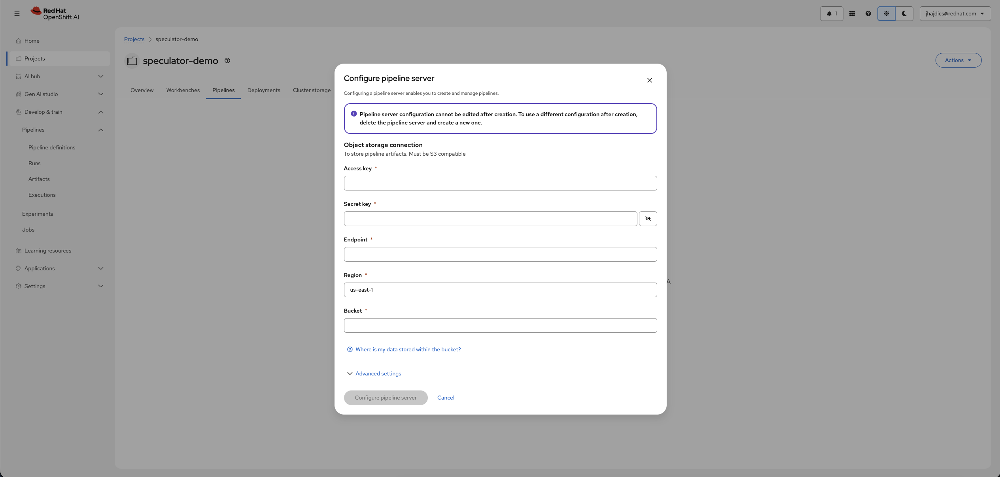
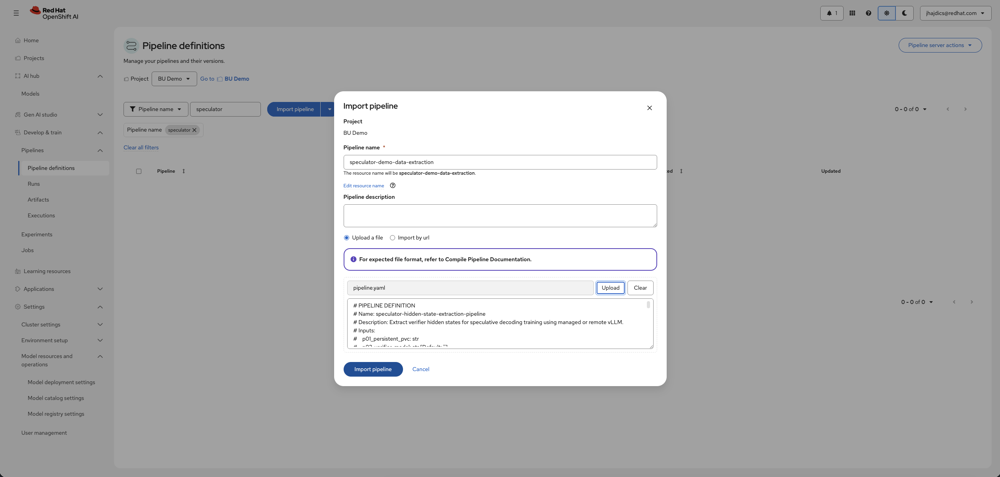
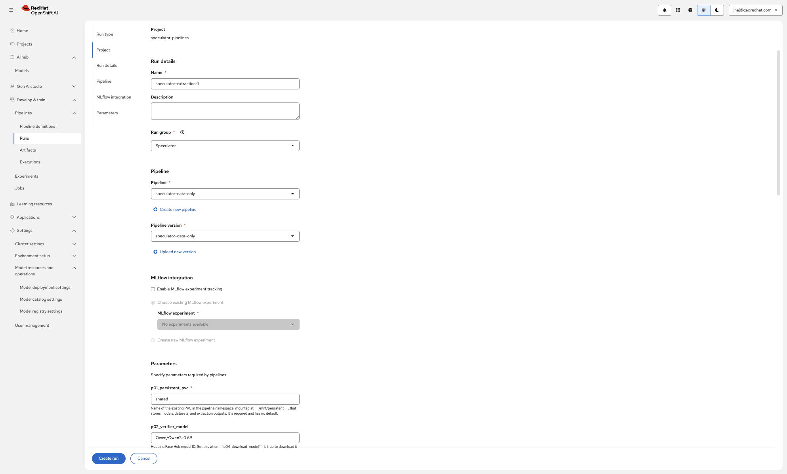

# Pipelines for Speculative Decoding Draft Model Training on Red Hat OpenShift AI

This guided example walks through training a custom Eagle3 draft model for speculative decoding using **Kubeflow Pipelines** on Red Hat OpenShift AI. It covers generating each pipeline definition from source, importing it into Red Hat OpenShift AI, running it, interpreting the evaluation results, and testing the served endpoint.

This example is tested on Red Hat OpenShift AI 3.6.

> [!WARNING]
>
> The upstream speculator pipelines may change. Re-generate the pipeline YAML after pulling upstream changes.

This page covers what is shared across all four modes — background, prerequisites, and the run instructions. Each mode has its own guide in a subfolder.

> [!TIP]
>
> Prefer driving TrainJobs directly from a notebook instead of pipelines? See the SDK-based examples at [`../../../rhoai-3.6/speculator/`](../../../rhoai-3.6/speculator/) — same four training modes, executed via the Kubeflow SDK `SpeculativeDecodingTrainer`.

## Contents

| Step | What it covers |
| --- | --- |
| **[1. Understand the pipelines](#1-understand-the-pipelines)** | [What speculative decoding is](#what-is-speculative-decoding) · [the four pipelines](#pipelines-overview) |
| **[2. Choose your mode](#2-choose-your-mode)** | [Match your goal](#1-match-your-goal-to-a-mode) · [resources](#2-check-the-resource-implications) · [access](#3-check-access) · [your path](#4-your-path-through-this-guide) |
| **[3. Check your cluster](#3-check-your-cluster)** | [Requirements](#requirements) · [hardware](#hardware-requirements) |
| **[4. Set up your project](#4-set-up-your-project)** | [RWX PVC](#existing-rwx-pvc) · [pipeline server](#configure-the-pipeline-server) · [credentials](#credentials) · [CTRs](#clustertrainingruntimes-ctrs) · [registry and KServe](#model-registry-and-kserve-train-only--online--offline) |
| **[5. Run a pipeline](#5-run-a-pipeline)** | [Compile](#1-generate-the-pipeline-yaml) · [import](#2-import-the-pipeline-into-red-hat-openshift-ai) · [create a run](#3-create-a-run-and-set-parameters) · [watch it](#4-watch-the-run) |
| **[6. Test the served endpoint](#6-test-the-served-endpoint)** | [Find it](#1-find-the-inferenceservice-and-its-url) · [model id](#2-discover-the-model-id) · [chat request](#3-send-a-chat-request) · [from your laptop](#4-access-from-your-laptop-optional) |
| **[7. Clean up](#7-clean-up)** | [Stop or delete the endpoint](#1-stop-restart-or-remove-the-serving-endpoint) · [when you are done](#2-when-you-are-done) |
| **[Reference](#reference)** | [Default verifier](#default-verifier-model) · [compile-time settings](#customizing-before-you-compile) · [troubleshooting](#troubleshooting) · [source](#source) |

Each mode has its own guide with a stage-by-stage walkthrough and its example parameter tables: [data-extraction](data-extraction/) · [train-only](train-only/) · [online](online/) · [offline](offline/).

## 1. Understand the pipelines

### What is Speculative Decoding?

Large language models generate tokens one at a time during inference. Each token requires reading the entire model from GPU memory (e.g., 140 GB for a 70B model in FP16), but the actual computation for one token is tiny. The GPU spends most of its time waiting for data to arrive from memory — running at under 1% compute utilization during normal token generation. This is called being **memory-bound**.

Speculative decoding exploits a key insight: verifying multiple tokens at once costs almost the same as generating one, because the expensive part (reading the model from memory) is identical and the GPU's compute units are idle anyway. A small, fast **draft model** quickly guesses the next several tokens, then the larger **verifier model** — `Qwen/Qwen3-0.6B` in these examples, kept deliberately small so an example run finishes quickly — checks all guesses at once in a single forward pass. Correct guesses become output; at the first rejected guess, the verifier's own token is used and the draft model starts guessing again. The output is mathematically identical to normal decoding — no quality loss.

For more background — why custom draft models matter after fine-tuning, and how the Eagle3 architecture reads hidden states from four intermediate verifier layers — see the [SDK example README](../../../rhoai-3.6/speculator/README.md#what-is-speculative-decoding).

### Pipelines Overview

There are four pipelines, one per training mode. Each is a separate pipeline definition in the [`pipelines-components`](https://github.com/red-hat-data-services/pipelines-components/tree/rhoai-3.6/pipelines/training/speculator) repository, with a subfolder here holding its guide:

| Pipeline | SDK-mode analog | Use Case | Guide |
| --- | --- | --- | --- |
| Hidden State Extraction | `DATA_ONLY` | First step of a two-step workflow. Extract hidden states once, then iterate on training many times. | [data-extraction/](data-extraction/) |
| Training | `TRAIN_ONLY` | Second step of the two-step workflow. Trains, evaluates, registers, and serves a draft from artifacts left by the extraction pipeline. | [train-only/](train-only/) |
| Online | `ONLINE` | Single Trainer job: a managed vLLM sidecar extracts hidden states on the fly while the draft trains. Simplest one-run path. | [online/](online/) |
| Offline | `OFFLINE` | Extraction via an external (user-managed) vLLM endpoint, then training — all in one run. For when you already run your own vLLM. | [offline/](offline/) |

Every pipeline that trains also **evaluates** the draft with GuideLLM (acceptance metrics), optionally **registers** it to the Kubeflow Model Registry (mandatory in train-only), and **serves** it with a KServe speculative-decoding endpoint.

[↑ Contents](#contents)

## 2. Choose your mode

Work through this page top to bottom before touching a cluster — by the end you should know your mode, know your cluster can support it, and know what (if anything) to request from your administrator.

### 1. Match your goal to a mode

| What do you need? | Choose | What must already be available? |
| --- | --- | --- |
| One run that manages extraction and training together | **ONLINE** | Capacity for the training worker and managed vLLM sidecar together; no external extraction server to prepare. |
| Extraction and training using a verifier endpoint you already operate | **OFFLINE** | A reachable, extraction-capable vLLM endpoint, compatible versions/layers, and shared PVC paths. An ordinary chat-serving endpoint is insufficient. The pipeline still needs training compute. |
| Reusable extraction outputs for separate training runs | **DATA_ONLY**, followed by **TRAIN_ONLY** | Extraction compute or an extraction-capable remote endpoint, plus persistent storage for the verifier, hidden states and preprocessed dataset. Extraction alone does not produce a trained draft. |
| Train another draft from compatible extraction outputs you already have | **TRAIN_ONLY** | The matching verifier weights, hidden states and preprocessed dataset on the PVC, training compute, and access to the required model registry. |

> [!TIP]
>
> **First time through?** ONLINE is the fewest moving parts — one run, nothing to wire between runs — but it needs **two GPUs together** in the Trainer pod. If that capacity is not available, or if you expect to tune hyperparameters more than once, run **DATA_ONLY** then **TRAIN_ONLY** instead: one GPU at a time, extraction paid for once, and a verification step on the PVC between the two.

### 2. Check the resource implications

For the default Qwen3-0.6B configuration: ONLINE needs **two GPUs together** in the Trainer pod (worker + sidecar); managed DATA_ONLY needs **one** extraction GPU; TRAIN_ONLY and OFFLINE need **one** pipeline GPU during their sequential GPU stages. Count the external OFFLINE server and any endpoints retained from previous runs separately — see [Hardware requirements](#hardware-requirements) and each mode guide's component table. A cluster-wide GPU count alone does not prove the pod can schedule: CPU, memory, GPU memory, and placement all matter.

### 3. Check access

Before you start, confirm with your administrator that you have access to what your selected mode needs: the project and its [pipeline server](#configure-the-pipeline-server), the Trainer [runtimes](#clustertrainingruntimes-ctrs), GPU resources, shared [RWX storage](#existing-rwx-pvc), and the [`kubernetes-credentials`](#credentials) secret — and, for the training modes, the [Model Registry and KServe serving](#model-registry-and-kserve-train-only--online--offline). On a restricted cluster, also confirm the pipeline, runtime, and serving images can be pulled. data-extraction needs none of that last group. If something is missing, ask your administrator to prepare it — the rest of this guide assumes it is in place.

### 4. Your path through this guide

1. This section — choose the mode.
2. [Set up your project](#prerequisites) — shared setup you do **once** per project.
3. [Run a pipeline](#quick-start) — compile the pipeline YAML, import it, create a run.
4. Your mode's guide — the parameter table, the stage-by-stage walkthrough, and how to verify that mode's actual outputs (extraction files before TRAIN_ONLY; evaluation metrics and a real endpoint request for the training modes).
5. [Testing the served endpoint](#testing-the-served-endpoint) — training modes only.
6. [Cleaning up](#cleaning-up) — release serving GPUs when you are done.

> [!NOTE]
>
> The example runs use deliberately small settings (16 extraction samples, 10 evaluation samples) — they prove the workflow end to end, not speedup. Establishing a speedup number requires a separate baseline run under matching conditions.

[↑ Contents](#contents)

## 3. Check your cluster

### Requirements

- An OpenShift cluster with Red Hat OpenShift AI **3.6** installed, with the **dashboard**, **trainer**, and **datasciencepipelines** components enabled; the **modelregistry** component is additionally required for the train-only pipeline (optional elsewhere)
- Component versions — the minimums declared by the pipeline source: Kubeflow Pipelines **>= 2.15.2**, Kubeflow Trainer **>= 0.1.0**, Kubernetes (OpenShift) **>= 1.28**; the training pipelines additionally need Model Registry **>= 0.3.4**, KServe **>= 2.10.0**, vLLM ServingRuntime **>= 0.24.0**
- Worker nodes with **NVIDIA GPUs** (Ampere or newer recommended) — the speculator runtimes are CUDA-based
- Python 3.11+ on your workstation or workbench, to generate the pipeline YAML
- A HuggingFace account and token (recommended, to avoid rate limits; Qwen3-0.6B is not gated)

Everything project-level — the pipeline server, the Trainer runtimes, and the shared RWX PVC — is prepared in [Set up your project](#prerequisites).

### Hardware requirements

Values below are for the default **Qwen3-0.6B** verifier. Requirements scale with verifier model size.

| Pipeline | Training GPU | vLLM sidecar GPU | Evaluation / Serving GPU | Peak concurrent pipeline GPUs |
| --- | --- | --- | --- | --- |
| data-extraction (managed vLLM) | — | 1 | — | 1 |
| data-extraction (remote vLLM) | — | — (external) | — | 0 |
| train-only | 1 | — | ~1 | 1 |
| online | 1 | 1 | ~1 | 2 |
| offline | 1 | — (external) | ~1 | 1 |

> [!NOTE]
>
> - The vLLM sidecar currently supports exactly 1 GPU (`p12_vllm_resource_gpu`).
> - Evaluation (GuideLLM) and the KServe endpoint each consume roughly one GPU while active.
> - Stages run sequentially — evaluation and serving start after the training job completes and reuse its freed GPUs, so the totals reflect **peak concurrent** usage: one pipeline GPU for train-only and offline, two for online (its training worker + vLLM sidecar run together in one Trainer pod).
> - Offline mode — and data-extraction in remote mode — uses your external vLLM server's own resources — size it separately, on top of the pipeline totals.
> - Every training run leaves a GPU-backed endpoint behind. If you do not [clean it up](#cleaning-up), its GPU counts toward the cluster total during your *next* run.

[↑ Contents](#contents)

<a id="prerequisites" name="prerequisites"></a>

## 4. Set up your project

Work through the setup your mode needs:

| Setup | Who does it | data-extraction | train-only / online / offline |
| --- | --- | --- | --- |
| [RWX PVC](#existing-rwx-pvc) | you | Required | Required |
| [Pipeline server](#configure-the-pipeline-server) | administrator | Required | Required |
| [Credentials](#credentials) | administrator | Required | Required |
| [CTRs](#clustertrainingruntimes-ctrs) | administrator | Required | Required |
| [Model Registry](#model-registry-and-kserve-train-only--online--offline) | administrator, then you | Not needed | Mandatory for train-only, optional for online/offline |
| [KServe serving](#model-registry-and-kserve-train-only--online--offline) | administrator | Not needed | Required |

data-extraction skips the last two rows because it does not train, serve, or register. [Run a pipeline](#quick-start) assumes every applicable row is done.

> [!NOTE]
>
> **Project** and **namespace** are the same thing: the dashboard says project, `oc` and the pipeline parameters say namespace — use that one name in every `<project-namespace>` placeholder below. The `oc` commands in this guide (verification, endpoint testing, troubleshooting) assume you ran `oc login` and `oc project <project-namespace>` in that terminal: selecting a project in the dashboard does **not** change your terminal's namespace. No project yet? Create one in the dashboard under **Develop & train > Data Science Projects > Create data science project** — see [Create a project](https://docs.redhat.com/en/documentation/red_hat_openshift_ai_self-managed/latest/html/getting_started_with_red_hat_openshift_ai_self-managed/creating-a-project_get-started).

### Existing RWX PVC

All models, datasets, hidden states, checkpoints and outputs live on one shared PersistentVolumeClaim that must exist before you run anything. `p01_persistent_pvc` names it, the pipelines mount it at `/mnt/persistent`, and they never create or resize it.

> [!IMPORTANT]
>
> Every run involves **two** PVCs:
>
> 1. **Yours** (`p01_persistent_pvc`) — the verifier, datasets, hidden states, checkpoints and final draft. Must be RWX and in the same namespace as the pipeline and the serving endpoint; PVCs cannot be mounted across namespaces.
> 2. **The KFP workspace PVC** — created by the pipeline at run time for its launcher tasks (200Gi, `nfs-csi`, RWX), fixed at compile time; see [Customizing before you compile](#customizing-before-you-compile).
>
> Run one pipeline at a time against a given PVC: concurrent runs share the PVC-root `final_model` path, so one run's evaluation or serving stage can load another run's draft.

Create it once in the dashboard: **Cluster storage > Add cluster storage**, name `shared`, size 100Gi, and pick a **ReadWriteMany** storage class explicitly — the default class is often RWO-only, which leaves the claim `Pending` or mounted read-only. See [Configure cluster storage](https://docs.redhat.com/en/documentation/red_hat_openshift_ai_self-managed/latest/html/working_on_projects/configuring-cluster-storage_projects) in the Red Hat OpenShift AI documentation for the procedure.


Verify with `oc get pvc shared` — expect `STATUS Bound`.

> [!TIP]
>
> Attaching the PVC to a workbench is optional and separate; the pipelines mount it themselves. Attach it only if you want a terminal for inspecting what the runs wrote to the PVC.

### Configure the pipeline server

The pipeline server must be running for your project before you can import or run pipelines. This is an **administrator task, and the first one** — configuring a pipeline server stores the object-storage credentials in a Secret, so ask your administrator to do it: in the dashboard, open the project, choose the **Pipelines** tab, and click **Configure pipeline server**, providing the S3-compatible bucket it asks for (pipeline artifacts land there). See [Configure a pipeline server](https://docs.redhat.com/en/documentation/red_hat_openshift_ai_self-managed/latest/html/working_with_ai_pipelines/managing-ai-pipelines_ai-pipelines#configuring-a-pipeline-server_ai-pipelines) in the Red Hat OpenShift AI documentation.



You can verify it is ready yourself: the project's **Pipelines** tab shows the **Pipeline definitions** page instead of a configuration prompt.

### Credentials

Before the first run, the administrator creates these Secrets in the project namespace — see [Using connections](https://docs.redhat.com/en/documentation/red_hat_openshift_ai_self-managed/latest/html/working_on_projects/using-connections_projects) in the Red Hat OpenShift AI documentation for creating secrets and connections. The pipelines submit Trainer jobs through the Kubernetes API, so `kubernetes-credentials` is required by all four pipelines — its token belongs to the pipeline runner ServiceAccount the pipeline server creates, is mounted only in the KFP launcher tasks (never forwarded to Trainer workers), and can expire.

| Secret | Keys | When required |
| --- | --- | --- |
| `kubernetes-credentials` | `KUBERNETES_SERVER_URL`, `KUBERNETES_AUTH_TOKEN` | Every run; use credentials for the same cluster as the pipeline. |
| `hf-token` | `HF_TOKEN` | Gated models or rate-limit-free downloads only — Qwen3-0.6B is not gated, so this example runs without it. |

### ClusterTrainingRuntimes (CTRs)

The Trainer jobs reference CTRs by name via the `pNN_job_runtime` parameter. Check what is installed:

```bash
oc get clustertrainingruntimes
```

| CTR name | Used by |
| --- | --- |
| `vllm-extract-cuda` | data-extraction (managed mode), online |
| `speculator-model-opt-cuda` | train-only, offline, data-extraction (remote mode) |

If missing, follow the [SDK example's CTR instructions](../../../rhoai-3.6/speculator/README.md) or deploy them from the Kubeflow Trainer runtime definitions.

### Model Registry and KServe (train-only / online / offline)

The train-only pipeline **always** registers the draft — a reachable registry is mandatory there; online and offline skip registration when the registry address is left empty. If no registry exists yet, your administrator can follow the [model registry creation instructions](https://docs.redhat.com/en/documentation/red_hat_openshift_ai_self-managed/latest/html/managing_model_registries/index) in the Red Hat OpenShift AI documentation.


What must already be available:

- **A Model Registry** your user can view in the dashboard (**AI Hub > Models > Registry**) and the pipeline runner can register into — creating it and binding its `registry-user-<registry-name>` Role to both identities (the runner for registration, your user for the dashboard view) are administrator tasks.
- **A serving namespace** that reaches the persistent PVC and lets the pipeline runner manage ServingRuntimes and InferenceServices — your project namespace is the simplest setup that works. Serving also reads the GPU HardwareProfile in `redhat-ods-applications`; without it the serve stage fails at InferenceService creation.

Each registry has a dedicated REST route named after it — the dashboard shows it on the registry's page. The pipeline parameters are the route URL **including the `https://` scheme** and the HTTPS port:

| Parameter (train-only names) | Value |
| --- | --- |
| `p02_model_registry_address` | `https://<registry-name>-rest.apps.<cluster-domain>` |
| `p45_model_registry_port` | `443` |

Use the `-rest` route, not the dashboard URL, and keep the `https://` scheme — the failure modes are in [Troubleshooting](#troubleshooting). In-cluster alternative: the registry Service, `model-registry-<name>.<namespace>.svc` (no scheme), port `8080` — ask an administrator for the name.

[↑ Contents](#contents)

<a id="quick-start" name="quick-start"></a>

## 5. Run a pipeline

The steps below use the data-extraction pipeline as the worked example, but the flow is identical for all four modes — only the parameters differ (each mode's guide has its parameter table). Work through [Set up your project](#prerequisites) first and complete each section's checks before importing anything — only the PVC is yours to create, so request the administrator tasks early.

### 1. Generate the pipeline YAML

The compiled pipeline YAML is not included in this repository — you generate it from the pipeline source in `pipelines-components`. Each pipeline's `pipeline.py` compiles itself when executed, writing `pipeline.yaml` beside it.

**Requirements:** Python 3.11+ and the KFP SDK. Do this on your own computer: compiling is a purely local step — it needs no cluster access and no workbench, and the first time the cluster is involved is [importing the result](#2-import-the-pipeline-into-red-hat-openshift-ai).

```bash
# Clone the rhoai-3.6 branch, matching the supported Red Hat OpenShift AI release
git clone --branch rhoai-3.6 https://github.com/red-hat-data-services/pipelines-components.git
cd pipelines-components

# Set up an isolated environment
python3 -m venv .venv
source .venv/bin/activate

# Pin the KFP SDK to the version your cluster's task images can install,
# then install the repository without letting pip float those pins. The
# install is required: the pipelines import shared `kfp_components`
# modules and compilation fails with ModuleNotFoundError without it.
pip install 'kfp==2.16.1' 'kfp-kubernetes==2.16.1'
pip install -e . --no-deps

# Compile the pipeline you want (one of: data_extraction, train_only, online, offline)
PYTHONPATH=$(pwd) python pipelines/training/speculator/data_extraction/pipeline.py

# The compiled pipeline is written next to its source:
# pipelines/training/speculator/data_extraction/pipeline.yaml
```

Repeat the last command for each mode you plan to run. To compile all four at once:

```bash
for mode in data_extraction train_only online offline; do
  PYTHONPATH=$(pwd) python "pipelines/training/speculator/$mode/pipeline.py"
done
```

> [!NOTE]
>
> - **Keep the version pins.** The KFP version you compile with is baked into every task, and the task pods do not all share one package index — a wrong pin fails tasks with `No matching distribution found` ([troubleshooting](#troubleshooting)).
> - Verify what landed before importing: `grep -o "kfp==[0-9][0-9.]*" pipelines/training/speculator/<mode>/pipeline.yaml | sort -u`. Expect **two** entries: `kfp==2.16.1`, baked into every task, and `kfp==2.17.0`, which the evaluation component installs itself.

**Expected result:** four `pipeline.yaml` files (or the one you need), one under each `pipelines/training/speculator/<mode>/` directory. Each is roughly 100–200 KB.

### 2. Import the pipeline into Red Hat OpenShift AI

1. In the Red Hat OpenShift AI dashboard, click **Develop & train** in the left navigation.
2. Choose **Pipelines**.
3. If the pipeline server was just configured, wait until the **Pipeline definitions** page loads without a configuration prompt.
4. Click **Import pipeline** (the button at the top of the **Pipeline definitions** page).
5. In the dialog:
   - **Name**: a display name, e.g. `speculator-hidden-state-extraction`
   - **Pipeline file**: select **Upload a file** and choose the `pipeline.yaml` you compiled in step 1.
6. Click **Import**.



**Expected result:** the pipeline appears in the **Pipeline definitions** list under the **display name you entered in the dialog** — imported definitions are listed by that name, not by the name embedded in the YAML.


### 3. Create a run and set parameters

1. On the **Pipeline definitions** page, click the imported pipeline.
2. Open the **Actions** menu on the definition page and choose **Create run**.

   

3. In the run form:
   - **Run name**: something meaningful, e.g. `speculator-extraction-1`
   - **Run group**: leave the default run group or create one — this only groups runs in the UI
   - **MLflow integration**: clear the **Enable MLflow experiment tracking** checkbox — it is **checked by default**, so you have to untick it. These pipelines have not been tested with an MLflow experiment association, and leaving it on may cause the run to fail or behave unexpectedly.
   - **Parameters**: fill in the values from the mode's example table (linked below). Parameters appear in `p01…` order, each with its own description underneath — booleans render as **True/False** radio buttons, numbers as steppers, and everything with a default can be left alone unless the table says otherwise.
4. Click **Create run**.



The ready-to-copy parameter tables:

- [data-extraction](data-extraction/README.md#example-qwen3-06b)
- [train-only](train-only/README.md#example-qwen3-06b)
- [online](online/README.md#example-qwen3-06b)
- [offline](offline/README.md#example-qwen3-06b)

### 4. Watch the run

1. From the run confirmation (or **Pipelines > Runs**), open the run. The pipeline graph shows each task as a node.
2. Node colors track state: pending, running, succeeded, failed.
3. Click any node to open its detail pane — **Logs** for stdout/stderr, **Artifacts** for its outputs.
4. Tasks run sequentially in these pipelines (extraction before training, training before evaluation, etc.), so a failure early in the graph stops everything downstream. The failing node's logs are the first place to look.


When the run succeeds, continue with the mode's guide — for the two-step workflow that means checking that the extraction run wrote `hidden_states/` under its output directory on the shared PVC, then the [train-only pipeline](train-only/README.md), whose guide covers [interpreting the evaluation results](train-only/README.md#10-interpreting-the-evaluation-results).

[↑ Contents](#contents)

<a id="testing-the-served-endpoint" name="testing-the-served-endpoint"></a>

## 6. Test the served endpoint

Every training pipeline leaves a **cluster-local** KServe InferenceService behind — the procedure below was verified against a live Red Hat OpenShift AI 3.6 cluster. For mode-specific details, see the train-only guide's [Testing the served endpoint](train-only/README.md#11-testing-the-served-endpoint); for background on model serving in general, see [Deploying models](https://docs.redhat.com/en/documentation/red_hat_openshift_ai_self-managed/latest/html/deploying_models/index) in the Red Hat OpenShift AI documentation.

> [!IMPORTANT]
>
> The endpoint is **cluster-local**: its URL is `<name>-predictor.<namespace>.svc.cluster.local` and resolves **only inside the cluster**. Running `curl` against it from your laptop fails with `Could not resolve host` — that is expected, not a broken deployment.

### 1. Find the InferenceService and its URL

```bash
oc get inferenceservice -n <project-namespace>
```

The `URL` column shows the cluster-local address. Note the deployment name is `<name>-predictor`.

### 2. Discover the model id

This is the step people get wrong: the vLLM server registers the model under the **InferenceService name**, not the verifier model ID. Ask it:

```bash
oc exec -n <project-namespace> deploy/<name>-predictor -c kserve-container -- \
  curl -s localhost:8080/v1/models
```

The response's `data[0].id` is the model id to use in requests.

### 3. Send a chat request

Run this from anywhere `oc` is logged in — the command executes inside the predictor container:

```bash
oc exec -n <project-namespace> deploy/<name>-predictor -c kserve-container -- \
  curl -s localhost:8080/v1/chat/completions \
  -H "Content-Type: application/json" \
  -d '{"model": "<name>", "messages": [{"role": "user", "content": "What is the capital of France?"}], "max_tokens": 200}'
```

The answer is in `choices[0].message.content`. To print just that, append `| jq -r '.choices[0].message.content'`.

### 4. Access from your laptop (optional)

Use port-forwarding:

```bash
oc port-forward -n <project-namespace> deploy/<name>-predictor 5000:8080
```

Then `curl http://localhost:5000/v1/models` (and the chat request with `http://localhost:5000/...`) from any local terminal.

> [!WARNING]
>
> Forward to the **container** port `8080`, not the Service's port. `oc port-forward` performs no Service port translation — it dials a port **inside the pod's network namespace**, where the vLLM server listens on 8080. Forwarding to the Service's port 80 yields `connection refused` even though everything is healthy. Keep the port-forward terminal open; re-run the command if it drops.

For an interactive session (repeated questions, or a conversation that keeps history), port-forward once as in step 4 and drive `http://localhost:5000` with curl or a small script — every request is independent unless you pass the full message history yourself.

[↑ Contents](#contents)

<a id="cleaning-up" name="cleaning-up"></a>

## 7. Clean up

Every training run leaves a **GPU-backed KServe endpoint** behind, and offline mode — or data-extraction in remote mode — additionally depends on your **external extraction server**. Neither needs to keep running after verification — release the GPUs while keeping the data that matters.

### 1. Stop, restart or remove the serving endpoint

Train-only, online and offline each leave one behind. The endpoint the run created is listed in the dashboard under **AI Hub > Models > Deployments**. Its action menu offers the three things you need:

| Action | What happens | When to use it |
| --- | --- | --- |
| **Stop** | KServe deletes the predictor pods and releases the GPU, keeping the InferenceService | You are done for now but expect to query the endpoint again |
| **Start** | Recreates the predictor from the same InferenceService — no pipeline re-run | Resuming a stopped endpoint; the first request is slow again while vLLM loads the model |
| **Delete** | Removes the InferenceService, its predictor and the GPU it held, permanently | You are finished with this draft, or you want the name free for the next run |

A stopped InferenceService reports `Stopped=True` in its status conditions, so `READY False` means paused, not broken. If the pipeline created a dedicated ServingRuntime for the run, that is a separate object — delete the runtime too. From the CLI, `oc get pods -n <project-namespace> | grep predictor` should return nothing once the GPUs are free; `oc delete inferenceservice <name> -n <project-namespace>` is the equivalent of **Delete**.

### 2. When you are done

- **Stop the external extraction server** — offline runs, and data-extraction runs with `p10_vllm_mode=remote`. Its GPUs are outside the pipeline's control: scale it to zero or tear it down however you deployed it.
- **Data survives shutdown.** The PVC — verifier, hidden states, processed datasets, `final_model` — is untouched by endpoint deletion, and Model Registry entries survive. But remember the weights-swap warning in each mode guide: registry versions reference the shared `final_model` path on the PVC, so a later rerun changes what a previously registered version points at. Copying `final_model` to a unique path preserves the **files** but does **not** repoint the registry — to keep a registered revision tied to its original weights, run the next revision against a **separate PVC**, or re-register the preserved copy as a **new version** pointing at its unique path.
- **Tidy the pipeline UI** (optional) — delete finished runs from the **Pipelines > Runs** page if the list gets noisy; this does not affect endpoints, PVCs, or registry entries.

[↑ Contents](#contents)

## Reference

### Default verifier model

These examples standardize on **`Qwen/Qwen3-0.6B`** with `target_layer_ids = "2,14,25,28"` (the four intermediate verifier layers Eagle3 reads). **`meta-llama/Llama-3.2-1B-Instruct`** has also been run end-to-end successfully on Red Hat OpenShift AI 3.6 with these pipelines.

The layer IDs are **verifier-specific**: they name four layers *of the verifier model*, and a wrong set fails at training time with a tensor shape mismatch. For Qwen3-0.6B use `2,14,25,28`; for any other verifier, look up that model's four Eagle3 target layers (see the [SDK example's guidance](../../../rhoai-3.6/speculator/README.md#speculator-specific-considerations)) — do not reuse Qwen's IDs for a different architecture.

### Customizing before you compile

Most settings — models, datasets, paths, hyperparameters, resources — are run-time parameters you fill in when creating the run. A few are baked in at compile time and can only be changed by editing the pipeline source before running step 1:

| Setting | Where | Default |
| --- | --- | --- |
| KFP workspace PVC size | `PVC_SIZE` in the mode's `pipeline.py` | `200Gi` |
| KFP workspace PVC storage class | `PVC_STORAGE_CLASS` in the mode's `pipeline.py` | `nfs-csi` |
| KFP workspace PVC access modes | `PVC_ACCESS_MODES` in the mode's `pipeline.py` | `["ReadWriteMany"]` |

Edit the constants near the top of the file, then re-run the compile command. `nfs-csi` will not exist on many clusters — check with `oc get storageclass` and substitute your RWX class.

### Troubleshooting

Compile and run-time problems, ordered roughly by when you'd hit them:

| Symptom | Diagnosis | Fix |
| --- | --- | --- |
| Compile fails: `ModuleNotFoundError: No module named 'kfp_components'` | The `pipelines-components` repo was not installed as a package | Run `pip install -e .` from the repository root |
| Compile fails: `ModuleNotFoundError: No module named 'components'` | `PYTHONPATH` not set to the repository root | Prefix the command with `PYTHONPATH=$(pwd)` and run it from the repo root |
| `pip install -e .` fails to resolve dependencies | Your package index (e.g. an internal mirror) doesn't carry a required package or version | On a Linux (el9) host, install the repo's hash-pinned set instead: `pip install -r requirements.txt`, then `pip install -e . --no-deps` |
| Import into Red Hat OpenShift AI rejected | YAML built with an incompatible KFP SDK version | Re-compile with the pinned versions in [step 1](#1-generate-the-pipeline-yaml) |
| A task fails with `No matching distribution found for kfp==<version>` | Every task installs the KFP version baked in at compile time, and the task pods do not all use the same package index — the registration task's image is pinned to an older one than the rest | Re-compile with the pin in [step 1](#1-generate-the-pipeline-yaml). The error lists what that pod can reach (`from versions: …`); the pin has to be a version every task's index offers, which is why this guide uses `2.16.1` |
| Evaluation fails with a tensor shape error on the draft's `fc` weights | The draft's `config.json` and its weights disagree on the number of auxiliary layers. The export that reconciles them runs in the Trainer job, so it depends on the runtime image and the `speculators` version installed by `pNN_packages_to_install` — not on the pipeline source | Check the training log for `Updated … Eagle3 draft config.json file(s) (target_hidden_size=…)`, and that `pNN_packages_to_install` pins `speculators==0.6.0.1`. Without that pin, the runtime image's own `speculators` build decides the export |
| "Configure pipeline server" prompt never goes away | Pipeline server not configured for the project — an administrator task | Ask your administrator to configure it, then re-check with `oc get serviceaccounts -n <project-namespace> \| grep pipeline-runner`; see [Configure the pipeline server](#configure-the-pipeline-server) |
| Run fails immediately with `storageclass.storage.k8s.io "nfs-csi" not found` | Cluster has no `nfs-csi` storage class; the KFP workspace PVC cannot be created | Find your RWX class with `oc get storageclass`, then [recompile](#customizing-before-you-compile) with your class name |
| PVC stuck `Pending` | No RWX dynamic provisioner, or capacity exhausted | Talk to your cluster admin; RWX storage is required |
| Trainer submit task fails with 401/403 | `kubernetes-credentials` secret missing, or its token expired (every run failing at job submission, sudden "runs stop starting", is the symptom) or lacks Trainer permissions | Ask your administrator to create or renew it — see [Credentials](#credentials) |
| Run fails with ClusterTrainingRuntime not found | CTR from `pNN_job_runtime` not deployed | `oc get clustertrainingruntimes`; deploy the missing runtime |
| Training pod OOM-killed | Verifier too large for defaults, or `gpu_memory_utilization` too high | Raise `pNN_training_resource_memory`; lower `gpu_memory_utilization` |
| Registry task fails with connection refused or 404 | Registry address wrong — the `https://` scheme dropped from the `-rest` route (plain HTTP to a TLS endpoint), or the dashboard URL used instead of the route — or the registry RoleBinding is missing | Use `https://<registry-name>-rest.apps.<cluster-domain>` with port `443` — not the dashboard URL — or the in-cluster Service `model-registry-<name>.<namespace>.svc` (no scheme) with port `8080`; the RoleBinding is described in [the registry prerequisites](#model-registry-and-kserve-train-only--online--offline) |
| Training fails: `HFValidationError: Repo id must be in the form 'repo_name' or 'namespace/repo_name'` | `verifier_model_pvc` uses the HuggingFace model ID format (e.g. `models/Qwen3-0.6B`) instead of the on-disk directory name | The download task replaces `/` with `--` in the model ID. Use the actual directory name: `models/Qwen--Qwen3-0.6B`. List `models/` on the shared PVC to confirm |
| Model download fails with 401 | Gated model without `hf-token` secret | Ask your administrator to create the `hf-token` secret |
| `curl: Could not resolve host: <name>-predictor.<ns>.svc.cluster.local` | The URL is cluster-local; you are off-cluster (e.g. your laptop) | Run the request from inside the cluster via `oc exec`, or use `oc port-forward` — see [Testing the served endpoint](#testing-the-served-endpoint) |
| `connection refused` when port-forwarding to port 80 | The predictor container listens on **8080**; port-forward does no Service port translation | Forward to the container port: `oc port-forward ... 5000:8080` |
| Chat request returns "model not found" | Wrong model id — the server registers the model under the **InferenceService name**, not the verifier model ID | Discover the id with `oc exec ... -- curl -s localhost:8080/v1/models` |
| First request to the endpoint hangs or is refused | vLLM still loading the model into GPU, or KServe scaled the predictor to zero and it is waking | Check `oc get inferenceservice` shows `True`, check the predictor pod is `Running`, wait, retry |
| Older registry versions break after a re-run | `final_model` on the PVC is overwritten each run | Preserve the revision's weights as described in [When you are done](#2-when-you-are-done) — a separate PVC, or re-register the preserved copy as a new version |

More mode-specific symptoms are in each subfolder's guide.

### Source

The pipelines documented here live in [`red-hat-data-services/pipelines-components`](https://github.com/red-hat-data-services/pipelines-components/tree/rhoai-3.6/pipelines/training/speculator) under `pipelines/training/speculator/`, on the **`rhoai-3.6`** branch — the one this guide compiles from, and the one whose runtime images match Red Hat OpenShift AI 3.6. The example parameter tables in the mode guides are derived from that branch's pipeline sources and READMEs; the full parameter lists are documented in the pipeline directories' own READMEs. The pipelines still change within a release branch, so re-generate your YAML after pulling `rhoai-3.6` and re-check the parameter list against the imported definition.

[↑ Contents](#contents)
