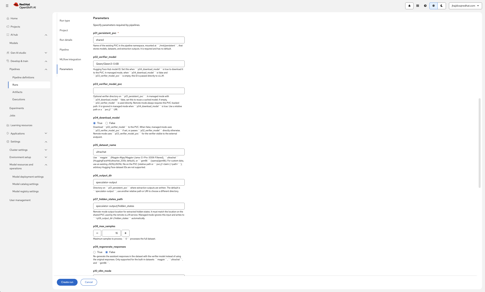
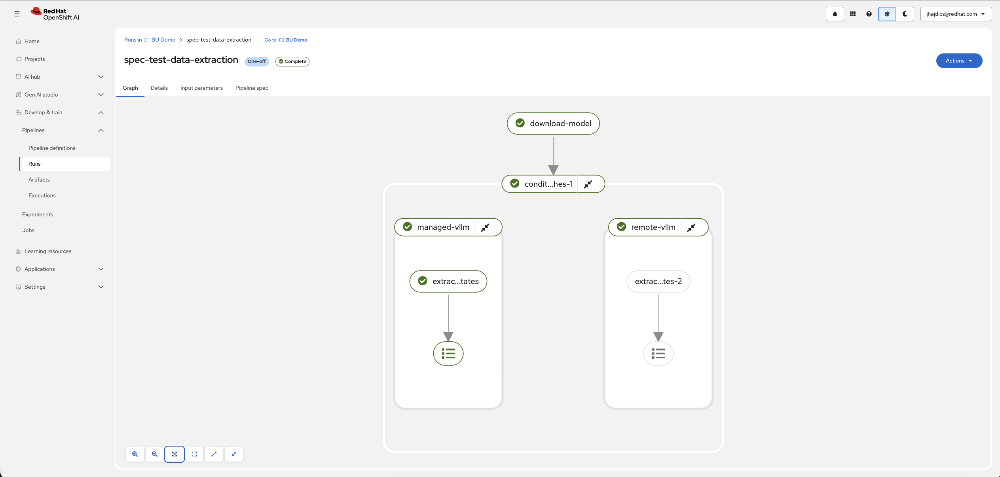
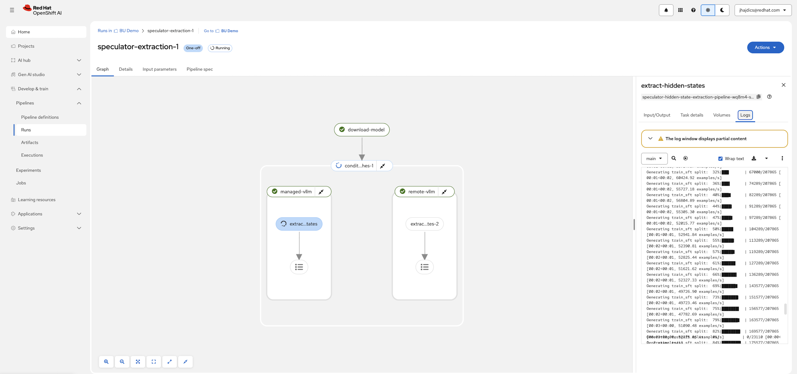

# Hidden State Extraction Pipeline (DATA_ONLY)

This pipeline creates the reusable training inputs for an Eagle3 speculative-decoding draft model. It processes samples from a supported dataset, runs them through the verifier model, and saves both the processed data and hidden-state tensors captured from selected verifier layers to the shared PVC. The [train-only pipeline](../train-only/) uses these artifacts to train the draft model, so you can repeat training experiments without extracting the same data again. This pipeline prepares data only; it does not train, evaluate, register, or serve a model.

Choose this two-step workflow when you want to reuse extraction results across training experiments. For a single run that combines extraction and training, see the [online](../online/) or [offline](../offline/) pipeline guides.

## Before you start

Complete the shared cluster and project setup in the [main Speculator pipelines guide](../README.md), especially [cluster requirements](../README.md#3-check-your-cluster) and [project prerequisites](../README.md#prerequisites). That guide covers the project, pipeline server, credentials, shared RWX PVC, and common hardware requirements; this page covers only extraction-specific requirements.

### Confirm the ClusterTrainingRuntime (CTR)

Confirm that the CTR for your selected mode is available. The [main guide's CTR section](../README.md#clustertrainingruntimes-ctrs) explains how to check installed runtimes.

| Mode | Required CTR |
| --- | --- |
| Managed vLLM | `vllm-extract-cuda` |
| External vLLM | `speculator-model-opt-cuda` |

### Choose an extraction mode

Choose the mode before creating the run. The main guide's [hardware requirements](../README.md#hardware-requirements) cover GPU capacity for each mode.

| Mode | How it works | Before you run |
| --- | --- | --- |
| **Managed** (recommended for a first run) | A vLLM sidecar in the extraction job serves the verifier. | Requires the `vllm-extract-cuda` CTR and one GPU for the sidecar. No external endpoint is needed. |
| **External** | The extraction job sends requests to a vLLM endpoint you operate. | Requires the `speculator-model-opt-cuda` CTR and an endpoint enabled for hidden-state extraction. The endpoint must access the verifier and write hidden states on the shared PVC; its GPUs are managed separately. |

> [!NOTE]
>
> To set up external vLLM, refer to the [external vLLM example and setup instructions](../../../../rhoai-3.6/manifests/external-vllm/README.md), including its [tested manifest](../../../../rhoai-3.6/manifests/external-vllm/vllm-server.yaml). A standard vLLM chat endpoint does not provide hidden-state extraction. The [offline pipeline guide](../offline/README.md#external-vllm-server) has additional endpoint-configuration details; use `p11_vllm_endpoint` and the extraction-specific paths shown below.

## Run the pipeline

Follow these steps in order. The [main guide](../README.md#quick-start) has the shared compilation and Dashboard instructions; the steps here give the extraction-specific command and values.

### 1. Generate the pipeline YAML

Complete the common environment setup in [Generate the pipeline YAML](../README.md#1-generate-the-pipeline-yaml). From the root of the `pipelines-components` checkout on the `rhoai-3.6` branch, compile data extraction:

```bash
PYTHONPATH=$(pwd) python pipelines/training/speculator/data_extraction/pipeline.py
```

The generated file is `pipelines/training/speculator/data_extraction/pipeline.yaml`.

### 2. Import the pipeline and create a run

In the Red Hat OpenShift AI Dashboard:

1. Open **Develop & train → Pipelines → Pipeline definitions** in the project prepared for this example.
2. Import the generated `pipeline.yaml`. If the definition already exists, upload it as a new version.
3. Open the imported definition and choose **Actions → Create run**.
4. Name the run, leave **Enable MLflow experiment tracking** unchecked, and enter the parameters below. See the main guide's [import](../README.md#2-import-the-pipeline-into-red-hat-openshift-ai) and [create-run](../README.md#3-create-a-run-and-set-parameters) instructions for the full Dashboard walkthrough.

### 3. Configure the run

The following is a small managed-mode example using Qwen3-0.6B:

| Parameter | Value | Notes |
| --- | --- | --- |
| `p01_persistent_pvc` | `shared` | Name of your existing RWX PVC, prepared in the [shared project setup](../README.md#existing-rwx-pvc). |
| `p02_verifier_model` | `Qwen/Qwen3-0.6B` | Hugging Face verifier model ID. The pipeline downloads it because `p04_download_model=true`. |
| `p04_download_model` | `true` | Downloads and caches the verifier on the PVC. |
| `p05_dataset_name` | `ultrachat` | Built-in `HuggingFaceH4/ultrachat_200k` dataset. Other built-ins are `magpie` and `gsm8k`; custom data must be a JSON/JSONL file on the PVC. Arbitrary Hugging Face dataset IDs are not supported. |
| `p06_output_dir` | `speculator-output` | PVC directory for the processed dataset and extraction outputs. Choose a fresh directory when you need a new extraction. |
| `p08_max_samples` | `16` | Small example run. Set to `0` to process the full dataset. |
| `p10_vllm_mode` | `managed` | Runs vLLM as a sidecar in the extraction job. |
| `p18_target_layer_ids` | `2,14,25,28` | Required for this downloaded verifier. Enter exactly four verifier-specific layer indices; these values are for Qwen3-0.6B only. See the main guide's [verifier guidance](../README.md#default-verifier-model) for other models. |
| `p20_packages_to_install` | `speculators==0.6.0.1,torchvision==0.24.0` | Comma-separated packages installed in the extraction job. |

Everything else can keep its default. The Dashboard's **Parameters** step shows each field's description below its input:



For **external vLLM** mode, keep the shared values above and change these parameters:

- `p10_vllm_mode`: `remote`
- `p11_vllm_endpoint`: URL of your external vLLM endpoint
- `p03_verifier_model_pvc`: verifier directory on the shared PVC that the endpoint can access. Remote mode always needs a PVC-backed verifier; if `p04_download_model=true`, point this to the downloaded model directory.
- `p07_hidden_states_path`: PVC path matching the external server's `shared_storage_path`
- `p23_job_runtime`: `speculator-model-opt-cuda`

`p18_target_layer_ids` is also required in external mode. Prepare the endpoint and confirm it is reachable from the project before starting the run.

### 4. Start and monitor the run

Click **Create run**, then open it from **Pipelines → Runs**. The graph shows the optional model-download task followed by extraction. Select a task to view its logs and status.

With managed mode, logs may be quiet while the vLLM sidecar loads the verifier; this is expected. For the 16-sample Qwen3-0.6B example, allow several minutes for startup and roughly 10–20 minutes for extraction, depending on cluster load.





### 5. Continue with train-only

When the run shows **Succeeded** in **Pipelines → Runs**, continue with the [train-only pipeline](../train-only/README.md). Keep these values aligned:

- Use the same PVC.
- Set train-only `p08_training_data_path` to the extraction `p06_output_dir`.
- Set train-only `p09_hidden_states_path` to `<p06_output_dir>/hidden_states` for managed mode, or to `p07_hidden_states_path` for external mode.
- Match train-only `p13_target_layer_ids` to extraction `p18_target_layer_ids`, and train-only `p11_total_seq_len` to extraction `p16_total_seq_len`.

The train-only guide's [wiring section](../train-only/README.md#6-wiring-it-to-a-data-extraction-run) has the complete parameter mapping.

## Troubleshooting

| Symptom | What to check |
| --- | --- |
| Run cannot find a CTR | Confirm the CTR for the selected mode is installed; see [CTR requirements](../README.md#clustertrainingruntimes-ctrs). |
| Managed vLLM does not become ready | Check the extraction task logs, verifier size, and available GPU memory; increase `p15_vllm_readiness_timeout_minutes` if startup needs more time. |
| External endpoint is unreachable or produces no hidden states | Confirm it is reachable from the project, supports hidden-state extraction, can access the verifier on the shared PVC, and writes to the configured `p07_hidden_states_path`. |
| Hidden states are missing or stale | Confirm the selected mode's output path and use a fresh `p06_output_dir` for a new extraction. |
| Model download returns 401 | The Hugging Face model requires an `hf-token` secret; ask the administrator to configure it as described in the [shared prerequisites](../README.md#credentials). |

For common compile-time issues, see the main guide's [troubleshooting section](../README.md#troubleshooting).
