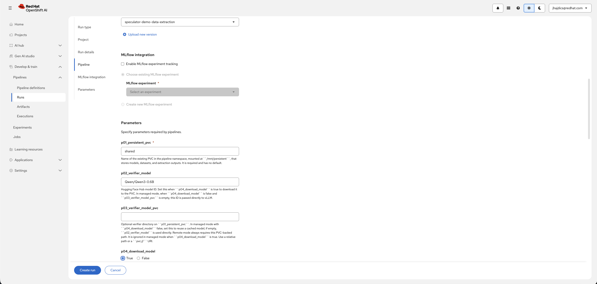

# Hidden State Extraction Pipeline (DATA_ONLY)

This guide covers the **speculator-hidden-state-extraction-pipeline** — the first step of the two-step speculator workflow. It extracts verifier hidden states for Eagle3 draft-model training. It does **not** train.

> [!WARNING]
>
> This pipeline may change. Re-generate the YAML after pulling upstream changes.

## 1. When to use this pipeline

- **Extract once, iterate many.** Hidden-state extraction is the expensive, one-time part of draft-model training. Run this pipeline once, then re-run the [train-only pipeline](../train-only/) as many times as you like while tuning hyperparameters — without paying for extraction again.
- Skip it entirely if you want a single-run workflow — use the [online](../online/) or [offline](../offline/) pipelines instead.

## 2. How it works

1. (Optional) A **download-model** task pulls `p02_verifier_model` from HuggingFace onto the PVC when `p04_download_model` is true.
2. A single **Trainer job** runs the extraction. Depending on `p10_vllm_mode`:
   - **managed** — the Trainer job includes a vLLM sidecar that serves the verifier on the fly.
   - **remote** — extraction talks to your external vLLM endpoint at `p11_vllm_endpoint`.
3. Hidden states are written to the PVC. Managed mode writes under `<p06_output_dir>/hidden_states`; remote mode writes to `p07_hidden_states_path`.

Relative storage paths resolve against `p01_persistent_pvc`. For example, with `p01_persistent_pvc="shared"`, `p06_output_dir="speculator-output"` resolves to `pvc://shared/speculator-output`.

> [!TIP]
>
> The zero-padded `pNN_` parameter prefixes exist only to preserve a logical order in the KFP UI, which sorts inputs alphabetically.

## 3. The pipeline run from start to finish

With `p10_vllm_mode=managed` and `p04_download_model=true` (the example configuration below), the run graph looks like this:

```text
download model ──> managed vLLM branch ──> extract hidden states
                        (Trainer job with vLLM sidecar)
```

Stage by stage:

| Task in the graph | What it does | What you'll observe | Typical duration (Qwen3-0.6B example run) |
| --- | --- | --- | --- |
| **download model** | Pulls `p02_verifier_model` from HuggingFace onto the PVC at `models/<org>--<model>` | Node logs show the download progress; a `hf-token` note appears if the model is gated | ~5–10 minutes |
| **managed vLLM** branch | The graph takes one of two branches depending on `p10_vllm_mode`; the unused branch is skipped | Exactly one branch lights up | — |
| **extract hidden states** | One Trainer job (`vllm-extract-cuda` CTR) with a vLLM sidecar serving the verifier; the worker requests hidden states for the dataset samples and writes them to the PVC | Logs sit quiet for the first few minutes while the sidecar loads the verifier into GPU — this is normal, not a hang. Then extraction progress streams: samples processed, tensors written | ~5–10 min sidecar startup + 10–20 minutes extraction |

While the Trainer job runs, you can also watch the pods it created:

```bash
oc get trainjobs,pods -n <project-namespace>
```

You'll see one TrainJob with the extraction worker and the vLLM sidecar containers. Both disappear when the run completes.

When every node is green, the run is done — but "green" only means the pipeline finished. Before handing off to the [train-only pipeline](../train-only/), make sure the run actually wrote its outputs: `hidden_states/` under `p06_output_dir` on the shared PVC, and the cached verifier under `models/` when `p04_download_model=true`.


## 4. Hardware requirements (Qwen3-0.6B)

| Mode | GPUs needed |
| --- | --- |
| managed vLLM | 1 (the sidecar; exactly 1 supported) |
| remote vLLM | 0 — your external endpoint owns its own GPUs |

Sidecar defaults: 96Gi memory, `gpu_memory_utilization=0.9`.

## 5. Setup

Confirm [access](../README.md#3-check-access) with your administrator and work through the [shared prerequisites](../README.md#prerequisites) first — for this mode, the registry and serving sections do not apply, and the only mode-specific addition is the CTR:

- `vllm-extract-cuda` for managed mode, `speculator-model-opt-cuda` for remote mode — check with `oc get clustertrainingruntimes`

## 6. Running the pipeline

Follow [Run a pipeline](../README.md#quick-start) in the common guide — compile this mode, import the YAML, create a run, and untick the **Enable MLflow experiment tracking** checkbox it warns about:

```bash
PYTHONPATH=$(pwd) python pipelines/training/speculator/data_extraction/pipeline.py
```

Fill in the parameters from the table below and leave everything not listed at its default.



What each graph node does and how long it takes is in [The pipeline run from start to finish](#3-the-pipeline-run-from-start-to-finish). With the example-run values below (16 samples, Qwen3-0.6B, managed vLLM), expect the run to complete in minutes — most of it is the vLLM sidecar loading the verifier.

### Example: Qwen3-0.6B

Minimal managed-mode parameter set for an example run:

| Parameter | Value | Notes |
| --- | --- | --- |
| `p01_persistent_pvc` | `shared` | Your existing RWX PVC name |
| `p02_verifier_model` | `Qwen/Qwen3-0.6B` | Downloaded because `p04_download_model=true` |
| `p04_download_model` | `true` | Cache the verifier on the PVC |
| `p05_dataset_name` | `ultrachat` | Built-in dataset |
| `p08_max_samples` | `16` | Example run; set `0` for the full dataset — and use a fresh `p06_output_dir`, or existing hidden states are reused and extraction is skipped |
| `p10_vllm_mode` | `managed` | Sidecar vLLM |
| `p18_target_layer_ids` | `2,14,25,28` | **Required** — download mode cannot infer layer IDs |
| `p20_packages_to_install` | `speculators==0.6.0.1,torchvision==0.24.0` | Comma-separated packages installed in the extraction job |

Everything else can keep its default. For remote mode instead, see [Managed vs remote vLLM](#7-managed-vs-remote-vllm).

The same values in the run form's **Parameters** step — each field carries the parameter's own description underneath, so you can check a value without leaving the page:


## 7. Managed vs remote vLLM

### Method 1: Managed vLLM sidecar (`p10_vllm_mode=managed`)

The pipeline adds a vLLM sidecar to the Trainer job. No infrastructure beyond the CTR is needed. When `p04_download_model=false`, managed mode reuses `p03_verifier_model_pvc` if set, or passes `p02_verifier_model` directly to vLLM.

### Method 2: External vLLM endpoint (`p10_vllm_mode=remote`)

Point `p11_vllm_endpoint` at your own vLLM deployment. Requirements:

- The external service must be able to access the verifier at `p03_verifier_model_pvc` on the shared PVC (remote mode always requires the PVC-backed path).
- The server must be launched **with hidden-states extraction enabled** — a standard vLLM deployment answers `/v1/models` but produces no hidden states. The quickest route is the tested manifest in this repository, [`manifests/external-vllm/vllm-server.yaml`](../../../../rhoai-3.6/manifests/external-vllm/vllm-server.yaml) (see its [README](../../../../rhoai-3.6/manifests/external-vllm/README.md), and the [parameter mapping](../offline/README.md#external-vllm-server) in the offline guide — the same mapping applies here, with `p07_hidden_states_path` and `p18_target_layer_ids`). Deploying it needs Deployment and Service creation, so an administrator applies it. The alternative is the speculators [`launch_vllm.py`](https://github.com/vllm-project/speculators/blob/main/scripts/launch_vllm.py) script in extraction mode, which configures the same `ExampleHiddenStatesConnector` (`kv_connector`) and `shared_storage_path`.
- Set `p07_hidden_states_path` to match the connector's `shared_storage_path` on the shared PVC — it must line up with what the service writes.
- Use the `speculator-model-opt-cuda` CTR (`p23_job_runtime`).
- Stop the server when you are done — its GPUs are outside the pipeline's control ([clean up](../README.md#2-when-you-are-done)).

Before running, verify the endpoint is reachable from the project namespace — the probe procedure (from a workbench, or administrator-run) is in the offline guide's [External vLLM server](../offline/README.md#external-vllm-server) section; point it at `p11_vllm_endpoint` instead of offline's `p03_vllm_endpoint`.

## 8. Verifier model and target layer IDs

`p18_target_layer_ids` must be exactly **four** comma-separated verifier layer indices. It is required when using `p03_verifier_model_pvc`, when `p04_download_model` is true, or in remote mode. It may be omitted **only** in managed mode when the verifier is passed as a HuggingFace model ID and not downloaded — the SDK can then infer indices from the model config. For Qwen3-0.6B: `2,14,25,28`.

The IDs are **verifier-specific** — a wrong set fails at training time with a tensor shape mismatch. For any verifier other than Qwen3-0.6B, find its four Eagle3 target layers as described in [Default verifier model](../README.md#default-verifier-model).

## 9. Dataset

`p05_dataset_name` accepts the built-ins `magpie` (Magpie-Align/Magpie-Llama-3.1-Pro-300K-Filtered), `ultrachat` (HuggingFaceH4/ultrachat_200k, default), and `gsm8k` (openai/gsm8k), or a JSON/JSONL file on the PVC (relative path or `pvc://<claim>/<path>`). Arbitrary HuggingFace dataset IDs are not supported.

## Reference

For the full parameter list, see the compiled pipeline YAML, or the pipeline's own README in the [pipelines-components repository](https://github.com/red-hat-data-services/pipelines-components/blob/rhoai-3.6/pipelines/training/speculator/data_extraction/README.md).

### Troubleshooting

| Symptom | Diagnosis | Fix |
| --- | --- | --- |
| Run fails waiting for vLLM to become ready (timeout) | Sidecar crashed or is slow to load the verifier | Check the Trainer pod logs; raise `p15_vllm_readiness_timeout_minutes`; verify GPU memory fits the verifier |
| Cannot connect to remote vLLM endpoint | Wrong `p11_vllm_endpoint`, or network policy blocks the path | Verify the URL from a pod in the pipeline namespace — see the probe procedure under [Method 2](#method-2-external-vllm-endpoint-p10_vllm_moderemote) |
| Extraction completes but hidden states are empty | Managed/remote path mismatch, or `p08_max_samples=0` semantics misunderstood | Managed mode writes to `<p06_output_dir>/hidden_states`; in remote mode align `p07_hidden_states_path` with the service's write location |
| Run fails with ClusterTrainingRuntime not found | Wrong CTR for the mode | Managed needs `vllm-extract-cuda`; remote needs `speculator-model-opt-cuda` |
| Extraction slow on shared storage | Concurrent I/O saturating NFS | Keep `p19_data_extraction_concurrency=1` |
| Download task fails with 401 | Gated model without `hf-token` secret | Ask your administrator to create the `hf-token` secret |

Compile-time problems (`ModuleNotFoundError`, storage class, package-index issues) are covered in the [common troubleshooting table](../README.md#troubleshooting).

### Source

Pipeline source: [`pipelines-components/pipelines/training/speculator/data_extraction`](https://github.com/red-hat-data-services/pipelines-components/tree/rhoai-3.6/pipelines/training/speculator/data_extraction). The example parameter tables above are derived from that directory's `README.md` and `pipeline.py`; re-check them against your imported definition after pulling the `rhoai-3.6` branch.
