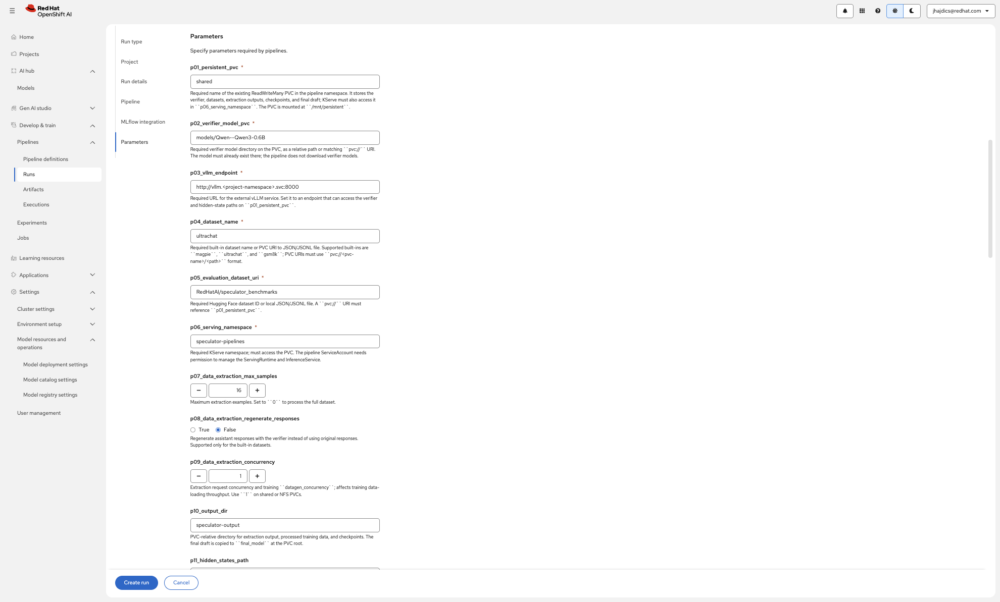
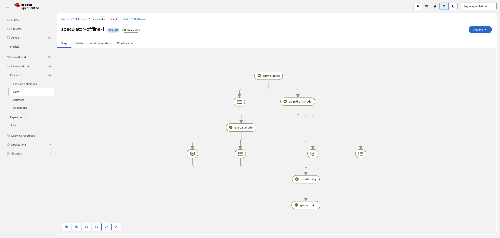
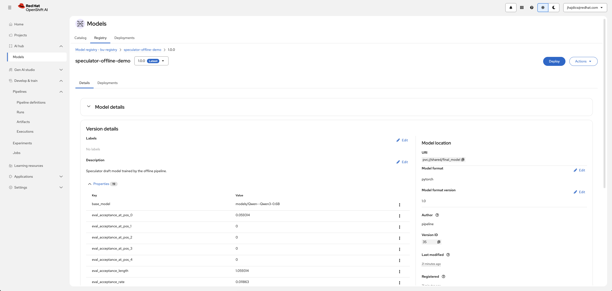
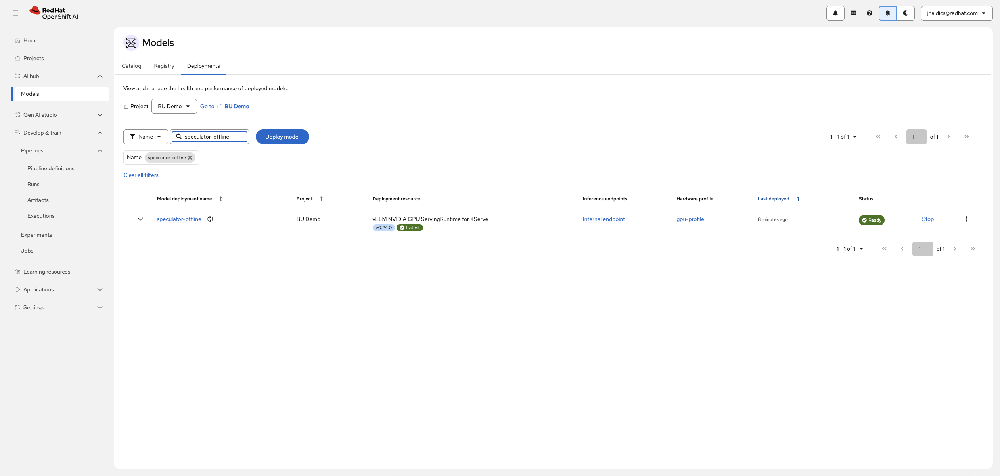

# Offline Pipeline (external vLLM, extraction + training in one run)

This pipeline combines extraction and training in a single run, with hidden states extracted by an **external, user-managed vLLM endpoint** instead of a managed sidecar. It creates its own hidden states and processed training data, so no pre-existing extraction artifacts are needed — but you need a vLLM endpoint you already operate, or need custom vLLM configuration the managed sidecar does not expose.

No external vLLM and want one run? Use [online](../online/). Want to iterate on training without re-extracting? Use [data-extraction](../data-extraction/README.md) + [train-only](../train-only/).

## Before you start

Complete the shared cluster and project setup in the [main Speculator pipelines guide](../README.md), especially [cluster requirements](../README.md#3-check-your-cluster) and [project prerequisites](../README.md#prerequisites). This pipeline always serves the draft, so the KServe serving setup in the [common prerequisites](../README.md#model-registry-and-kserve-train-only--online--offline) is required; the Model Registry part applies only if you keep registration enabled.

### Confirm the ClusterTrainingRuntime (CTR)

Confirm that the CTR for this pipeline is available. The [main guide's CTR section](../README.md#clustertrainingruntimes-ctrs) explains how to check installed runtimes.

| Pipeline | Required CTR |
| --- | --- |
| Offline | `speculator-model-opt-cuda` |

### External vLLM server

> [!IMPORTANT]
>
> This endpoint is a **prerequisite you do not create from this guide**. Deploying it needs Deployment and Service creation, so it is an administrator task (or whoever operates vLLM in your cluster). Have it running and verified before you create a run.

A tested manifest already exists in this repository: [`manifests/external-vllm/vllm-server.yaml`](../../../../rhoai-3.6/manifests/external-vllm/vllm-server.yaml) from the SDK example, with [deployment, verification and cleanup instructions](../../../../rhoai-3.6/manifests/external-vllm/README.md). It deploys a `vllm-svc` Deployment and Service (port 8000) plus a same-project NetworkPolicy, on the pinned `registry.redhat.io/rhaii-fast/vllm-cuda-rhel9` image that carries the extraction support — upstream vLLM images do not have it. It mounts PVC `shared` at `/mnt`.

It was written for the SDK notebooks, so four values need mapping to this pipeline before the administrator applies it:

| Manifest env | Default | Set it to |
| --- | --- | --- |
| `SPECULATOR_VERIFIER_MODEL` | `/mnt/models/Qwen3-0.6B` | `/mnt/` + your `p02_verifier_model_pvc` — the pipeline's download task writes `models/Qwen--Qwen3-0.6B`, with `--` in place of `/` |
| `SPECULATOR_HS_PATH` | `/mnt/speculator/run-01-offline/hidden_states` | `/mnt/` + your `p11_hidden_states_path` (default `speculator-output/hidden_states`) |
| `SPECULATOR_TARGET_LAYER_IDS` | `2, 14, 25, 28` | The same four IDs as `p15_target_layer_ids` |
| `claimName` | `shared` | Your `p01_persistent_pvc`, in **your project** |

The resulting endpoint for `p03_vllm_endpoint` is `http://vllm-svc.<project-namespace>.svc:8000` — no `/v1` suffix; the pipeline appends the API path itself.

Whatever manifest is used, the endpoint must:

- be reachable from the pipeline project,
- be launched **with hidden-states extraction enabled** — a standard vLLM chat-serving deployment is not sufficient. Launch it with the speculators [`launch_vllm.py`](https://github.com/vllm-project/speculators/blob/main/scripts/launch_vllm.py) script in extraction mode, which configures the `ExampleHiddenStatesConnector` (`kv_connector`) whose `shared_storage_path` points at the PVC directory the pipeline reads — align it with `p11_hidden_states_path` — and `target_layer_ids` matching `p15_target_layer_ids`,
- serve the verifier you intend to train against, with access to the verifier and hidden-state paths on `p01_persistent_pvc`.

### Verifier already on the PVC

`p02_verifier_model_pvc` must identify the relative verifier directory, and the model must already exist there. **This pipeline does not download models from HuggingFace.** Cache it once either by:

- running the [data-extraction pipeline](../data-extraction/README.md#3-configure-the-run) with `p04_download_model=true`, or
- copying the model to the PVC manually.

The cache path follows the `models/<org>--<model>` naming (model ID with `/` replaced by `--`), e.g. `models/Qwen--Qwen3-0.6B`.

> [!IMPORTANT]
>
> `p15_target_layer_ids` is **required** in offline mode — four comma-separated layer IDs matching the verifier. The SDK cannot auto-detect layer IDs from the PVC-backed verifier. For Qwen3-0.6B: `2,14,25,28`. Layer IDs are verifier-specific — see [Default verifier model](../README.md#default-verifier-model) for other verifiers.

### Dataset

`p04_dataset_name` accepts the built-ins `magpie` (Magpie-Align/Magpie-Llama-3.1-Pro-300K-Filtered), `ultrachat` (HuggingFaceH4/ultrachat_200k), and `gsm8k` (openai/gsm8k), or a JSON/JSONL dataset already on the PVC (`pvc://<pvc-name>/<path>`). Only these built-ins and local files are supported in offline mode. `p07_data_extraction_max_samples=0` processes all examples; keep `p09_data_extraction_concurrency=1` on shared/RWX storage.

## Run the pipeline

Follow these steps in order. The [main guide](../README.md#quick-start) has the shared compilation and Dashboard instructions; the steps here give the offline-specific command and values.

### 1. Generate the pipeline YAML

Complete the common environment setup in [Generate the pipeline YAML](../README.md#1-generate-the-pipeline-yaml). From the root of the `pipelines-components` checkout on the `rhoai-3.6` branch, compile offline:

```bash
PYTHONPATH=$(pwd) python pipelines/training/speculator/offline/pipeline.py
```

The generated file is `pipelines/training/speculator/offline/pipeline.yaml`.

### 2. Import the pipeline and create a run

In the Red Hat OpenShift AI Dashboard:

1. Open **Develop & train → Pipelines → Pipeline definitions** in the project prepared for this example.
2. Import the generated `pipeline.yaml`. If the definition already exists, upload it as a new version.
3. Open the imported definition and choose **Actions → Create run**.
4. Name the run, leave **Enable MLflow experiment tracking** unchecked, and enter the parameters below. See the main guide's [import](../README.md#2-import-the-pipeline-into-red-hat-openshift-ai) and [create-run](../README.md#3-create-a-run-and-set-parameters) instructions for the full Dashboard walkthrough.

### 3. Configure the run

The following example uses Qwen3-0.6B and assumes the verifier was already cached on the PVC (e.g., by a prior data-extraction run). Use a new `p50_model_registry_version` per revision if registering:

| Parameter | Value | Notes |
| --- | --- | --- |
| `p01_persistent_pvc` | `shared` | Your existing RWX PVC name |
| `p02_verifier_model_pvc` | `models/Qwen--Qwen3-0.6B` | Must already exist on the PVC |
| `p03_vllm_endpoint` | `http://vllm-svc.<project-namespace>.svc:8000` | Your extraction-capable vLLM Service — see the project note below |
| `p04_dataset_name` | `ultrachat` | Built-in dataset |
| `p05_evaluation_dataset_uri` | `RedHatAI/speculator_benchmarks` | HuggingFace evaluation dataset with built-in subsets |
| `p06_serving_namespace` | `<pvc-namespace>` | Must access the PVC |
| `p07_data_extraction_max_samples` | `16` | **Set this explicitly** — the default is `0`, which extracts the *whole* dataset |
| `p15_target_layer_ids` | `2,14,25,28` | **Required** |
| `p38_packages_to_install` | `speculators==0.6.0.1,torchvision==0.24.0` | Comma-separated packages installed in the extraction and training jobs |
| `p40_evaluation_max_samples` | `10` | Reduced for quick testing; default `80` for full runs |
| `p41_evaluation_max_tokens` | `64` | Reduced for quick testing; default `256` for full runs |
| `p47_model_registry_address` | `""` | Empty skips registration; to register, use `https://<registry-name>-rest.apps.<cluster-domain>` — where to find it is in the [common guide](../README.md#model-registry-and-kserve-train-only--online--offline) |
| `p48_model_registry_port` | `443` | Set alongside a non-empty registry address — the default `8080` only fits the in-cluster service |

Everything else can keep its default for a first run. Note there is no model download and no managed-sidecar configuration in this mode — the external endpoint's resources are your responsibility.

Paths must stay aligned within the run: extraction writes to `p10_output_dir` / `p11_hidden_states_path`, training reads from `p12_training_data_path` / `p11_hidden_states_path`. Defaults line up (`speculator-output` and `speculator-output/hidden_states`); if you change `p10_output_dir`, update `p12_training_data_path` and `p11_hidden_states_path` to match.

The Dashboard's **Parameters** step shows each field's description below its input:



> [!IMPORTANT]
>
> The example endpoint is in **your project** on purpose. The server has to read and write `p01_persistent_pvc`, and a vLLM running in a different project cannot mount that claim. If your vLLM must live elsewhere, it needs its own access to the same underlying storage (for example a PVC in that project bound to the same RWX volume), and `p11_hidden_states_path` must resolve to the same directory on both sides.

One parameter in that table is more than a convenience:

> [!WARNING]
>
> One default is not safe to keep: `p07_data_extraction_max_samples` defaults to `0`, which means the **full** dataset (ultrachat_200k is ~200,000 conversations). Always set it explicitly for an example run — the table above uses `16`. The data-extraction pipeline defaults to `16` instead, so the two modes differ here.

And one expectation to set about the evaluation stage's runtime:

> [!NOTE]
>
> `p40_evaluation_max_samples` and `p41_evaluation_max_tokens` bound the GuideLLM **benchmark sweep** only. They do not cap the evaluator's initial pass, which issues its own requests against the endpoint and generates up to the backend's token limit (4096). Lowering them shortens the sweep but does not make the evaluation stage short: expect the full stage duration and one GPU held for the duration even with the example values.

### 4. Start and monitor the run

Click **Create run**, then open it from **Pipelines → Runs**. The graph is a straight line — extract, train, evaluate, register (skipped entirely when `p47_model_registry_address` is empty), serve — and a failure at any node stops everything after it; that node's logs are where to look.

A failure at **extract hidden states** with a connection error is almost always the external endpoint (wrong URL, or a NetworkPolicy blocking the path) — not the pipeline. Verify with the probe command in [External vLLM server](#external-vllm-server) before debugging anything else.

For the 16-sample Qwen3-0.6B example, expect ~10–20 minutes extraction, ~10–20 minutes training, ~15–30 minutes evaluation (its vLLM server takes minutes to load before the sweep begins), then registration and serving.




### 5. Review the results

When the run shows **Succeeded**, the evaluation metrics and the served endpoint are ready to inspect.

Same evaluation task and metrics as the train-only pipeline — see [Review the results](../train-only/README.md#5-review-the-results) in that guide for the full metric table and how to read it.

The evaluation task's metrics in the Red Hat OpenShift AI UI:


If you kept registration enabled (`p47_model_registry_address` set), the draft appears in the Model Registry afterwards under `p49_model_registry_name` / `p50_model_registry_version` — find it via **AI Hub > Models > Registry > your registry**:



To test the served endpoint, follow [Testing the served endpoint](../README.md#testing-the-served-endpoint) in the common guide. One offline-specific note: KServe may scale the predictor to zero after a period of idleness, so the first request after a quiet period can take a while while the predictor wakes.

The deployed endpoint in the Red Hat OpenShift AI UI:



To iterate, sweep `p16_training_epochs`, `p17_training_lr`, `p19_training_num_layers`, and `p43_evaluation_num_speculative_tokens` between runs. Each offline run repeats extraction — to iterate on training alone, split into [data-extraction](../data-extraction/README.md) + [train-only](../train-only/).

## Troubleshooting

| Symptom | What to check |
| --- | --- |
| "Configure pipeline server" prompt never goes away | Pipeline server not configured for the project — ask your administrator; see [Configure the pipeline server](../README.md#configure-the-pipeline-server). |
| Trainer submit task fails with 401/403 | `kubernetes-credentials` secret missing or its token expired — ask your administrator to create or renew it; see [Credentials](../README.md#credentials). |
| Run fails with ClusterTrainingRuntime not found | `oc get clustertrainingruntimes`; this pipeline needs `speculator-model-opt-cuda`. |
| Extraction fails: cannot connect to endpoint | Verify `p03_vllm_endpoint` from a probe pod in the pipeline project — see [External vLLM server](#external-vllm-server). |
| Extraction succeeds but training fails: hidden states not found | Path misalignment between extraction output and training input — align `p10`/`p11`/`p12`; changing `p10_output_dir` requires updating the other two. |
| Training fails with a layer/tensor shape mismatch | Set the four layer IDs for your verifier (`2,14,25,28` for Qwen3-0.6B). |
| Training pod OOM-killed | Raise `p35_training_resource_memory`. |
| Verifier not found | `p02_verifier_model_pvc` doesn't exist — this pipeline never downloads; see [Verifier already on the PVC](#verifier-already-on-the-pvc). |
| Training fails: `HFValidationError: Repo id must be in the form 'repo_name' or 'namespace/repo_name'` | Use the on-disk directory name (`models/Qwen--Qwen3-0.6B`), not the HuggingFace model ID. |
| Evaluation fails with a tensor shape error on the draft's `fc` weights | Check the training log for `Updated … Eagle3 draft config.json file(s) (target_hidden_size=…)`, and that `p38_packages_to_install` pins `speculators==0.6.0.1`. |
| Registry task fails | Use the `-rest` route URL with `https://` and port `443` (or the in-cluster service with `8080`); add the RoleBinding — or leave the address empty to skip. |
| `curl: Could not resolve host: <name>-predictor.<ns>.svc.cluster.local` | The endpoint URL is cluster-local; run the request from inside the cluster via `oc exec` — see the [common guide](../README.md#testing-the-served-endpoint). |
| Chat request to the endpoint returns "model not found" | Use the InferenceService name as the `model`. |
| Older registry versions break after re-run | `final_model` is overwritten each run; use a separate PVC per revision. |
| First request to the endpoint hangs or is refused | Check `oc get inferenceservice` shows `True`; wait and retry. |

For common compile-time issues, see the main guide's [troubleshooting section](../README.md#troubleshooting).
