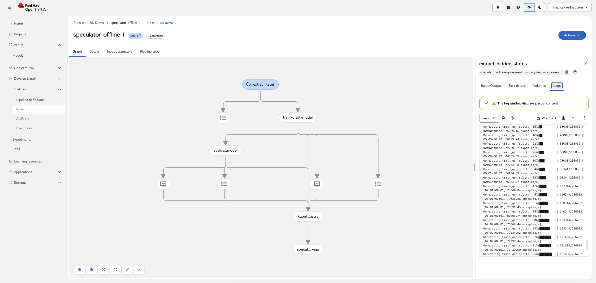
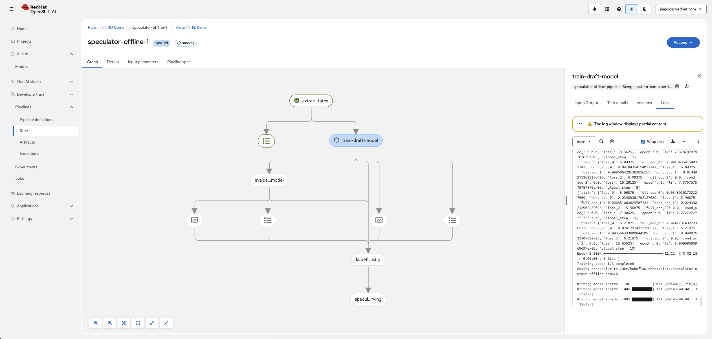
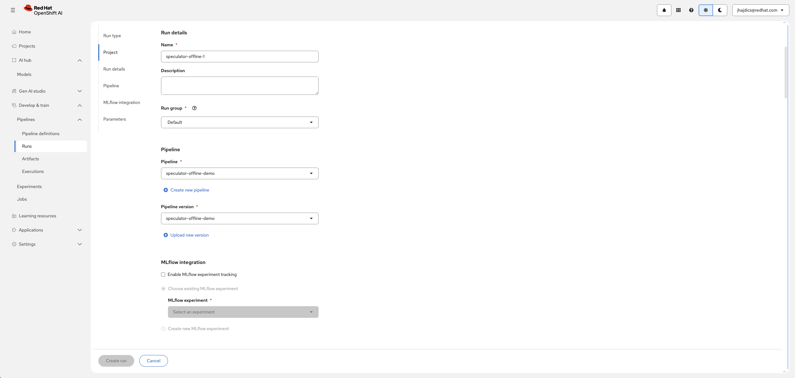
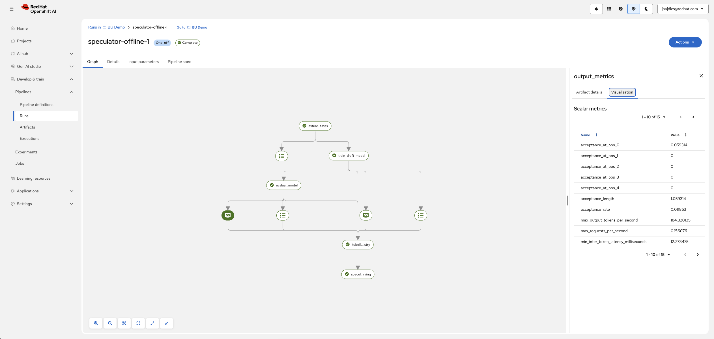

# Offline Pipeline (external vLLM, extraction + training in one run)

This guide covers the **speculator-offline-pipeline** — extraction and training combined in a single run, with hidden states extracted by an **external, user-managed vLLM endpoint** instead of a managed sidecar.

> [!WARNING]
>
> This pipeline may change. Re-generate the YAML after pulling upstream changes.

## 1. When to use this pipeline

- **You already run vLLM.** Point the pipeline at your existing deployment and skip the managed sidecar entirely.
- **You need custom vLLM configuration** the managed sidecar doesn't expose.
- No external vLLM and want one run? Use [online](../online/). Want to iterate on training without re-extracting? Use [data-extraction](../data-extraction/README.md) + [train-only](../train-only/).

## 2. How it works

The offline pipeline combines data-only extraction and train-only training in a single run — it creates hidden states and processed training data itself, so pre-existing extraction artifacts are not required:

1. **Extraction** sends requests to the external vLLM endpoint at `p03_vllm_endpoint`. No managed sidecar is launched. Hidden states are written to `p11_hidden_states_path` and processed data below `p10_output_dir`.
2. **Training** reads processed data from `p12_training_data_path` and hidden states from `p11_hidden_states_path`.
3. **Evaluate** with GuideLLM.
4. **Register** — optional; leave `p47_model_registry_address` empty to skip.
5. **Serve** via a cluster-local KServe InferenceService using the verifier at `p02_verifier_model_pvc` and the draft at `final_model`.

The completed draft is written to `pvc://<p01_persistent_pvc>/final_model`. Each run **replaces** this shared path — use a separate PVC per revision if earlier registry versions must keep referencing their original weights. A retained serving endpoint is affected the same way: when its predictor restarts or scales back up, it loads the **new** weights, even though the endpoint name is unchanged. An InferenceService still serving from the same PVC also picks up the new weights the next time its predictor restarts or scales up, even though the endpoint name is unchanged.

`p01_persistent_pvc` is an existing ReadWriteMany PVC in the pipeline namespace, mounted at `/mnt/persistent`, storing the verifier, datasets, extraction outputs, checkpoints, and final draft. It must also be available in `p06_serving_namespace`. With `p01_persistent_pvc="shared"`, `p10_output_dir="speculator-output"` resolves to `pvc://shared/speculator-output`.

## 3. The pipeline run from start to finish

With registration enabled, the run graph looks like this:

```text
extract hidden states ──> train draft model ──> evaluate draft model ──> register to model registry ──> serve draft model
(via external vLLM)
```

Like online, this is a one-run pipeline — but the extraction stage talks to **your** external vLLM endpoint instead of a managed sidecar. Stage by stage:

| Task in the graph | What it does | What you'll observe | Typical duration (Qwen3-0.6B example run) |
| --- | --- | --- | --- |
| **extract hidden states** | A Trainer job (`speculator-model-opt-cuda` CTR) sends requests to `p03_vllm_endpoint` and writes hidden states to the PVC | Node logs show the endpoint connection and per-sample extraction progress. If the endpoint is unreachable, this node fails fast — run the probe command in [Setup](#external-vllm-server) first | ~10–20 minutes |
| **train draft model** | Trains the Eagle3 draft from the hidden states just written | Training loss streaming, checkpoint saves, draft copied to `final_model` | ~10–20 minutes |
| **evaluate draft model** | Starts a vLLM server with speculative decoding and runs the GuideLLM sweep | Slow start (server load), then results publish as **metrics artifacts** | ~15–30 minutes |
| **register to model registry** | (Skipped entirely when `p47_model_registry_address` is empty) Registers `final_model` | Model version appears in the Model Registry UI; it can fail fast on wrong address or missing RoleBinding | Up to a few minutes |
| **serve draft model** | Creates the KServe InferenceService using your verifier and the draft, waits for readiness | ServingRuntime + InferenceService creation, predictor rollout | ~5–15 minutes |

A failure at **extract hidden states** with a connection error is almost always the external endpoint (wrong URL, or a NetworkPolicy blocking the path) — not the pipeline. Verify with the probe command in [Setup](#external-vllm-server) before debugging anything else.






## 4. Hardware requirements (Qwen3-0.6B)

| Component | GPU | CPU | Memory |
| --- | --- | --- | --- |
| Extraction + training worker | 1 (`p34`) | 4 cores | 64Gi |
| External vLLM | your own — size separately | — | — |
| Evaluation / serving | ~1 | — | — |

Extraction and training share one runtime (`p37_job_runtime`, default `speculator-model-opt-cuda`) and one set of env overrides / packages (`p36_job_envs`, `p38_packages_to_install`).

## 5. Setup

Confirm [access](../README.md#3-check-access) with your administrator and work through the [shared prerequisites](../README.md#prerequisites), plus the offline-specific ones:

### External vLLM server

> [!IMPORTANT]
>
> This endpoint is a **prerequisite you do not create from this guide**. Deploying it needs Deployment and Service creation, so it is an administrator task (or whoever operates vLLM in your cluster). Have it running and verified before you create a run.

A tested manifest already exists in this repository: [`manifests/external-vllm/vllm-server.yaml`](../../../../rhoai-3.6/manifests/external-vllm/vllm-server.yaml) from the SDK example, with [deployment, verification and cleanup instructions](../../../../rhoai-3.6/manifests/external-vllm/README.md). It deploys a `vllm-svc` Deployment and Service (port 8000) plus a same-namespace NetworkPolicy, on the pinned `registry.redhat.io/rhaii-fast/vllm-cuda-rhel9` image that carries the extraction support — upstream vLLM images do not have it. It mounts PVC `shared` at `/mnt`.

It was written for the SDK notebooks, so four values need mapping to this pipeline before the administrator applies it:

| Manifest env | Default | Set it to |
| --- | --- | --- |
| `SPECULATOR_VERIFIER_MODEL` | `/mnt/models/Qwen3-0.6B` | `/mnt/` + your `p02_verifier_model_pvc` — the pipeline's download task writes `models/Qwen--Qwen3-0.6B`, with `--` in place of `/` |
| `SPECULATOR_HS_PATH` | `/mnt/speculator/run-01-offline/hidden_states` | `/mnt/` + your `p11_hidden_states_path` (default `speculator-output/hidden_states`) |
| `SPECULATOR_TARGET_LAYER_IDS` | `2, 14, 25, 28` | The same four IDs as `p15_target_layer_ids` |
| `claimName` | `shared` | Your `p01_persistent_pvc`, in **your project namespace** |

The resulting endpoint for `p03_vllm_endpoint` is `http://vllm-svc.<project-namespace>.svc:8000` — no `/v1` suffix; the pipeline appends the API path itself.

Whatever manifest is used, these four things must hold:

1. the image carries the hidden-states connector (the pinned image above does; a stock vLLM build does not),
2. `shared_storage_path` resolves to the same RWX PVC directory the pipeline reads (`p11_hidden_states_path` on `p01_persistent_pvc`), writable by the server's UID under OpenShift's restricted SCC,
3. `target_layer_ids` match `p15_target_layer_ids`,
4. it serves the verifier you intend to train against and is reachable from your project namespace.

`p03_vllm_endpoint` must point at a vLLM deployment that:

- is reachable from the pipeline namespace,
- can access the verifier and hidden-state paths on `p01_persistent_pvc`,
- serves the verifier model you intend to train against,
- is launched **with hidden-states extraction enabled** — a standard vLLM deployment is not sufficient.

The last point matters: extraction requires the server to expose the verifier's hidden states. Launch it with the speculators [`launch_vllm.py`](https://github.com/vllm-project/speculators/blob/main/scripts/launch_vllm.py) script in extraction mode, which configures:

- the `ExampleHiddenStatesConnector` (`kv_connector`) whose `shared_storage_path` points at the PVC directory the pipeline reads — align it with `p11_hidden_states_path`,
- `target_layer_ids` matching the pipeline's `p15_target_layer_ids` (the launcher appends the verifier's final layer by default).

A plain vLLM deployment answers `/v1/models` and passes the probe below, but produces no hidden states — the extraction stage then fails or writes nothing.

Verify reachability from the project namespace before running. Most users cannot create pods directly (`oc run` needs administrator-level access) — use whichever path below fits your project:

- **If the project already has a pod with `curl`** — a workbench is the usual case (workbench pods ship curl, and you can exec into your own workbenches). Find the pod name, then exec the probe from inside it:

  ```bash
  oc get pods -n <project-namespace>
  oc exec -n <project-namespace> <pod-name> -- curl -s <p03_vllm_endpoint>/v1/models
  ```

- **Otherwise, ask an administrator to run the probe** — pod creation requires administrator access:

  ```bash
  oc run vllm-probe --rm -it --restart=Never --image=curlimages/curl -- \
    curl -s <p03_vllm_endpoint>/v1/models
  ```

  If the probe fails with an image pull error on a restricted cluster, the administrator should substitute any image the cluster serves that contains curl.

If the probe fails to connect, fix networking (NetworkPolicy, endpoint URL) before running the pipeline — the pipeline's first extraction request will fail the same way.

### Verifier already on the PVC

`p02_verifier_model_pvc` must identify the relative verifier directory, and the model must already exist there. **This pipeline does not download models from HuggingFace.** Cache it once either by:

- running the [data-extraction pipeline](../data-extraction/README.md#3-configure-the-run) with `p04_download_model=true`, or
- copying the model to the PVC manually.

The cache path follows the `models/<org>--<model>` naming (model ID with `/` replaced by `--`), e.g. `models/Qwen--Qwen3-0.6B`.

### Remaining prerequisites

- CTR `speculator-model-opt-cuda`
- Serving namespace permissions — **always required**; every offline run serves the draft
- Model Registry + RoleBinding — only if you keep registration enabled. To register, use the registry's `-rest` route URL (`https://...`, scheme included) with port `443` in `p48_model_registry_port`; see the [common prerequisites](../README.md#model-registry-and-kserve-train-only--online--offline)

> [!IMPORTANT]
>
> `p15_target_layer_ids` is **required** in offline mode — four comma-separated layer IDs matching the verifier. The SDK cannot auto-detect layer IDs from the PVC-backed verifier. For Qwen3-0.6B: `2,14,25,28`. Layer IDs are verifier-specific — see [Default verifier model](../README.md#default-verifier-model) for other verifiers.

## 6. Dataset

`p04_dataset_name` accepts the built-ins `magpie` (Magpie-Align/Magpie-Llama-3.1-Pro-300K-Filtered), `ultrachat` (HuggingFaceH4/ultrachat_200k), and `gsm8k` (openai/gsm8k), or a JSON/JSONL dataset already on the PVC (`pvc://<pvc-name>/<path>`). Only these built-ins and local files are supported in offline mode. `p07_data_extraction_max_samples=0` processes all examples; keep `p09_data_extraction_concurrency=1` on shared/NFS storage.

## 7. Key OFFLINE configuration

### Path alignment

Extraction writes to `p10_output_dir` / `p11_hidden_states_path`; training reads from `p12_training_data_path` / `p11_hidden_states_path`. Defaults line up (`speculator-output` and `speculator-output/hidden_states`). If you change `p10_output_dir`, update `p12_training_data_path` and `p11_hidden_states_path` to match.

### Not used in OFFLINE

There is no model download — no `download_model` parameter. No managed sidecar — no vLLM sidecar resource parameters. The external endpoint's resources are your responsibility.

## 8. Running the pipeline

Follow [Run a pipeline](../README.md#quick-start) in the common guide — compile this mode, import the YAML, create a run, and untick the **Enable MLflow experiment tracking** checkbox it warns about:

```bash
PYTHONPATH=$(pwd) python pipelines/training/speculator/offline/pipeline.py
```

Fill in the parameters from the table below and leave everything not listed at its default. Use a new `p50_model_registry_version` per revision if registering.



The stage-by-stage walkthrough is in [The pipeline run from start to finish](#3-the-pipeline-run-from-start-to-finish).

### Example: Qwen3-0.6B

Assumes the verifier was already cached on the PVC (e.g., by a prior data-extraction run):

| Parameter | Value | Notes |
| --- | --- | --- |
| `p01_persistent_pvc` | `shared` | Your existing RWX PVC name |
| `p02_verifier_model_pvc` | `models/Qwen--Qwen3-0.6B` | Must already exist on the PVC |
| `p03_vllm_endpoint` | `http://vllm-svc.<project-namespace>.svc:8000` | Your extraction-capable vLLM Service — see the namespace note below |
| `p04_dataset_name` | `ultrachat` | Built-in dataset |
| `p05_evaluation_dataset_uri` | `RedHatAI/speculator_benchmarks` | HuggingFace evaluation dataset with built-in subsets |
| `p06_serving_namespace` | `<pvc-namespace>` | Must access the PVC |
| `p07_data_extraction_max_samples` | `16` | **Set this explicitly** — the default is `0`, which extracts the *whole* dataset |
| `p15_target_layer_ids` | `2,14,25,28` | **Required** |
| `p38_packages_to_install` | `speculators==0.6.0.1,torchvision==0.24.0` | Comma-separated packages installed in the extraction and training jobs |
| `p40_evaluation_max_samples` | `10` | Reduced for quick testing; default `80` for full runs |
| `p41_evaluation_max_tokens` | `64` | Reduced for quick testing; default `256` for full runs |
| `p47_model_registry_address` | `""` | Empty skips registration; to register, use `https://<registry-name>-rest.apps.<cluster-domain>` |
| `p48_model_registry_port` | `443` | Set alongside a non-empty registry address — the default `8080` only fits the in-cluster service |

Training/evaluation/resource parameters can keep their defaults for a first run.

> [!IMPORTANT]
>
> The example endpoint is in **your project namespace** on purpose. The server has to read and write `p01_persistent_pvc`, and PVCs are namespace-scoped — a vLLM running in a different namespace cannot mount that claim. If your vLLM must live elsewhere, it needs its own access to the same underlying storage (for example a PVC in that namespace bound to the same RWX volume), and `p11_hidden_states_path` must resolve to the same directory on both sides.

One parameter in that table is more than a convenience:

> [!WARNING]
>
> One default is not safe to keep: `p07_data_extraction_max_samples` defaults to `0`, which means the **full** dataset (ultrachat_200k is ~200,000 conversations). Always set it explicitly for an example run — the table above uses `16`. The data-extraction pipeline defaults to `16` instead, so the two modes differ here.

And one expectation to set about the evaluation stage's runtime:

> [!NOTE]
>
> `p40_evaluation_max_samples` and `p41_evaluation_max_tokens` bound the GuideLLM **benchmark sweep** only. They do not cap the evaluator's initial pass, which issues its own requests against the endpoint and generates up to the backend's token limit (4096). Lowering them shortens the sweep but does not make the evaluation stage short: expect the full stage duration and one GPU held for the duration even with the example values.

The first of those values in the run form's **Parameters** step — each field carries the parameter's own description underneath, so you can check one without leaving the page:


## 9. Interpreting the results

Same evaluation task and metrics as the train-only pipeline — see [Interpreting the evaluation results](../train-only/README.md#10-interpreting-the-evaluation-results) in that guide for the full metric table and how to read it.

The evaluation task's metrics in the Red Hat OpenShift AI UI:



If you kept registration enabled (`p47_model_registry_address` set), the draft appears in the Model Registry afterwards under `p49_model_registry_name` / `p50_model_registry_version` — find it via **AI Hub > Models > Registry > your registry**:


## 10. Testing the served endpoint

Follow [Testing the served endpoint](../README.md#testing-the-served-endpoint) in the common guide. One offline-specific note: KServe may scale the predictor to zero after a period of idleness — check `oc get inferenceservice -n <p06_serving_namespace>` shows `True` before concluding something is broken.

The deployed endpoint in the Red Hat OpenShift AI UI:


## 11. Customization

Sweep `p16_training_epochs`, `p17_training_lr`, `p19_training_num_layers`, and `p43_evaluation_num_speculative_tokens` between runs. Each offline run repeats extraction — to iterate on training alone, split into [data-extraction](../data-extraction/README.md) + [train-only](../train-only/).

## Reference

For the full parameter list, see the compiled pipeline YAML, or the pipeline's own README in the [pipelines-components repository](https://github.com/red-hat-data-services/pipelines-components/blob/rhoai-3.6/pipelines/training/speculator/offline/README.md).

### Troubleshooting

| Symptom | Diagnosis | Fix |
| --- | --- | --- |
| Extraction fails: cannot connect to endpoint | Wrong `p03_vllm_endpoint` or network policy blocks it | Verify the URL from a probe pod in the pipeline namespace (see [Setup](#external-vllm-server)) |
| Extraction succeeds but training fails: hidden states not found | Path misalignment between extraction output and training input | Align `p10`/`p11`/`p12` — changing `p10_output_dir` requires updating the other two |
| Training fails with a layer/tensor shape mismatch | `p15_target_layer_ids` doesn't match the verifier | Set the four layer IDs for your verifier (`2,14,25,28` for Qwen3-0.6B) |
| Verifier not found | `p02_verifier_model_pvc` doesn't exist — this pipeline never downloads | Cache the verifier first; see [Verifier already on the PVC](#verifier-already-on-the-pvc) |
| Training fails: `HFValidationError: Repo id must be in the form 'repo_name' or 'namespace/repo_name'` | `p02_verifier_model_pvc` uses the HuggingFace model ID format (e.g. `models/Qwen3-0.6B`) instead of the on-disk directory name | The download task replaces `/` with `--` in the model ID. Use the actual directory name: `models/Qwen--Qwen3-0.6B`. List `models/` on the shared PVC to confirm |
| Registry task fails | Wrong registry address or missing RoleBinding | Use the `-rest` route URL with `https://` and port `443` in `p48` (or the in-cluster service with `8080`); add the RoleBinding — or leave the address empty to skip |
| Older registry versions break after re-run | `final_model` overwritten each run | Separate PVC per revision |
| First request to the endpoint hangs or is refused | KServe scaled the predictor to zero, or vLLM is still loading | Check `oc get inferenceservice` shows `True`; wait and retry |

Compile-time problems and endpoint-access problems are covered in the [common troubleshooting table](../README.md#troubleshooting).

### Source

Pipeline source: [`pipelines-components/pipelines/training/speculator/offline`](https://github.com/red-hat-data-services/pipelines-components/tree/rhoai-3.6/pipelines/training/speculator/offline). The example parameter tables above are derived from that directory's `README.md` and `pipeline.py`; re-check them against your imported definition after pulling the `rhoai-3.6` branch.
