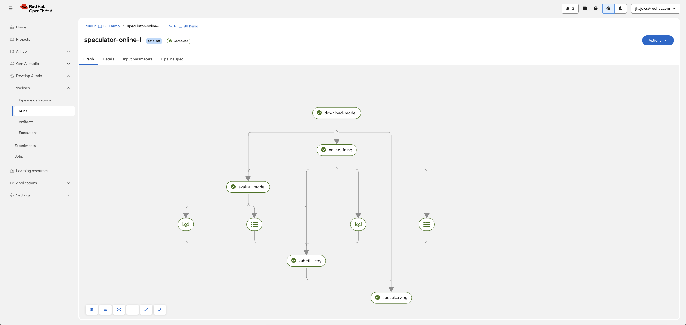
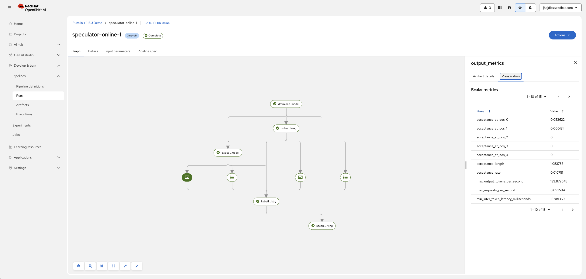
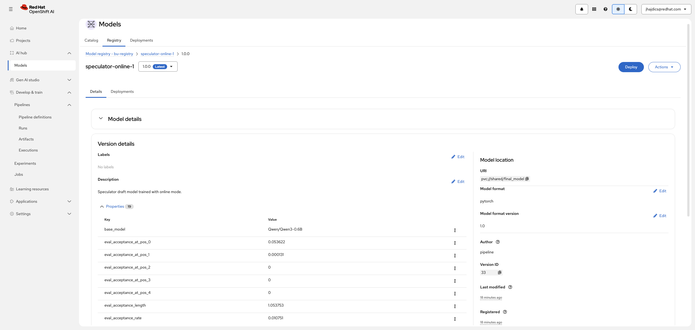

# Online Pipeline (single-job extraction + training)

This pipeline is the simplest one-run path to a trained Eagle3 speculative-decoding draft. A single Trainer job extracts hidden states with a managed vLLM sidecar **and** trains the draft, then the pipeline evaluates, optionally registers, and serves it. No pre-existing extraction artifacts and no external vLLM endpoint are needed.

Prefer separate extraction and training so you can sweep hyperparameters cheaply? Use [data-extraction](../data-extraction/README.md) + [train-only](../train-only/). Already run your own vLLM? Use [offline](../offline/).

## Before you start

Complete the shared cluster and project setup in the [main Speculator pipelines guide](../README.md), especially [cluster requirements](../README.md#3-check-your-cluster) and [project prerequisites](../README.md#prerequisites). This pipeline always serves the draft, so the KServe serving setup in the [common prerequisites](../README.md#model-registry-and-kserve-train-only--online--offline) is required; the Model Registry part applies only if you keep registration enabled.

### Confirm the ClusterTrainingRuntime (CTR)

Confirm that the CTR for this pipeline is available. The [main guide's CTR section](../README.md#clustertrainingruntimes-ctrs) explains how to check installed runtimes.

| Pipeline | Required CTR |
| --- | --- |
| Online | `vllm-extract-cuda` |

### Verifier model

`p02_verifier_model` is the optional HuggingFace model ID, used for downloading or resolving the default cached directory. `p04_download_model` defaults to `false`:

- Downloads enabled → the model ID is downloaded onto the PVC before training; evaluation and serving then read it from there.
- Downloads disabled → training can load the verifier directly from HuggingFace, but the **complete pipeline still needs it on the PVC**: the evaluation stage reads the verifier directory and fails with `FileNotFoundError` when it is missing. The verifier must already exist at `p03_verifier_model_pvc` (relative path or matching `pvc://` URI), or at the default cache directory derived from the model ID.

Unless the verifier is already cached on the PVC (for example by a prior data-extraction run with downloads enabled), keep `p04_download_model=true`.

If downloading requires authentication, ask your administrator to create the optional `hf-token` secret (see the [common prerequisites](../README.md#credentials)).

> [!IMPORTANT]
>
> `p05_target_layer_ids` is **required** — four comma-separated layer IDs matching the verifier. The online Trainer receives the cached model as a PVC URI and cannot auto-detect layer IDs from the PVC-backed model config. For Qwen3-0.6B: `2,14,25,28`. Layer IDs are verifier-specific — see [Default verifier model](../README.md#default-verifier-model) for other verifiers.

### Dataset

`p06_dataset_name` accepts the built-ins `magpie` (Magpie-Align/Magpie-Llama-3.1-Pro-300K-Filtered), `ultrachat` (HuggingFaceH4/ultrachat_200k), and `gsm8k` (openai/gsm8k), or a PVC URI (`pvc://<p01_persistent_pvc>/<path>`) to a JSON/JSONL file. `p09_data_extraction_max_samples=0` processes the full dataset; `p11_data_extraction_concurrency` controls vLLM request concurrency (use `1` on shared/RWX PVCs).

## Run the pipeline

Follow these steps in order. The [main guide](../README.md#quick-start) has the shared compilation and Dashboard instructions; the steps here give the online-specific command and values.

### 1. Generate the pipeline YAML

Complete the common environment setup in [Generate the pipeline YAML](../README.md#1-generate-the-pipeline-yaml). From the root of the `pipelines-components` checkout on the `rhoai-3.6` branch, compile online:

```bash
PYTHONPATH=$(pwd) python pipelines/training/speculator/online/pipeline.py
```

The generated file is `pipelines/training/speculator/online/pipeline.yaml`.

### 2. Import the pipeline and create a run

In the Red Hat OpenShift AI Dashboard:

1. Open **Develop & train → Pipelines → Pipeline definitions** in the project prepared for this example.
2. Import the generated `pipeline.yaml`. If the definition already exists, upload it as a new version.
3. Open the imported definition and choose **Actions → Create run**.
4. Name the run, leave **Enable MLflow experiment tracking** unchecked, and enter the parameters below. See the main guide's [import](../README.md#2-import-the-pipeline-into-red-hat-openshift-ai) and [create-run](../README.md#3-create-a-run-and-set-parameters) instructions for the full Dashboard walkthrough.

### 3. Configure the run

The following example uses Qwen3-0.6B. Use a new `p46_model_registry_version` per revision if registering:

| Parameter | Value | Notes |
| --- | --- | --- |
| `p01_persistent_pvc` | `shared` | Your existing RWX PVC name |
| `p02_verifier_model` | `Qwen/Qwen3-0.6B` | Downloaded because `p04_download_model=true` |
| `p04_download_model` | `true` | Cache the verifier on the PVC |
| `p05_target_layer_ids` | `2,14,25,28` | **Required** |
| `p06_dataset_name` | `ultrachat` | Built-in dataset |
| `p07_evaluation_dataset_uri` | `RedHatAI/speculator_benchmarks` | HuggingFace evaluation dataset with built-in subsets |
| `p08_serving_namespace` | `<pvc-namespace>` | Must access the PVC |
| `p09_data_extraction_max_samples` | `16` | **Set this explicitly** — the default is `0`, which extracts the *whole* dataset |
| `p35_packages_to_install` | `speculators==0.6.0.1,torchvision==0.24.0` | Comma-separated packages installed in the online Trainer job |
| `p37_evaluation_max_samples` | `10` | Reduced for quick testing; default `80` for full runs |
| `p38_evaluation_max_tokens` | `64` | Reduced for quick testing; default `256` for full runs |
| `p43_model_registry_address` | `""` | Empty skips registration; to register, use `https://<registry-name>-rest.apps.<cluster-domain>` — where to find it is in the [common guide](../README.md#model-registry-and-kserve-train-only--online--offline) |
| `p44_model_registry_port` | `443` | Set alongside a non-empty registry address — the default `8080` only fits the in-cluster service |

Everything else can keep its default for a first run — note some training internals are hardcoded in this pipeline rather than exposed (cosine-scheduler cycle count, checkpoint and log frequency, sidecar GPU count 1, evaluation sample seed). Set `PIP_INDEX_URL`/`PIP_EXTRA_INDEX_URL` via `p36_job_envs` if you need a custom package index for `p35_packages_to_install`.

The Dashboard's **Parameters** step shows each field's description below its input:


> [!WARNING]
>
> One default is not safe to keep: `p09_data_extraction_max_samples` defaults to `0`, which means the **full** dataset (ultrachat_200k is ~200,000 conversations). Always set it explicitly for an example run — the table above uses `16`. The data-extraction pipeline defaults to `16` instead, so the two modes differ here.

And one expectation to set about the evaluation stage's runtime:

> [!NOTE]
>
> `p37_evaluation_max_samples` and `p38_evaluation_max_tokens` bound the GuideLLM **benchmark sweep** only. They do not cap the evaluator's initial pass, which issues its own requests against the endpoint and generates up to the backend's token limit (4096). Lowering them shortens the sweep but does not make the evaluation stage short: expect the full stage duration and one GPU held for the duration even with the example values.

### 4. Start and monitor the run

Click **Create run**, then open it from **Pipelines → Runs**. The graph shows the optional model-download task, then the defining node — a single Trainer job that does extraction and training together — followed by evaluate, register (skipped entirely when `p43_model_registry_address` is empty), and serve. A failure at any node stops everything after it, and that node's logs are where to look.

While the Trainer job runs, the project contains **one TrainJob with two GPU containers**: the training worker and the vLLM sidecar. You can watch it with:

```bash
oc get trainjobs,pods -n <project-namespace>
```

The training node is the longest and starts quietly: the sidecar takes minutes to load the verifier into GPU before extraction and training begin — a pod in `Running` state with no training log output yet is normal during that window. For the 16-sample Qwen3-0.6B example, expect ~15–45 minutes for that node, then ~15–30 minutes evaluation, then registration and serving.




### 5. Review the results

When the run shows **Succeeded**, the evaluation metrics and the served endpoint are ready to inspect.

Same evaluation task and metrics as the train-only pipeline — see [Review the results](../train-only/README.md#5-review-the-results) in that guide for the full metric table and how to read it. The short version: check `acceptance_length` (mean tokens per verifier pass; higher is better, 1 means the draft contributes nothing), and remember the pipeline emits **no speedup ratio** — only absolute throughput numbers.

The evaluation task's metrics in the Red Hat OpenShift AI UI:



If you kept registration enabled (`p43_model_registry_address` set), the draft appears in the Model Registry afterwards under `p45_model_registry_name` / `p46_model_registry_version` — find it via **AI Hub > Models > Registry > your registry**:



To test the served endpoint, follow [Testing the served endpoint](../README.md#testing-the-served-endpoint) in the common guide. One online-specific note: KServe may scale the predictor to zero after a period of idleness — the first request after a quiet period can take a while or be refused while the predictor wakes. Check `oc get inferenceservice -n <p08_serving_namespace>` shows `True` before concluding something is broken.

The deployed endpoint in the Red Hat OpenShift AI UI:


To iterate, sweep `p14_training_epochs`, `p15_training_lr`, `p17_training_num_layers`, and `p40_evaluation_num_speculative_tokens` between runs. Note that each run repeats extraction — if you find yourself iterating often, switch to the two-step [data-extraction](../data-extraction/README.md) + [train-only](../train-only/) workflow and only pay for extraction once.

## Troubleshooting

| Symptom | What to check |
| --- | --- |
| "Configure pipeline server" prompt never goes away | Pipeline server not configured for the project — ask your administrator; see [Configure the pipeline server](../README.md#configure-the-pipeline-server). |
| Trainer submit task fails with 401/403 | `kubernetes-credentials` secret missing or its token expired — ask your administrator to create or renew it; see [Credentials](../README.md#credentials). |
| Run fails with ClusterTrainingRuntime not found | `oc get clustertrainingruntimes`; this pipeline needs `vllm-extract-cuda`. |
| Run fails waiting for the vLLM sidecar | Check the Trainer pod logs and verifier size against GPU memory; raise `p33_vllm_readiness_timeout_minutes` if startup needs more time. |
| Training pod OOM-killed | Raise `p30_training_resource_memory`. |
| Model download fails with 401 | The model is gated — ask your administrator to create the `hf-token` secret. |
| Evaluation fails with a tensor shape error on the draft's `fc` weights | Check the training log for `Updated … Eagle3 draft config.json file(s) (target_hidden_size=…)`, and that `p35_packages_to_install` pins `speculators==0.6.0.1`. |
| Registry task fails | Use the `-rest` route URL with `https://` and port `443` (or the in-cluster service with `8080`); add the RoleBinding — or leave the address empty to skip. |
| Serving task fails with forbidden | Grant the pipeline ServiceAccount ServingRuntime/InferenceService manage rights in `p08_serving_namespace`. |
| `curl: Could not resolve host: <name>-predictor.<ns>.svc.cluster.local` | The endpoint URL is cluster-local; run the request from inside the cluster via `oc exec` — see the [common guide](../README.md#testing-the-served-endpoint). |
| Chat request to the endpoint returns "model not found" | Use the InferenceService name as the `model`. |
| First request to the endpoint hangs or is refused | Check `oc get inferenceservice` shows `True`; wait and retry. |
| Older registry versions break after re-run | `final_model` is overwritten each run; use a separate PVC per revision. |
| Training fails: `HFValidationError: Repo id must be in the form 'repo_name' or 'namespace/repo_name'` | Use the on-disk directory name (`models/Qwen--Qwen3-0.6B`), not the HuggingFace model ID. |
| Slow extraction on shared storage | Keep `p11_data_extraction_concurrency=1`. |

For common compile-time issues, see the main guide's [troubleshooting section](../README.md#troubleshooting).
