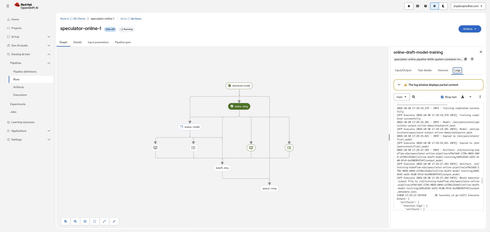
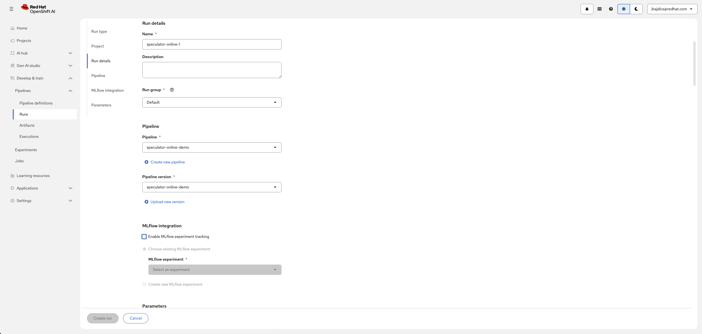
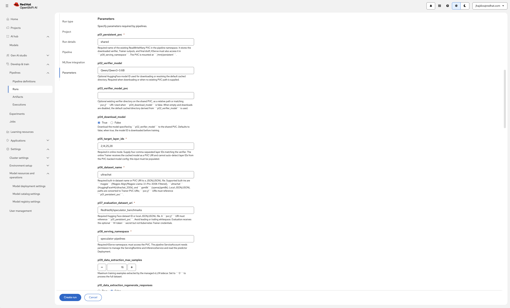
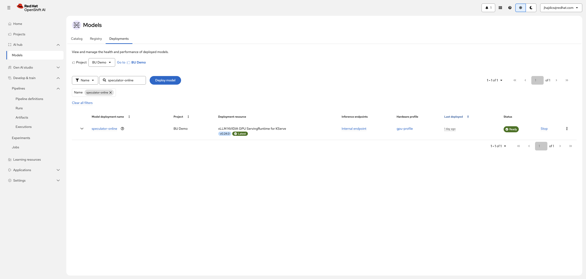

# Online Pipeline (single-job extraction + training)

This guide covers the **speculator-online-pipeline** — the simplest one-run path to a trained Eagle3 draft. A single Trainer job extracts hidden states with a managed vLLM sidecar **and** trains the draft, then the pipeline evaluates, optionally registers, and serves it.

> [!WARNING]
>
> This pipeline may change. Re-generate the YAML after pulling upstream changes.

## 1. When to use this pipeline

- **Everything in one run.** No pre-existing extraction artifacts, no separate data-only runs, no external vLLM to operate. If you just want a trained draft with minimal setup, start here.
- Prefer separate extraction/training so you can sweep hyperparameters cheaply? Use [data-extraction](../data-extraction/) + [train-only](../train-only/). Already run your own vLLM? Use [offline](../offline/).

## 2. How it works

1. (Optional) Download `p02_verifier_model` from HuggingFace to the PVC when `p04_download_model=true`; otherwise reuse `p03_verifier_model_pvc` or the default cache directory derived from the model ID.
2. **One Trainer job** runs with a managed vLLM sidecar: the sidecar generates hidden states on the fly while training consumes them.
3. **Evaluate** with GuideLLM.
4. **Register** — optional. Leave `p43_model_registry_address` empty to skip.
5. **Serve** via a cluster-local KServe InferenceService.

The completed draft is written to `pvc://<p01_persistent_pvc>/final_model`. Each run **replaces** this shared path — use a separate PVC per revision if earlier registry versions must keep referencing their original weights. A retained serving endpoint is affected the same way: when its predictor restarts or scales back up, it loads the **new** weights, even though the endpoint name is unchanged.

`p01_persistent_pvc` is an existing ReadWriteMany PVC in the pipeline namespace, mounted at `/mnt/persistent`. It must also be available in `p08_serving_namespace`. With `p01_persistent_pvc="shared"`, `p12_output_dir="speculator-output"` resolves to `pvc://shared/speculator-output`.

## 3. The pipeline run from start to finish

With `p04_download_model=true` and registration enabled, the run graph looks like this:

```text
download model ──> online draft model training ──> evaluate draft model ──> register to model registry ──> serve draft model
                  (one Trainer job: extraction sidecar + training)
```

The defining feature is the **second node**: a single Trainer job that does extraction and training together. Stage by stage:

| Task in the graph | What it does | What you'll observe | Typical duration (Qwen3-0.6B example run) |
| --- | --- | --- | --- |
| **download model** | (Only when `p04_download_model=true`) Pulls `p02_verifier_model` onto the PVC | Download progress in the node logs | ~5–10 minutes |
| **online draft model training** | One Trainer job (`vllm-extract-cuda` CTR): a vLLM sidecar serves the verifier and produces hidden states on the fly while the training worker consumes them | The longest node. Logs are quiet for the first few minutes while the sidecar loads the verifier, then training loss starts streaming. What looks like a hang at minute two is the sidecar loading | ~15–45 minutes |
| **evaluate draft model** | Starts a vLLM server with speculative decoding and runs the GuideLLM sweep | Slow start (server load), then results publish as **metrics artifacts** | ~15–30 minutes |
| **register to model registry** | (Skipped entirely when `p43_model_registry_address` is empty) Registers `final_model` | Model version appears in the Model Registry UI; it can fail fast on wrong address or missing RoleBinding | Up to a few minutes |
| **serve draft model** | Creates the KServe InferenceService and waits for readiness | ServingRuntime + InferenceService creation, predictor rollout | ~5–15 minutes |

What the cluster side looks like during the run is covered next, in [What a running job looks like](#4-what-a-running-job-looks-like).




## 4. What a running job looks like

While the Trainer job runs, the project namespace contains **one TrainJob with two GPU containers**: the training worker and the vLLM sidecar (`vllm-extract-cuda` CTR). You can watch it with:

```bash
oc get trainjobs,pods -n <project-namespace>
```

The sidecar takes minutes to load the verifier into GPU before extraction starts — a pod in `Running` state with no training log output yet is normal during that window. Total GPUs in use while training: `p29_training_resource_gpu` + 1 (the sidecar is always exactly 1).

## 5. Hardware requirements (Qwen3-0.6B)

| Component | GPU | CPU | Memory |
| --- | --- | --- | --- |
| Training worker | 1 (`p29`) | 4 cores | 64Gi |
| vLLM sidecar | 1 (hardcoded — always exactly 1) | — | 96Gi |
| Evaluation / serving | ~1 | — | — |

**Peak concurrent: 2 GPUs** — the training worker and its sidecar run together in one Trainer pod. Evaluation and serving start only after that job finishes and reuse the freed GPUs, so they do not add to the peak; an endpoint left over from an *earlier* run does, because it is still holding a GPU when the next run starts. This matches the [common hardware requirements](../README.md#hardware-requirements) table.

## 6. Setup

Confirm [access](../README.md#3-check-access) with your administrator and work through the [shared prerequisites](../README.md#prerequisites). Mode-specific additions:

- CTR `vllm-extract-cuda` (`p34_job_runtime` default)
- Serving namespace permissions — **always required**; every online run serves the draft
- Model Registry + RoleBinding — only if you keep registration enabled. To register, use the registry's `-rest` route URL (`https://...`, scheme included) with port `443` in `p44_model_registry_port`; see the [common prerequisites](../README.md#model-registry-and-kserve-train-only--online--offline)

Set `PIP_INDEX_URL`/`PIP_EXTRA_INDEX_URL` via `p36_job_envs` if you need a custom package index for `p35_packages_to_install`.

## 7. Verifier model

`p02_verifier_model` is the optional HuggingFace model ID, used for downloading or resolving the default cached directory. `p04_download_model` defaults to `false`:

- Downloads enabled → the model ID is downloaded onto the PVC before training; evaluation and serving then read it from there.
- Downloads disabled → training can load the verifier directly from HuggingFace, but the **complete pipeline still needs it on the PVC**: the evaluation stage reads the verifier directory and fails with `FileNotFoundError` when it is missing. The verifier must already exist at `p03_verifier_model_pvc` (relative path or matching `pvc://` URI), or at the default cache directory derived from the model ID.

Unless the verifier is already cached on the PVC (for example by a prior data-extraction run with downloads enabled), keep `p04_download_model=true`.

If downloading requires authentication, ask your administrator to create the optional `hf-token` secret (see the [common prerequisites](../README.md#credentials)).

> [!IMPORTANT]
>
> `p05_target_layer_ids` is **required** — four comma-separated layer IDs matching the verifier. The online Trainer receives the cached model as a PVC URI and cannot auto-detect layer IDs from the PVC-backed model config. For Qwen3-0.6B: `2,14,25,28`. Layer IDs are verifier-specific — see [Default verifier model](../README.md#default-verifier-model) for other verifiers.

## 8. Dataset

`p06_dataset_name` accepts the built-ins `magpie` (Magpie-Align/Magpie-Llama-3.1-Pro-300K-Filtered), `ultrachat` (HuggingFaceH4/ultrachat_200k), and `gsm8k` (openai/gsm8k), or a PVC URI (`pvc://<p01_persistent_pvc>/<path>`) to a JSON/JSONL file. `p09_data_extraction_max_samples=0` processes the full dataset; `p11_data_extraction_concurrency` controls vLLM request concurrency (use `1` on shared/NFS PVCs).

## 9. Key ONLINE configuration

Some training internals are hardcoded in this pipeline rather than exposed: the cosine-scheduler cycle count (`0.5`), checkpoint frequency (every epoch), log frequency (every step), sidecar GPU count 1, evaluation sample seed 42.

### Not used in ONLINE

There are no parameters for the settings listed above, and no separate extraction pipeline to coordinate paths with — `p12_output_dir` covers Trainer outputs and checkpoints.

## 10. Running the pipeline

Follow [Run a pipeline](../README.md#quick-start) in the common guide — compile this mode, import the YAML, create a run, and untick the **Enable MLflow experiment tracking** checkbox it warns about:

```bash
PYTHONPATH=$(pwd) python pipelines/training/speculator/online/pipeline.py
```

Fill in the parameters from the table below and leave everything not listed at its default. Use a new `p46_model_registry_version` per revision if registering.



The stage-by-stage walkthrough is in [The pipeline run from start to finish](#3-the-pipeline-run-from-start-to-finish).

### Example: Qwen3-0.6B

| Parameter | Value | Notes |
| --- | --- | --- |
| `p01_persistent_pvc` | `shared` | Your existing RWX PVC name |
| `p02_verifier_model` | `Qwen/Qwen3-0.6B` | Downloaded because `p04_download_model=true` |
| `p04_download_model` | `true` | Cache the verifier on the PVC |
| `p05_target_layer_ids` | `2,14,25,28` | **Required** |
| `p06_dataset_name` | `ultrachat` | Built-in dataset |
| `p07_evaluation_dataset_uri` | `RedHatAI/speculator_benchmarks` | HuggingFace evaluation dataset with built-in subsets |
| `p08_serving_namespace` | `<pvc-namespace>` | Must access the PVC |
| `p09_data_extraction_max_samples` | `16` | **Set this explicitly** — the default is `0`, which extracts the *whole* dataset |
| `p35_packages_to_install` | `speculators==0.6.0.1,torchvision==0.24.0` | Comma-separated packages installed in the online Trainer job |
| `p37_evaluation_max_samples` | `10` | Reduced for quick testing; default `80` for full runs |
| `p38_evaluation_max_tokens` | `64` | Reduced for quick testing; default `256` for full runs |
| `p43_model_registry_address` | `""` | Empty skips registration; to register, use `https://<registry-name>-rest.apps.<cluster-domain>` |
| `p44_model_registry_port` | `443` | Set alongside a non-empty registry address — the default `8080` only fits the in-cluster service |

Training/evaluation/resource parameters can keep their defaults for a first run.

> [!WARNING]
>
> One default is not safe to keep: `p09_data_extraction_max_samples` defaults to `0`, which means the **full** dataset (ultrachat_200k is ~200,000 conversations). Always set it explicitly for an example run — the table above uses `16`. The data-extraction pipeline defaults to `16` instead, so the two modes differ here.

And one expectation to set about the evaluation stage's runtime:

> [!NOTE]
>
> `p37_evaluation_max_samples` and `p38_evaluation_max_tokens` bound the GuideLLM **benchmark sweep** only. They do not cap the evaluator's initial pass, which issues its own requests against the endpoint and generates up to the backend's token limit (4096). Lowering them shortens the sweep but does not make the evaluation stage short: expect the full stage duration and one GPU held for the duration even with the example values.

The first of those values in the run form's **Parameters** step — each field carries the parameter's own description underneath, so you can check one without leaving the page:



## 11. Interpreting the results

Same evaluation task and metrics as the train-only pipeline — see [Interpreting the evaluation results](../train-only/README.md#10-interpreting-the-evaluation-results) in that guide for the full metric table and how to read it. The short version: check `acceptance_length` (mean tokens per verifier pass; higher is better, 1 means the draft contributes nothing), and remember the pipeline emits **no speedup ratio** — only absolute throughput numbers.

The evaluation task's metrics in the Red Hat OpenShift AI UI:


If you kept registration enabled (`p43_model_registry_address` set), the draft appears in the Model Registry afterwards under `p45_model_registry_name` / `p46_model_registry_version` — find it via **AI Hub > Models > Registry > your registry**:


## 12. Testing the served endpoint

Follow [Testing the served endpoint](../README.md#testing-the-served-endpoint) in the common guide. One online-specific note: KServe may scale the predictor to zero after a period of idleness — the first request after a quiet period can take a while or be refused while the predictor wakes. Check `oc get inferenceservice -n <p08_serving_namespace>` shows `True` before concluding something is broken.

The deployed endpoint in the Red Hat OpenShift AI UI:



## 13. Iterating / customization

Sweep `p14_training_epochs`, `p15_training_lr`, `p17_training_num_layers`, and `p40_evaluation_num_speculative_tokens` between runs. Note that each run repeats extraction — if you find yourself iterating often, switch to the two-step [data-extraction](../data-extraction/) + [train-only](../train-only/) workflow and only pay for extraction once.

## Reference

For the full parameter list, see the compiled pipeline YAML, or the pipeline's own README in the [pipelines-components repository](https://github.com/red-hat-data-services/pipelines-components/blob/rhoai-3.6/pipelines/training/speculator/online/README.md).

### Troubleshooting

| Symptom | Diagnosis | Fix |
| --- | --- | --- |
| Run fails waiting for the vLLM sidecar | Sidecar crashed or verifier too large for `p32` | Check Trainer pod logs; raise `p33_vllm_readiness_timeout_minutes`; verify GPU memory |
| Training pod OOM-killed | Defaults too small for the verifier | Raise `p30_training_resource_memory` |
| Registry task fails | Wrong registry address or missing RoleBinding | Use the `-rest` route URL with `https://` and port `443` in `p44` (or the in-cluster service with `8080`); add the RoleBinding — or leave the address empty to skip |
| Serving task fails with forbidden | ServiceAccount lacks KServe permissions | Grant ServingRuntime/InferenceService manage rights in `p08_serving_namespace` |
| First request to the endpoint hangs or is refused | KServe scaled the predictor to zero, or vLLM is still loading | Check `oc get inferenceservice` shows `True`; wait and retry |
| Older registry versions break after re-run | `final_model` overwritten each run | Separate PVC per revision |
| Training fails: `HFValidationError: Repo id must be in the form 'repo_name' or 'namespace/repo_name'` | `p03_verifier_model_pvc` uses the HuggingFace model ID format (e.g. `models/Qwen3-0.6B`) instead of the on-disk directory name | The download task replaces `/` with `--` in the model ID. Use the actual directory name: `models/Qwen--Qwen3-0.6B`. List `models/` on the shared PVC to confirm |
| Slow extraction on shared storage | Concurrent I/O saturating NFS | Keep `p11_data_extraction_concurrency=1` |

Compile-time problems and endpoint-access problems are covered in the [common troubleshooting table](../README.md#troubleshooting).

### Source

Pipeline source: [`pipelines-components/pipelines/training/speculator/online`](https://github.com/red-hat-data-services/pipelines-components/tree/rhoai-3.6/pipelines/training/speculator/online). The example parameter tables above are derived from that directory's `README.md` and `pipeline.py`; re-check them against your imported definition after pulling the `rhoai-3.6` branch.
