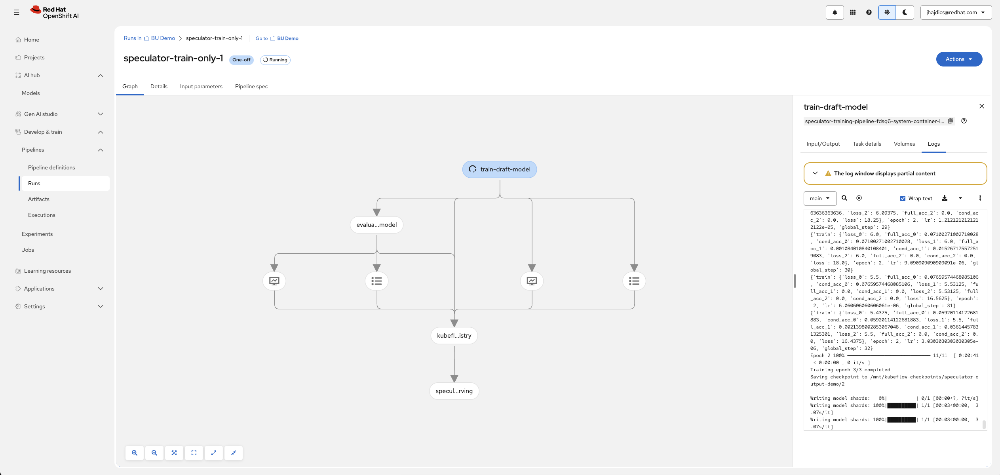
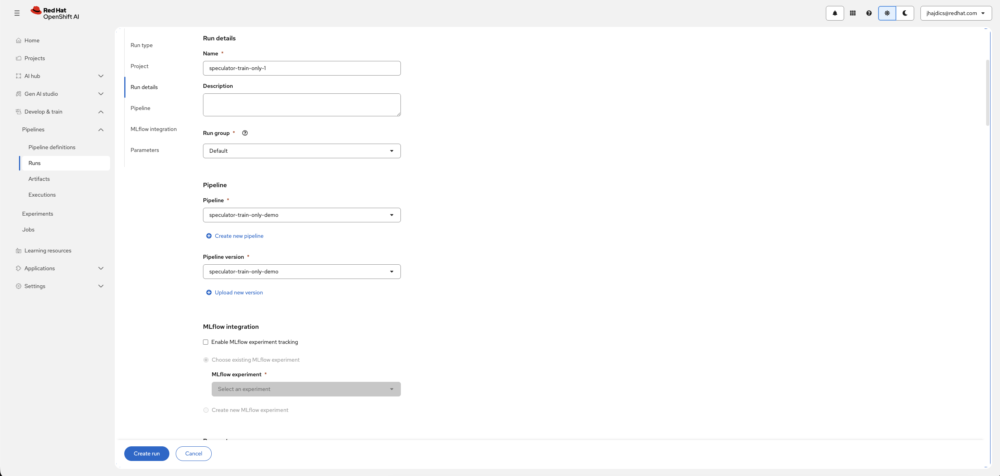
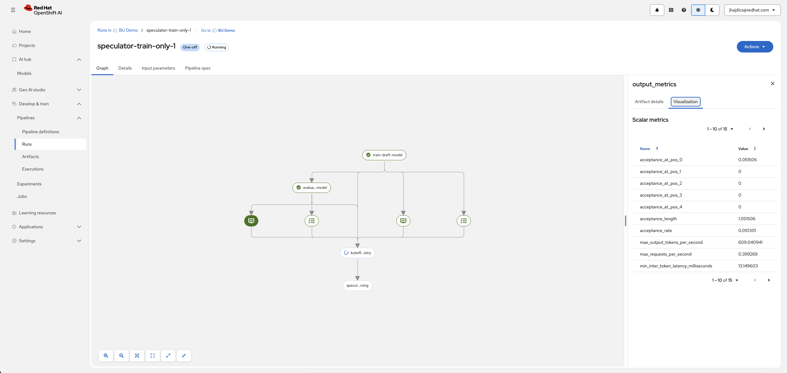
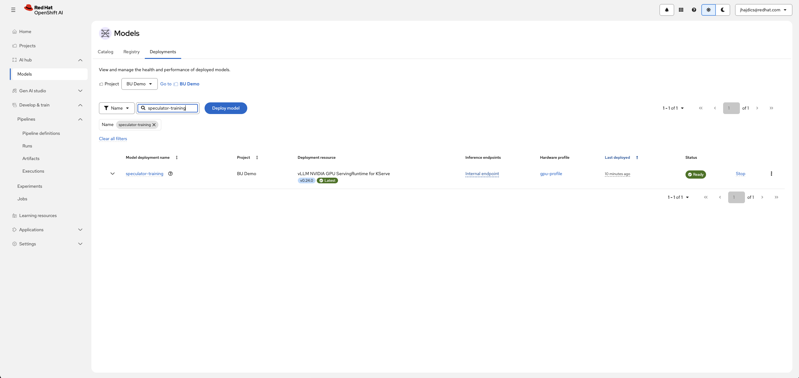

# Train-Only Pipeline (TRAIN_ONLY)

This guide covers the **speculator-training-pipeline** — the second step of the two-step speculator workflow. It trains, evaluates, registers, and serves an Eagle3 draft model from artifacts already on the PVC.

## When to use this pipeline

- **Iterate on hyperparameters.** After the [data-extraction pipeline](../data-extraction/) has produced hidden states and processed data, re-run this pipeline alone to sweep epochs, learning rate, or architecture settings — extraction is never repeated.
- **Mandatory Model Registry.** Unlike online/offline, this pipeline **always** registers the trained draft before serving it — registry setup is a hard prerequisite here.

## How it works

The pipeline expects the verifier model, hidden states, and preprocessed dataset from a previous data-extraction run to already exist on the shared PVC. It does **not** download the verifier. Stages:

1. **Train** the Eagle3 draft from the hidden states (Trainer job, `speculator-model-opt-cuda` CTR).
2. **Evaluate** with GuideLLM — it benchmarks the served **speculative** endpoint (verifier + draft) and reports acceptance metrics. It does not run a verifier-only baseline; see [Interpreting the evaluation results](#interpreting-the-evaluation-results) for why a separate baseline is needed to claim a speedup.
3. **Register** the draft to the Kubeflow Model Registry (unconditional).
4. **Serve** via a cluster-local KServe InferenceService for speculative decoding.

The trained draft is copied to `pvc://<p01_persistent_pvc>/final_model` for evaluation, registry, and serving.

Relative storage paths resolve against `p01_persistent_pvc`, and explicit `pvc://<claim>/<path>` paths must reference that same PVC. With `p01_persistent_pvc="shared"`, `p06_verifier_model_pvc="models/Qwen--Qwen3-0.6B"` is equivalent to `pvc://shared/models/Qwen--Qwen3-0.6B`.

## The pipeline run from start to finish

The run graph is a straight line of four tasks — no branches, no optionality (this pipeline always registers):

```text
train draft model ──> evaluate draft model ──> register to model registry ──> serve draft model
```

Stage by stage:

| Task in the graph | What it does | What you'll observe | Typical duration (Qwen3-0.6B example run) |
| --- | --- | --- | --- |
| **train draft model** | One Trainer job (`speculator-model-opt-cuda` CTR) trains the Eagle3 draft from the hidden states on the PVC | Logs show per-step training loss decreasing and checkpoint saves. The draft is copied to `final_model` on the PVC at the end | ~10–20 minutes (16 extraction samples, 3 epochs) |
| **evaluate draft model** | Starts its own vLLM server with speculative decoding enabled and runs a GuideLLM benchmark sweep against it | Slow to start — the vLLM server takes minutes to load verifier + draft before the sweep begins. Results are published as **metrics artifacts**, not plain logs | ~15–30 minutes |
| **register to model registry** | Registers `final_model` to the Model Registry under `p03_model_registry_name` / `p46_model_registry_version` | Model version appears in the Model Registry UI; it can fail fast on wrong address or missing RoleBinding | Up to a few minutes |
| **serve draft model** | Creates the KServe InferenceService in `p04_serving_namespace` and waits for it to become ready | Logs show the ServingRuntime and InferenceService being created, then the predictor rollout. The node succeeds only once the endpoint answers | ~5–15 minutes |

A failure at any node stops everything after it, and that node's logs are where to look. The two nodes that fail most often in practice are **evaluate** (vLLM startup timeout — raise `p43_evaluation_startup_timeout_seconds`) and **register** (wrong host/port split or missing RoleBinding — see [Troubleshooting](#troubleshooting)).




## Hardware requirements (Qwen3-0.6B)

| Component | GPU | CPU | Memory |
| --- | --- | --- | --- |
| Training worker | 1 | 4 cores | 64Gi |
| Evaluation / serving | ~1 | — | — |

Expect roughly 35–70 minutes end-to-end for the example-run configuration, depending on cluster load — most of it is the evaluation step spinning up its own vLLM server.

## Setup

Confirm [access](../README.md#check-access) with your administrator and work through the [shared prerequisites](../README.md#prerequisites), **all of them** — this pipeline additionally requires:

- **Model Registry + RoleBinding**: required — train-only always registers the draft. Select one under **AI Hub > Models > Registry** in the dashboard (creating a registry is an administrator task), use its `-rest` route URL (`https://...`, scheme included) as `p02_model_registry_address` with `p45_model_registry_port` = `443`, and ask your administrator to bind the registry's `registry-user-<registry-name>` Role to the pipeline ServiceAccount and your user. See the [common prerequisites](../README.md#model-registry-and-kserve-train-only--online--offline) for the full instructions and the in-cluster Service alternative.
- **Serving namespace**: `p04_serving_namespace` must match the PVC namespace and have the required KServe permissions.
- CTR `speculator-model-opt-cuda` (`p35_job_runtime` default).

## Wiring it to a data-extraction run

The path contract between the two pipelines:

| This pipeline parameter | Must match |
| --- | --- |
| `p08_training_data_path` (default `speculator-output`) | The extraction run's `p06_output_dir` |
| `p09_hidden_states_path` (default `speculator-output/hidden_states`) | The extraction run's output dir + `/hidden_states` |
| `p13_target_layer_ids` | The extraction run's `p18_target_layer_ids` — exactly |
| `p11_total_seq_len` | The extraction run's `p16_total_seq_len` |

Defaults line up out of the box. If you customized the extraction output directory, update the paths here too — they are **not** discovered automatically from previous runs. The verifier must be supplied via `p06_verifier_model_pvc`; when the extraction run used `p04_download_model=true`, point this at the directory it cached — the download task names it after the model ID with `/` replaced by `--` (e.g. `models/Qwen--Qwen3-0.6B`, `models/meta-llama--Llama-3.2-1B-Instruct`).

> [!WARNING]
>
> A common mistake is setting `p06_verifier_model_pvc` to the HuggingFace model ID format (e.g. `models/Qwen3-0.6B`) instead of the on-disk directory name (`models/Qwen--Qwen3-0.6B`). The download task replaces `/` with `--` in the model ID — always list `models/` on the shared PVC (for example from a workbench with the PVC attached) and use the directory name you actually see before creating a train-only run.

## Preparing the evaluation dataset

The evaluation task benchmarks the trained draft model using [GuideLLM](https://github.com/neuralmagic/guidellm). Set `p07_evaluation_dataset_uri` to a HuggingFace dataset that contains the evaluation subsets expected by the upstream evaluator.

The recommended dataset is [`RedHatAI/speculator_benchmarks`](https://huggingface.co/datasets/RedHatAI/speculator_benchmarks), which ships the `HumanEval` subset (and others like `math_reasoning`, `qa`, `summarization`) that the evaluation script requires. It is public and does not need a HuggingFace token.

### Using a local JSONL file instead

If you prefer to evaluate with your own prompts, prepare a JSONL file with one JSON object per line:

```jsonl
{"prompt": "What is the capital of France?"}
{"prompt": "Explain quantum computing in simple terms."}
{"messages": [{"role": "user", "content": "How does photosynthesis work?"}]}
```

Each record must contain a `prompt` field, a `text` field, or a `messages` array with at least one `user` role entry. Upload the file to your PVC and set `p07_evaluation_dataset_uri` to a `pvc://` URI (e.g. `pvc://shared/eval-prompts.jsonl`). The pipeline samples up to `p38_evaluation_max_samples` prompts (default 80) from the file.

## Running the pipeline

Follow [Run a pipeline](../README.md#quick-start) in the common guide — compile this mode, import the YAML, create a run, and untick the **Enable MLflow experiment tracking** checkbox it warns about:

```bash
PYTHONPATH=$(pwd) python pipelines/training/speculator/train_only/pipeline.py
```

Fill in the parameters from the table below and leave everything not listed at its default. Use a **new** `p46_model_registry_version` for every trained revision — re-using a version number overwrites the registry entry's meaning.



What each of the four tasks does and how long it takes is in [The pipeline run from start to finish](#the-pipeline-run-from-start-to-finish).

### Example: Qwen3-0.6B

Assumes a completed data-extraction run with defaults, and the verifier cached by its download task:

| Parameter | Value | Notes |
| --- | --- | --- |
| `p01_persistent_pvc` | `shared` | Same PVC as extraction |
| `p02_model_registry_address` | `https://<registry-name>-rest.apps.<cluster-domain>` | The registry's `-rest` route URL, scheme included |
| `p03_model_registry_name` | `qwen3-06b-draft` | Unique in the registry |
| `p04_serving_namespace` | `<pvc-namespace>` | Must access the PVC |
| `p05_serving_endpoint_name` | `qwen3-06b-speculator` | DNS-compatible |
| `p06_verifier_model_pvc` | `models/Qwen--Qwen3-0.6B` | Where extraction cached it — verify on the PVC |
| `p07_evaluation_dataset_uri` | `RedHatAI/speculator_benchmarks` | HuggingFace evaluation dataset with built-in subsets |
| `p13_target_layer_ids` | `2,14,25,28` | Must match the extraction run |
| `p36_packages_to_install` | `speculators==0.6.0.1,torchvision==0.24.0` | Comma-separated packages installed in the training job |
| `p38_evaluation_max_samples` | `10` | Reduced for quick testing; default `80` for full runs |
| `p39_evaluation_max_tokens` | `64` | Reduced for quick testing; default `256` for full runs |
| `p45_model_registry_port` | `443` | **Required with a route address** — the default `8080` only fits the in-cluster service |
| `p46_model_registry_version` | `1.0.0` | New value for every trained revision; re-using one overwrites what that version means |

The `p38_evaluation_max_samples` and `p39_evaluation_max_tokens` values above are reduced to speed up an example run. For production evaluation, leave them at their defaults (`80` and `256`).

> [!NOTE]
>
> These two parameters bound the GuideLLM **benchmark sweep** only. They do not cap the evaluator's initial pass, which issues its own requests against the endpoint and generates up to the backend's token limit (4096). Lowering them shortens the sweep but does not make the evaluation stage short: expect the full ~15–30 minutes and one GPU held for the duration even with the example values.

The first of those values in the run form's **Parameters** step. Note `p02_model_registry_address` carries the `https://` scheme even though the field's own description says to enter only the hostname — that description is written for the in-cluster Service, and a `-rest` route needs the scheme:


## What gets trained

Only the draft model — the verifier is never modified. Defaults train a 1-layer draft (`p17_training_num_layers`) with a linear LR scheduler over 3 epochs at learning rate `1e-4`. The draft vocabulary size is derived automatically when `p16_training_draft_vocab_size=0`.

## Interpreting the evaluation results

The **evaluation task** benchmarks the served draft with GuideLLM and logs its results as KFP **metrics artifacts** — not plain log output. To find them: open the run in the Red Hat OpenShift AI UI, click the evaluation node, and look at its **Artifacts / Metrics** output.



### Acceptance metrics

| Metric | Meaning |
| --- | --- |
| `acceptance_rate` | Accepted draft tokens ÷ proposed draft tokens. The headline quality number for the draft. |
| `acceptance_length` | `1 + (accepted tokens ÷ drafts)` — the mean number of tokens produced per verifier pass, including the verifier's own token. This is the figure that translates most directly into speedup. |
| `acceptance_at_pos_N` | Acceptance rate at each position within a draft. It falls off with position: position 0 is the easiest guess, and later positions are only reached if every earlier one was accepted. |
| `num_drafts`, `num_draft_tokens`, `num_accepted_tokens` | The raw counts the ratios above are computed from. |

With `p41_num_speculative_tokens=5`, each draft proposes 5 tokens, so `acceptance_length` ranges from 1 (every guess rejected — speculation gained nothing) up to 6 (all five accepted). A rejection ends the draft: the verifier emits its own token and the next draft starts from scratch, which is why `acceptance_length` grows faster than `acceptance_rate` does — the long fully-accepted runs are what pay off.

Treat these as orientation, not thresholds: an `acceptance_length` near 1 means the draft is contributing nothing and something is wrong (too little training data, mismatched `target_layer_ids`, or a draft/verifier mismatch), while a value well above 2 means the draft is earning its keep.

### Throughput metrics

| Metric | Meaning |
| --- | --- |
| `max_output_tokens_per_second` | Peak output throughput across the GuideLLM sweep. |
| `max_requests_per_second` | Peak request throughput. |
| `min_latency_median_seconds` | Best median end-to-end request latency. |
| `min_inter_token_latency_milliseconds` | Best median delay between consecutive output tokens. |

> [!NOTE]
>
> The pipeline does **not** emit a speedup ratio. These are absolute numbers for the speculative endpoint only. To quantify speedup, benchmark the same verifier without speculation under the same conditions and compare `max_output_tokens_per_second` yourself.

One more thing to set expectations before you judge a first run:

> [!IMPORTANT]
>
> Example-run settings (e.g. 16 extraction samples, default epochs) produce a **weak draft on purpose** — the point is to prove the plumbing. Expect poor acceptance numbers on a first example run; see [Iterating on hyperparameters](#iterating-on-hyperparameters) for what to change.

### Checking the registry entry

After the run succeeds, the draft appears in the Model Registry: **AI Hub > Models > Registry > your registry**, under the name you set in `p03_model_registry_name`, with the version from `p46_model_registry_version`.


## Testing the served endpoint

The run leaves a **cluster-local** KServe InferenceService. The full procedure — including how to find the serving URL from the run's logs — is in the [common guide](../README.md#testing-the-served-endpoint); the essentials:

```bash
# 1. Find the InferenceService and confirm it is ready (True):
oc get inferenceservice -n <p04_serving_namespace>

# 2. Discover the model id — it is the InferenceService name,
#    NOT the verifier model ID:
oc exec -n <p04_serving_namespace> deploy/<p05_serving_endpoint_name>-predictor -c kserve-container -- \
  curl -s localhost:8080/v1/models

# 3. Ask it something:
oc exec -n <p04_serving_namespace> deploy/<p05_serving_endpoint_name>-predictor -c kserve-container -- \
  curl -s localhost:8080/v1/chat/completions \
  -H "Content-Type: application/json" \
  -d '{"model": "<p05_serving_endpoint_name>", "messages": [{"role": "user", "content": "What is the capital of France?"}], "max_tokens": 200}'
```

The answer is in `choices[0].message.content`. Note the server is vLLM behind KServe; the first request after the run may take a moment while the model loads into GPU.



A note on reading the result: with speculative decoding the output is still **correct** regardless of draft quality — the verifier guarantees the tokens; a bad draft only costs speed. So a sensible answer tells you the whole stack works; whether the draft is *good* is what the [acceptance metrics](#interpreting-the-evaluation-results) tell you.

## Iterating on hyperparameters

Because extraction is reused, iterating is cheap — re-run **only this pipeline** with a new `p46_model_registry_version` and adjusted parameters:

- More data (the first thing to fix after an example run): re-run **extraction** with `p08_max_samples=0` for the full dataset, then train-only again. Use a **fresh `p06_output_dir`** for the new extraction run and point the train-only input paths (`p08_training_data_path`, `p09_hidden_states_path`) at it — keeping the existing extraction directory causes the SDK to skip extraction, so training would still use the original small dataset.
- More training: raise `p14_training_epochs` or tune `p15_training_lr`.
- Bigger draft: raise `p17_training_num_layers`.
- Different speculation depth: `p41_num_speculative_tokens` (affects evaluation and serving).

Watch the acceptance metrics after each iteration and keep the best revision in the registry. `final_model` on the PVC is overwritten every run — if earlier registry versions must keep referencing their original weights, use a separate PVC per revision. A retained serving endpoint is affected the same way: a predictor that restarts or scales back up loads the new weights, even though the endpoint name is unchanged.

## Troubleshooting

| Symptom | Diagnosis | Fix |
| --- | --- | --- |
| "Configure pipeline server" prompt never goes away | Pipeline server not configured for the project — an administrator task | Ask your administrator to configure it — see [Configure the pipeline server](../README.md#configure-the-pipeline-server) |
| Trainer submit task fails with 401/403 | `kubernetes-credentials` secret missing, or its token expired (every run failing at job submission, sudden "runs stop starting", is the symptom) or lacks Trainer permissions | Ask your administrator to create or renew it — see [Credentials](../README.md#credentials) |
| Run fails with ClusterTrainingRuntime not found | `p35_job_runtime` names a CTR that is not deployed | `oc get clustertrainingruntimes`; this mode needs `speculator-model-opt-cuda` |
| Training task fails: hidden states not found | Paths don't match the extraction run's output | Align `p08`/`p09`/`p10` with the extraction run's `p06_output_dir`; list the extraction output directory on the shared PVC to check what was written |
| Training fails with a layer/tensor shape mismatch | `p13_target_layer_ids` or `p11_total_seq_len` differs from the extraction run | Set both to exactly the extraction run's values |
| Evaluation fails with a tensor shape error on the draft's `fc` weights | The draft's `config.json` and its weights disagree on the number of auxiliary layers — the reconciling export runs in the Trainer job and depends on the `speculators` version installed by `p36_packages_to_install` | Check the training log for `Updated … Eagle3 draft config.json file(s) (target_hidden_size=…)`, and that `p36_packages_to_install` pins `speculators==0.6.0.1` |
| Registry task fails with connection refused | Wrong host/port split or missing RoleBinding | Use the `-rest` route URL with `https://` and port `443` (or the in-cluster service with `8080`); add the RoleBinding |
| Serving task fails with forbidden | ServiceAccount lacks KServe permissions in `p04_serving_namespace` | Grant ServingRuntime/InferenceService manage rights |
| Training pod OOM-killed | Verifier too large for defaults | Raise `p33_training_resource_memory` |
| Older registry versions break after a re-run | `final_model` on the PVC is overwritten each run | Use a separate PVC per revision if old versions must keep referencing their weights |
| Training fails: `HFValidationError: Repo id must be in the form 'repo_name' or 'namespace/repo_name'` | `p06_verifier_model_pvc` uses the HuggingFace model ID format (e.g. `models/Qwen3-0.6B`) instead of the on-disk directory name | The download task replaces `/` with `--` in the model ID. Use the actual directory name: `models/Qwen--Qwen3-0.6B`. List `models/` on the shared PVC to confirm |
| `curl: Could not resolve host: <name>-predictor.<ns>.svc.cluster.local` | The endpoint URL is cluster-local; you are off-cluster (e.g. your laptop) | Run the request from inside the cluster via `oc exec` — see [Testing the served endpoint](#testing-the-served-endpoint) |
| Chat request to the endpoint returns "model not found" | Wrong model id — the server registers the model under the InferenceService name | Use the InferenceService name as the `model`; see [Testing the served endpoint](#testing-the-served-endpoint) |
| First request to the endpoint hangs or is refused | vLLM still loading the model into GPU, or KServe scaled the predictor to zero and it is waking | Check `oc get inferenceservice` shows `True`, check the predictor pod is `Running`, wait, retry |

Compile-time problems are covered in the [common troubleshooting table](../README.md#troubleshooting).

## Source

Pipeline source: [`pipelines-components/pipelines/training/speculator/train_only`](https://github.com/red-hat-data-services/pipelines-components/tree/rhoai-3.6/pipelines/training/speculator/train_only), on the **`rhoai-3.6`** branch. For the full parameter list, see the compiled pipeline YAML, or the pipeline's own [README](https://github.com/red-hat-data-services/pipelines-components/blob/rhoai-3.6/pipelines/training/speculator/train_only/README.md) in that repository. The example parameter tables above are derived from that directory's `README.md` and `pipeline.py`; re-check them against your imported definition after pulling the `rhoai-3.6` branch.
