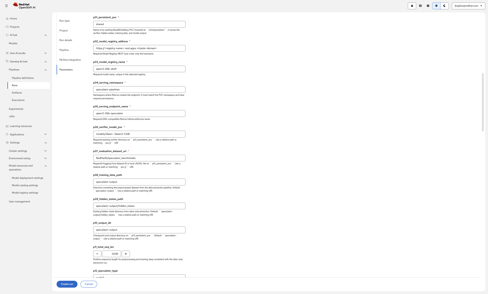
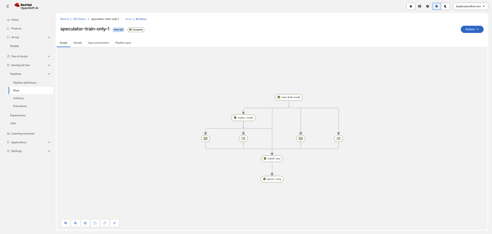
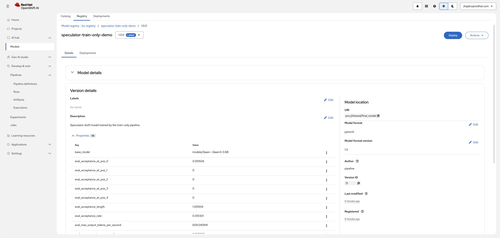

# Train-Only Pipeline (TRAIN_ONLY)

This pipeline trains, evaluates, registers, and serves an Eagle3 speculative-decoding draft model from the artifacts a [data-extraction](../data-extraction/README.md) run left on the shared PVC: hidden states, the processed dataset, and the cached verifier. Extraction is never repeated, so you can re-run this pipeline alone to sweep hyperparameters cheaply. Only the draft model is trained — the verifier is never modified. Unlike online and offline, this pipeline **always** registers the trained draft to the Model Registry before serving it.

Prefer a single run that combines extraction and training? See the [online](../online/) or [offline](../offline/) pipeline guides.

## Before you start

Complete the shared cluster and project setup in the [main Speculator pipelines guide](../README.md), especially [cluster requirements](../README.md#3-check-your-cluster) and [project prerequisites](../README.md#prerequisites). This pipeline additionally requires the Model Registry and KServe serving described in the [common prerequisites](../README.md#model-registry-and-kserve-train-only--online--offline) — registration is mandatory in this mode.

### Confirm the ClusterTrainingRuntime (CTR)

Confirm that the CTR for this pipeline is available. The [main guide's CTR section](../README.md#clustertrainingruntimes-ctrs) explains how to check installed runtimes.

| Pipeline | Required CTR |
| --- | --- |
| Train-only | `speculator-model-opt-cuda` |

### Wire it to a data-extraction run

<a id="6-wiring-it-to-a-data-extraction-run"></a>

The path contract between the two pipelines:

| This pipeline parameter | Must match |
| --- | --- |
| `p08_training_data_path` (default `speculator-output`) | The extraction run's `p06_output_dir` |
| `p09_hidden_states_path` (default `speculator-output/hidden_states`) | The extraction run's output dir + `/hidden_states` |
| `p13_target_layer_ids` | The extraction run's `p18_target_layer_ids` — exactly |
| `p11_total_seq_len` | The extraction run's `p16_total_seq_len` |

Defaults line up out of the box. If you customized the extraction output directory, update the paths here too — they are **not** discovered automatically from previous runs. The verifier must be supplied via `p06_verifier_model_pvc`; when the extraction run used `p04_download_model=true`, point this at the directory it cached — the download task names it after the model ID with `/` replaced by `--` (e.g. `models/Qwen--Qwen3-0.6B`, `models/meta-llama--Llama-3.2-1B-Instruct`).

> [!WARNING]
>
> A common mistake is setting `p06_verifier_model_pvc` to the HuggingFace model ID format (e.g. `models/Qwen3-0.6B`) instead of the on-disk directory name (`models/Qwen--Qwen3-0.6B`). The download task replaces `/` with `--` in the model ID — always list `models/` on the shared PVC (for example from a workbench with the PVC attached) and use the directory name you actually see before creating a train-only run.

### Prepare the evaluation dataset

The evaluation task benchmarks the trained draft model using [GuideLLM](https://github.com/neuralmagic/guidellm). Set `p07_evaluation_dataset_uri` to a HuggingFace dataset that contains the evaluation subsets expected by the upstream evaluator.

The recommended dataset is [`RedHatAI/speculator_benchmarks`](https://huggingface.co/datasets/RedHatAI/speculator_benchmarks), which ships the `HumanEval` subset (and others like `math_reasoning`, `qa`, `summarization`) that the evaluation script requires. It is public and does not need a HuggingFace token.

#### Using a local JSONL file instead

If you prefer to evaluate with your own prompts, prepare a JSONL file with one JSON object per line:

```jsonl
{"prompt": "What is the capital of France?"}
{"prompt": "Explain quantum computing in simple terms."}
{"messages": [{"role": "user", "content": "How does photosynthesis work?"}]}
```

Each record must contain a `prompt` field, a `text` field, or a `messages` array with at least one `user` role entry. Upload the file to your PVC and set `p07_evaluation_dataset_uri` to a `pvc://` URI (e.g. `pvc://shared/eval-prompts.jsonl`). The pipeline samples up to `p38_evaluation_max_samples` prompts (default 80) from the file.

## Run the pipeline

Follow these steps in order. The [main guide](../README.md#quick-start) has the shared compilation and Dashboard instructions; the steps here give the train-only-specific command and values.

### 1. Generate the pipeline YAML

Complete the common environment setup in [Generate the pipeline YAML](../README.md#1-generate-the-pipeline-yaml). From the root of the `pipelines-components` checkout on the `rhoai-3.6` branch, compile train-only:

```bash
PYTHONPATH=$(pwd) python pipelines/training/speculator/train_only/pipeline.py
```

The generated file is `pipelines/training/speculator/train_only/pipeline.yaml`.

### 2. Import the pipeline and create a run

In the Red Hat OpenShift AI Dashboard:

1. Open **Develop & train → Pipelines → Pipeline definitions** in the project prepared for this example.
2. Import the generated `pipeline.yaml`. If the definition already exists, upload it as a new version.
3. Open the imported definition and choose **Actions → Create run**.
4. Name the run, leave **Enable MLflow experiment tracking** unchecked, and enter the parameters below. See the main guide's [import](../README.md#2-import-the-pipeline-into-red-hat-openshift-ai) and [create-run](../README.md#3-create-a-run-and-set-parameters) instructions for the full Dashboard walkthrough.

### 3. Configure the run

The following example uses Qwen3-0.6B and assumes a completed data-extraction run with defaults, with the verifier cached by its download task. Use a **new** `p46_model_registry_version` for every trained revision — re-using a version number overwrites the registry entry's meaning. Note, though, that each run also **overwrites `final_model` on the PVC** — the registry is unaffected: each version's weights are persisted to the Model Registry's S3 backing storage, so earlier versions keep their own copy:

| Parameter | Value | Notes |
| --- | --- | --- |
| `p01_persistent_pvc` | `shared` | Same PVC as extraction |
| `p02_model_registry_address` | `https://<registry-name>-rest.apps.<cluster-domain>` | The registry's `-rest` route URL, scheme included — where to find it is in the [common guide](../README.md#model-registry-and-kserve-train-only--online--offline) |
| `p03_model_registry_name` | `qwen3-06b-draft` | Unique in the registry |
| `p04_serving_namespace` | `<pvc-namespace>` | Must access the PVC |
| `p05_serving_endpoint_name` | `qwen3-06b-speculator` | DNS-compatible |
| `p06_verifier_model_pvc` | `models/Qwen--Qwen3-0.6B` | Where extraction cached it — verify on the PVC |
| `p07_evaluation_dataset_uri` | `RedHatAI/speculator_benchmarks` | HuggingFace evaluation dataset with built-in subsets |
| `p13_target_layer_ids` | `2,14,25,28` | Must match the extraction run |
| `p36_packages_to_install` | `speculators==0.6.0.1,torchvision==0.24.0` | Comma-separated packages installed in the training job |
| `p38_evaluation_max_samples` | `10` | Reduced for quick testing; default `80` for full runs |
| `p39_evaluation_max_tokens` | `64` | Reduced for quick testing; default `256` for full runs |
| `p45_model_registry_port` | `443` | **Required with a route address** — the default `8080` only fits the in-cluster service |
| `p46_model_registry_version` | `1.0.0` | New value for every trained revision |

Everything else can keep its default. The Dashboard's **Parameters** step shows each field's description below its input:



Note `p02_model_registry_address` carries the `https://` scheme even though the field's own description says to enter only the hostname — that description is written for the in-cluster Service, and a `-rest` route needs the scheme.

> [!NOTE]
>
> `p38_evaluation_max_samples` and `p39_evaluation_max_tokens` bound the GuideLLM **benchmark sweep** only. They do not cap the evaluator's initial pass, which issues its own requests against the endpoint and generates up to the backend's token limit (4096). Lowering them shortens the sweep but does not make the evaluation stage short: expect the full ~15–30 minutes and one GPU held for the duration even with the example values.

### 4. Start and monitor the run

Click **Create run**, then open it from **Pipelines → Runs**. The graph is a straight line of four tasks — train, evaluate, register, serve — with no branches or optionality. A failure at any node stops everything after it, and that node's logs are where to look. The two nodes that fail most often in practice are **evaluate** (vLLM startup timeout — raise `p43_evaluation_startup_timeout_seconds`) and **register** (wrong host/port split or missing RoleBinding — see [Troubleshooting](#troubleshooting)).

For the 16-sample Qwen3-0.6B example, expect roughly 35–70 minutes end to end, depending on cluster load: ~10–20 minutes training, ~15–30 minutes evaluation (its vLLM server takes minutes to load verifier + draft before the sweep begins), then registration and serving.




### 5. Review the results

When the run shows **Succeeded**, the evaluation metrics, the registry entry, and the served endpoint are all ready to inspect.

#### Acceptance metrics

The **evaluation task** benchmarks the served draft with GuideLLM and logs its results as KFP **metrics artifacts** — not plain log output. To find them: open the run in the Red Hat OpenShift AI UI, click the evaluation node, and look at its **Artifacts / Metrics** output.


| Metric | Meaning |
| --- | --- |
| `acceptance_rate` | Accepted draft tokens ÷ proposed draft tokens. The headline quality number for the draft. |
| `acceptance_length` | `1 + (accepted tokens ÷ drafts)` — the mean number of tokens produced per verifier pass, including the verifier's own token. This is the figure that translates most directly into speedup. |
| `acceptance_at_pos_N` | Acceptance rate at each position within a draft. It falls off with position: position 0 is the easiest guess, and later positions are only reached if every earlier one was accepted. |
| `num_drafts`, `num_draft_tokens`, `num_accepted_tokens` | The raw counts the ratios above are computed from. |

With `p41_num_speculative_tokens=5`, each draft proposes 5 tokens, so `acceptance_length` ranges from 1 (every guess rejected — speculation gained nothing) up to 6 (all five accepted). A rejection ends the draft: the verifier emits its own token and the next draft starts from scratch, which is why `acceptance_length` grows faster than `acceptance_rate` does — the long fully-accepted runs are what pay off.

Treat these as orientation, not thresholds: an `acceptance_length` near 1 means the draft is contributing nothing and something is wrong (too little training data, mismatched `target_layer_ids`, or a draft/verifier mismatch), while a value well above 2 means the draft is earning its keep.

> [!IMPORTANT]
>
> Example-run settings (e.g. 16 extraction samples, default epochs) produce a **weak draft on purpose** — the point is to prove the plumbing. Expect poor acceptance numbers on a first example run; see [Iterate on hyperparameters](#iterate-on-hyperparameters) for what to change.

#### Throughput metrics

| Metric | Meaning |
| --- | --- |
| `max_output_tokens_per_second` | Peak output throughput across the GuideLLM sweep. |
| `max_requests_per_second` | Peak request throughput. |
| `min_latency_median_seconds` | Best median end-to-end request latency. |
| `min_inter_token_latency_milliseconds` | Best median delay between consecutive output tokens. |

> [!NOTE]
>
> The pipeline does **not** emit a speedup ratio. These are absolute numbers for the speculative endpoint only. To quantify speedup, benchmark the same verifier without speculation under the same conditions and compare `max_output_tokens_per_second` yourself.

#### Checking the registry entry

The draft appears in the Model Registry: **AI Hub > Models > Registry > your registry**, under the name you set in `p03_model_registry_name`, with the version from `p46_model_registry_version`.



#### Test the served endpoint

The run leaves a **cluster-local** KServe InferenceService. The full procedure — including how to find the serving URL from the run's logs — is in the [common guide](../README.md#testing-the-served-endpoint); the essentials:

```bash
# 1. Find the InferenceService and confirm it is ready (True):
oc get inferenceservice -n <p04_serving_namespace>

# 2. Discover the model id — it is the InferenceService name,
#    NOT the verifier model ID:
oc exec -n <p04_serving_namespace> deploy/<p05_serving_endpoint_name>-predictor -c kserve-container -- \
  curl -s localhost:8080/v1/models

# 3. Ask it something:
oc exec -n <p04_serving_namespace> deploy/<p05_serving_endpoint_name>-predictor -c kserve-container -- \
  curl -s localhost:8080/v1/chat/completions \
  -H "Content-Type: application/json" \
  -d '{"model": "<p05_serving_endpoint_name>", "messages": [{"role": "user", "content": "What is the capital of France?"}], "max_tokens": 200}'
```

The answer is in `choices[0].message.content`. Note the server is vLLM behind KServe; the first request after the run may take a moment while the model loads into GPU.


A note on reading the result: with speculative decoding the output is still **correct** regardless of draft quality — the verifier guarantees the tokens; a bad draft only costs speed. So a sensible answer tells you the whole stack works; whether the draft is *good* is what the [acceptance metrics](#acceptance-metrics) tell you.

#### Iterate on hyperparameters

Because extraction is reused, iterating is cheap — re-run **only this pipeline** with a new `p46_model_registry_version` and adjusted parameters:

- More data (the first thing to fix after an example run): re-run **extraction** with `p08_max_samples=0` for the full dataset, then train-only again. Use a **fresh `p06_output_dir`** for the new extraction run and point the train-only input paths (`p08_training_data_path`, `p09_hidden_states_path`) at it — keeping the existing extraction directory causes the SDK to skip extraction, so training would still use the original small dataset.
- More training: raise `p14_training_epochs` or tune `p15_training_lr`.
- Bigger draft: raise `p17_training_num_layers`.
- Different speculation depth: `p41_num_speculative_tokens` (affects evaluation and serving).

## Troubleshooting

| Symptom | What to check |
| --- | --- |
| "Configure pipeline server" prompt never goes away | Pipeline server not configured for the project — ask your administrator; see [Configure the pipeline server](../README.md#configure-the-pipeline-server). |
| Trainer submit task fails with 401/403 | `kubernetes-credentials` secret missing or its token expired — ask your administrator to create or renew it; see [Credentials](../README.md#credentials). |
| Run fails with ClusterTrainingRuntime not found | `oc get clustertrainingruntimes`; this pipeline needs `speculator-model-opt-cuda`. |
| Training task fails: hidden states not found | Align `p08`/`p09` with the extraction run's `p06_output_dir`; list the extraction output directory on the shared PVC to check what was written. |
| Training fails with a layer/tensor shape mismatch | Set `p13_target_layer_ids` and `p11_total_seq_len` to exactly the extraction run's values. |
| Evaluation fails with a tensor shape error on the draft's `fc` weights | Check the training log for `Updated … Eagle3 draft config.json file(s) (target_hidden_size=…)`, and that `p36_packages_to_install` pins `speculators==0.6.0.1`. |
| Registry task fails with connection refused | Use the `-rest` route URL with `https://` and port `443` (or the in-cluster service with `8080`); add the RoleBinding. |
| Serving task fails with forbidden | Grant the pipeline ServiceAccount ServingRuntime/InferenceService manage rights in `p04_serving_namespace`. |
| Training pod OOM-killed | Raise `p33_training_resource_memory`. |
| Older registry versions break after a re-run | `final_model` on the PVC is overwritten each run; use a separate PVC per revision if old versions must keep their weights. |
| Training fails: `HFValidationError: Repo id must be in the form 'repo_name' or 'namespace/repo_name'` | Use the on-disk directory name (`models/Qwen--Qwen3-0.6B`), not the HuggingFace model ID — the download task replaces `/` with `--`. |
| `curl: Could not resolve host: <name>-predictor.<ns>.svc.cluster.local` | The endpoint URL is cluster-local; run the request from inside the cluster via `oc exec` — see [Test the served endpoint](#test-the-served-endpoint). |
| Chat request to the endpoint returns "model not found" | Use the InferenceService name as the `model`; see [Test the served endpoint](#test-the-served-endpoint). |
| First request to the endpoint hangs or is refused | Check `oc get inferenceservice` shows `True` and the predictor pod is `Running`; wait and retry. |

For common compile-time issues, see the main guide's [troubleshooting section](../README.md#troubleshooting).
