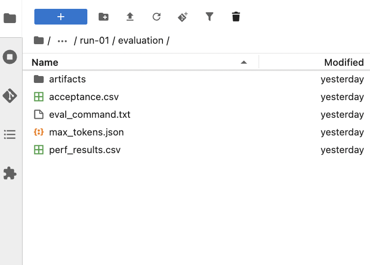

# Run the Speculator Evaluation Job

This guide runs an evaluation **sweep**, which tests the serving system at
different request rates, against a trained Eagle3 draft model. A **subset** is
the selected benchmark task within the evaluation dataset. For an overview of
how the draft model works with the verifier model, see the [Speculator
overview](../../speculator/README.md). The Job starts a temporary vLLM server
with the verifier and draft model, runs the Speculators evaluator, and saves
results to a shared PVC.

You do **not** need to deploy the external vLLM server used for hidden-state
extraction in `DATA_ONLY` or `OFFLINE` training. The evaluation Job starts its
own temporary server.

Run the commands that reference the Job manifest or create the script ConfigMap
from this directory: `examples/fine-tuning/rhoai-3.6/manifests/evaluation/`.
The Python script is at `run_speculator_evaluation.py` in this directory.

## Prerequisites

Before submitting the Job, confirm that:

- You can log in to the OpenShift cluster with the `oc` CLI.
- The namespace contains the shared PVC used by the workbench and training run.
  PVCs are namespace-scoped, so create the ConfigMap and Job in the namespace
  where that PVC exists.
- The PVC is `Bound` and contains:
  - The verifier model directory.
  - The trained draft checkpoint directory, such as
    `speculator/run-01/checkpoints/checkpoint_best`.
  - Space for evaluation output.
- The Job can request **one NVIDIA GPU**, 4 CPU cores and 32 GiB of memory
  (limits: 8 CPU cores and 64 GiB). Ask your administrator to confirm GPU
  availability and project quota.
- The cluster can pull the Job image from `registry.redhat.io`. Add an
  `imagePullSecrets` entry to the Job manifest if your cluster requires one.
- The Job can reach `raw.githubusercontent.com`, PyPI, and Hugging Face. The
  script downloads the pinned Speculators `v0.9.0` evaluator files, installs
  GuideLLM if needed, and downloads the default evaluation dataset. This example
  does not support offline execution or configurable internal mirrors.

## Log in and select the namespace

Copy the `oc login` command from the OpenShift web console's **Copy login
command** page and run it in a terminal with the `oc` CLI:

```bash
oc login --token=<access-token> --server=https://api.<cluster-domain>:6443
```

Set the namespace and PVC name. Replace the example values with yours:

```bash
NAMESPACE="<your-namespace>"
PVC_NAME="shared"

oc whoami
oc project "$NAMESPACE"
oc get pvc "$PVC_NAME" -n "$NAMESPACE"
```

The PVC should show `Bound`. Confirm you have permission to create the resources
and read Job logs:

```bash
oc auth can-i create configmaps -n "$NAMESPACE"
oc auth can-i create jobs -n "$NAMESPACE"
oc auth can-i get pods -n "$NAMESPACE"
oc auth can-i get pods/log -n "$NAMESPACE"
oc get resourcequota -n "$NAMESPACE"
```

## Configure the script and Job manifest

Set the required model and output paths as environment variables in
`speculator-evaluation-job.yaml`; do not edit the Python source. These
variables are required by the script. The paths are relative to the PVC mount
root at `/mnt/persistent`; do not use `pvc://` URIs. Replace the example paths
only if your PVC uses different directories. These sample values must match the
verifier model, trained draft checkpoint, and output directory on the mounted
PVC:

```yaml
env:
  - name: SPECULATOR_VERIFIER_MODEL
    value: models/Qwen3-0.6B
  - name: SPECULATOR_DRAFT_MODEL
    value: speculator/run-01/checkpoints/checkpoint_best
  - name: SPECULATOR_OUTPUT_DIR
    value: speculator/run-01/evaluation
```

Set `SPECULATOR_DRAFT_MODEL` to the checkpoint produced by the training
workflow you ran:

- [TRAIN_ONLY notebook](../../speculator/train-only/speculator-train-only-example.ipynb): `speculator/<run-name>/checkpoints/checkpoint_best`
- [OFFLINE notebook](../../speculator/offline/speculator-offline-example.ipynb): `speculator/<run-name>-offline/checkpoint_best`
- [ONLINE notebook](../../speculator/online/speculator-online-example.ipynb): `speculator/<run-name>-online/checkpoint_best`

Replace `<run-name>` with the `RUN_NAME` value used in the notebook. These
paths are relative to `/mnt/persistent` and must match the checkpoint directory
on the PVC.

The Job already runs the script with `python3`; customers only need to update
these three environment variable values. The script validates the verifier and
draft directories before starting vLLM, and creates the output directory if it
does not exist.

The other evaluation settings keep the official Speculators evaluator defaults
in `USER_CONFIG`. The default dataset runs the standard subsets
`HumanEval`, `math_reasoning`, `qa`, `question`, `rag`, `summarization`,
`tool_call`, `translation`, and `writing`. For example:

```python
"pvc_mount_root": "/mnt/persistent",
"dataset": "RedHatAI/speculator_benchmarks",
"subsets": "HumanEval,math_reasoning,qa,question,rag,summarization,tool_call,translation,writing",
"mode": "sweep",
"max_requests": 200,
"max_concurrency": 128,
"max_tokens": 4096,
"temperature": 1.0,
```

For a quick configuration check, temporarily lower `max_requests` in the
script before running the Job and treat the result as a smoke test, not as a
performance benchmark. For meaningful performance comparisons, keep the
workload, concurrency, warmup, and hardware configuration consistent across
runs.

Replace the verifier and draft paths with directories on your PVC. The output
directory is created by the script. If you use another Hugging Face dataset,
set `subsets` to a subset that exists in that dataset. For a local JSONL
dataset, set `dataset` to its absolute path under `/mnt/persistent` and set
`subsets` to `"local"`.

In `speculator-evaluation-job.yaml`:

- The manifest intentionally omits `metadata.namespace`, so the
  `-n "$NAMESPACE"` option selects the target namespace.
- Set `claimName` to the PVC name from the namespace. For example:

  ```yaml
  persistentVolumeClaim:
    claimName: shared
  ```

  Keep `claimName` as a literal PVC name in the manifest. It cannot be supplied
  through a container environment variable because Kubernetes must resolve and
  mount the PVC before the container starts.

- Keep the PVC mount path at `/mnt/persistent` to match `pvc_mount_root` in the
  script and the relative paths passed to the script.

The ConfigMap and Job must be created in the same namespace as the PVC. The
evaluation Job needs read access to the verifier and draft directories and
write access to the output directory.

## Create or update the script ConfigMap

From this directory, create the ConfigMap from the evaluation script:

```bash
oc create configmap speculator-eval-script \
  --from-file=run_speculator_evaluation.py=run_speculator_evaluation.py \
  -n "$NAMESPACE" \
  --dry-run=client -o yaml |
  oc apply -n "$NAMESPACE" -f -
```

If you edit the script later, run this command again to update the ConfigMap.

## Submit and monitor the evaluation Job

If a previous Job with this name exists, delete it before starting a new run:

```bash
oc delete job speculator-evaluation -n "$NAMESPACE" --ignore-not-found
```

Apply the Job manifest:

```bash
oc apply -f speculator-evaluation-job.yaml -n "$NAMESPACE"
```

Watch the Job and its Pod:

```bash
oc get job speculator-evaluation -n "$NAMESPACE" -w
oc get pods -l app=speculator-evaluation -n "$NAMESPACE"
```

Follow the logs:

```bash
oc logs -f job/speculator-evaluation -n "$NAMESPACE"
```

The first run can take longer while the image is pulled, the evaluator files are
downloaded, and vLLM loads the models.

## Review the results

The script writes results under the configured `output_dir` on the PVC. For
example, if `output_dir` is `speculator/run-01/evaluation`, inspect that
directory from the workbench file browser.

The main result files are:

- `acceptance.csv`: contains draft-token acceptance metrics.
- `perf_results.csv`: contains latency and throughput metrics.
- Raw evaluator files: contain detailed evaluation output.

The following values are from an earlier ten-request smoke test. They only show
how to read the output and are not accurate or representative benchmark
results.

The `acceptance.csv` row reported:

```text
num_drafts=127,535
num_draft_tokens=637,675
num_accepted_tokens=6,112
acceptance_length=1.0479
```

This means:

- `6,112 / 637,675` equals approximately 0.96% of proposed draft tokens
  accepted.
- The official evaluator calculates `acceptance_length` as:
  `1 + (num_accepted_tokens / num_drafts)`.
- For this row:
  `1 + (6,112 / 127,535) = 1.0479`.
- `acceptance_length` is an evaluator metric, not a percentage.

Because this run used only ten requests, do not use these values to judge model
quality or performance.

In `perf_results.csv`:

- `rps_median`: requests per second.
- `latency_median_s`: seconds per request.
- `itl_median_ms`: milliseconds between output tokens.
- `ttft_median_ms`: milliseconds before the first token.
- `output_tps_median`: output tokens per second.

For example, `output_tps_median=26` means that benchmark point reported a
median output throughput of 26 tokens per second.

This example measures the verifier and draft model running together. It does
not measure the verifier model by itself, so these results cannot prove a
speedup.

To claim a speedup, run a separate benchmark using the same verifier model
without a draft model, with the same dataset, request settings, and hardware.
That baseline run is outside this example.

`HumanEval` provides coding prompts for the workload. This evaluation does not
execute or grade the generated code.



## Clean up

Delete the Job and ConfigMap when you no longer need them:

```bash
oc delete job speculator-evaluation -n "$NAMESPACE" --ignore-not-found
oc delete configmap speculator-eval-script -n "$NAMESPACE" --ignore-not-found
```

This does not delete the verifier, draft checkpoint, or evaluation results on
the PVC.

## Troubleshooting

- **Job stays Pending:** Check GPU availability and namespace quota.
- **ImagePullBackOff:** Check registry access and the Job's `imagePullSecrets`.
- **Verifier or draft path not found:** Confirm the directories exist on the PVC
  and that the script paths are relative to `/mnt/persistent`.
- **Evaluation download or install fails:** Check egress to GitHub, PyPI, and
  Hugging Face, or configure approved internal mirrors.
- **Job fails on a second run:** Delete the previous Job before applying the
  manifest again; Jobs with the same name are not reusable after completion.
